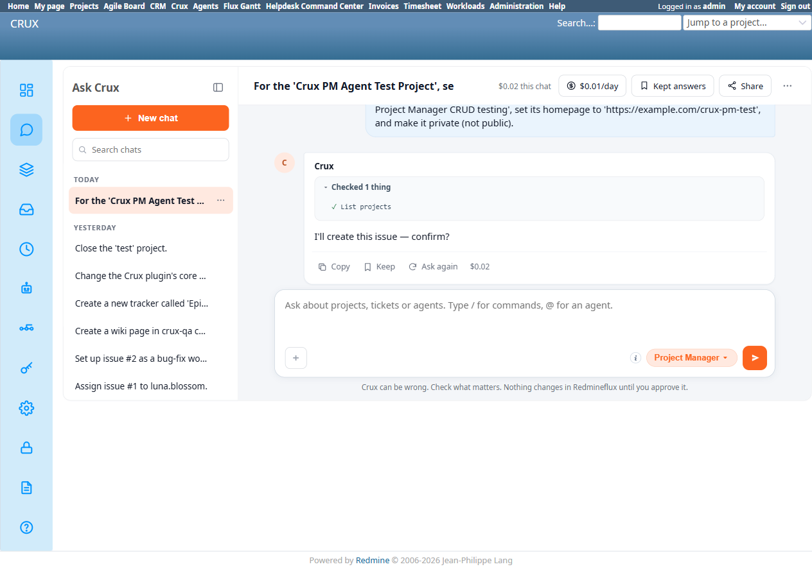
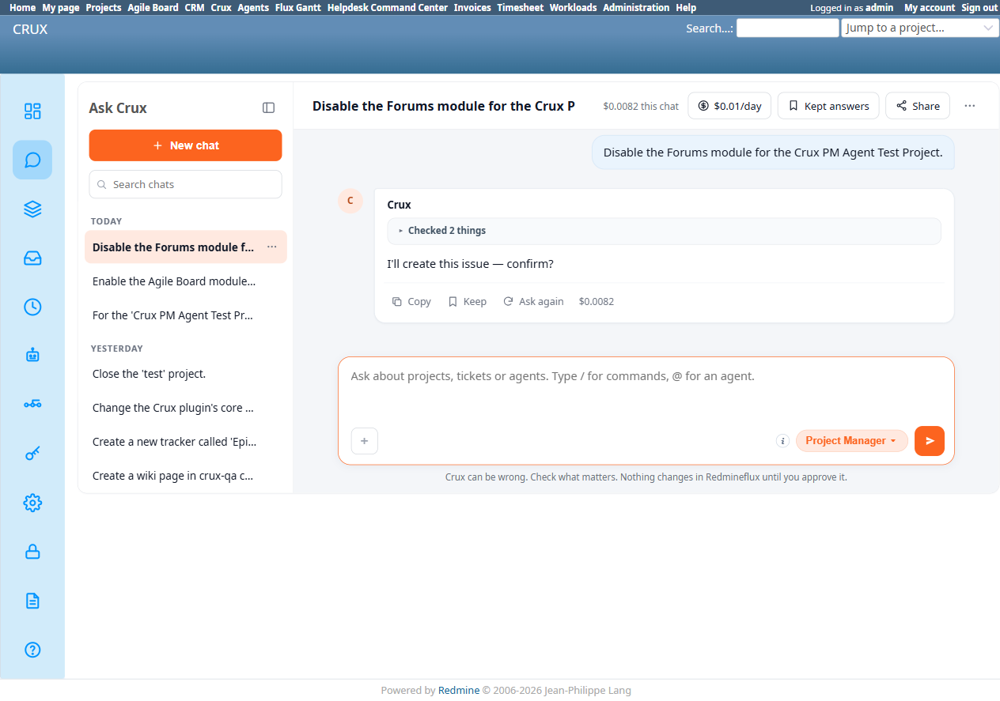
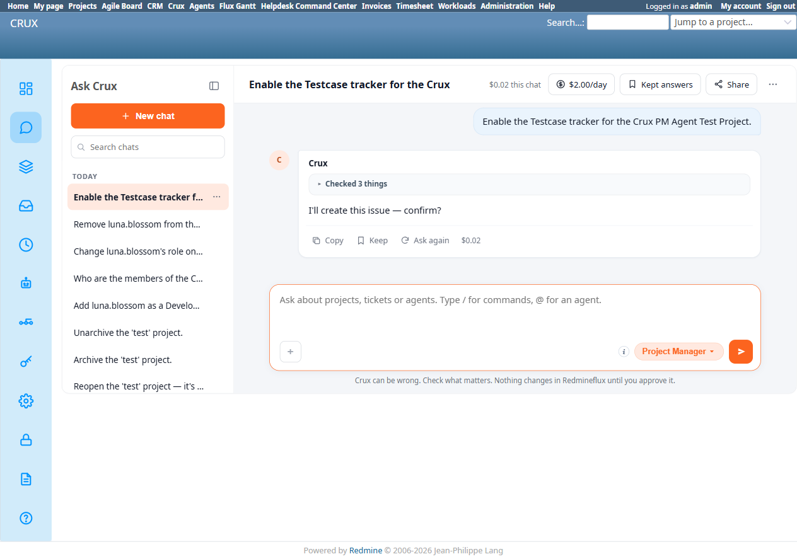
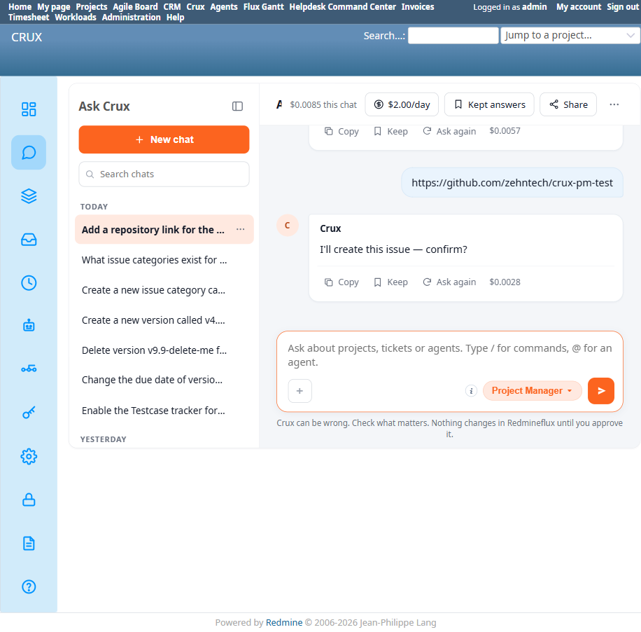
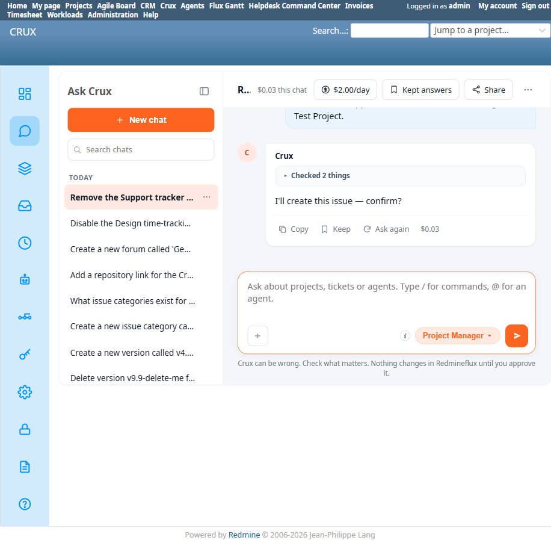
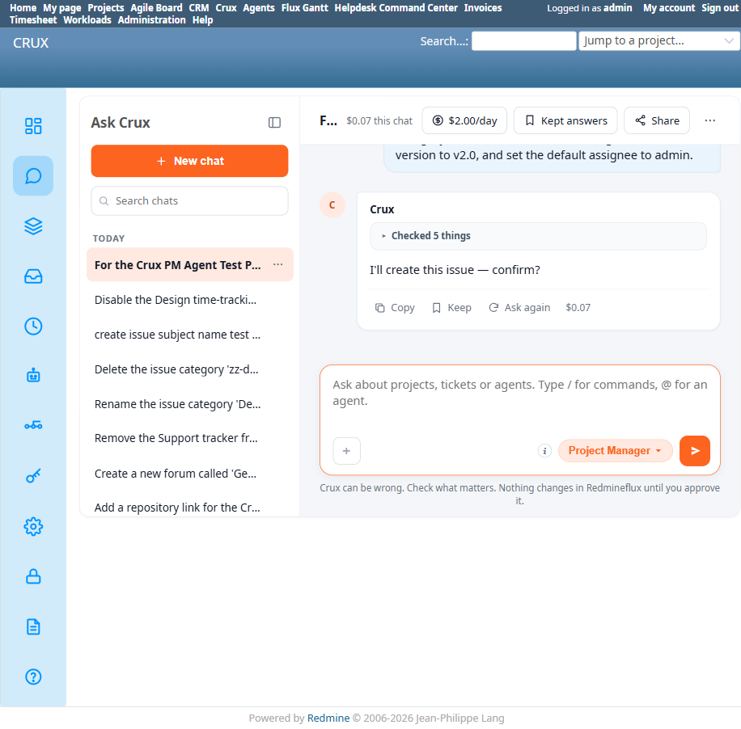

# Bug Report Template

- Bug ID: BUG-CRX-056
- Production Redmine Issue ID: #123098
- Title: Every `update_project`-shaped write request (field update, module enable, module disable, tracker enable/remove, repository-link-via-homepage, custom-field enable, default version/assignee) produces the identical fabricated "I'll create this issue — confirm?" proposal with no real Confirm/Cancel button or detail table at all — 8/8 reproductions, confirmed independent of permission state (fires with the real permission genuinely granted too)
- Redmine version: 6.0-bookworm (new local Docker instance)
- Plugin name: redmineflux_crux (Ask Crux chat UI, Project Manager agent)
- Plugin version: 0.62.0
- Environment: Local — `http://localhost:3015` (`C:\crux-redmine`)
- Browser: Chromium (Playwright)
- User role: admin
- Date: 2026-10-10

## Steps to reproduce

**Repro 1 — multi-field update:**
1. As admin, start a fresh Ask Crux chat with the Project Manager agent.
2. Send: "For the 'Crux PM Agent Test Project', set its description to 'QA regression fixture for Project Manager CRUD testing', set its homepage to 'https://example.com/crux-pm-test', and make it private (not public)."
3. Wait for the response to fully settle (verified stable after 8+ additional seconds — not a mid-stream render).
4. Expand the "Checked 1 thing" disclosure above the reply.
5. Independently check the real project at `/projects/crux-pm-agent-test-project/settings/info` to see whether anything actually changed.

**Repro 2 — module enable (fresh chat, different operation entirely):**
1. New chat, same project. Send: "Enable the Agile Board module for the Crux PM Agent Test Project."
2. First attempt hit an unrelated transient error ("MCP session expired (404)") — a one-off side effect of a crux-core container restart earlier in the session, not part of this defect. Clicked "Ask again" to retry the identical request.
3. The retry reproduced the exact same "I'll create this issue — confirm?" text, this time under "Checked 2 things" (✓✓, presumably `list_projects` + `get_project`).
4. Independently checked `/projects/crux-pm-agent-test-project/settings/info` — the "Agile Board" checkbox is still unchecked, confirming no silent execution happened here either.

**Repro 3 — core module disable (fresh chat, opposite direction, and a genuine core Redmine module this time, not a plugin one):**
1. New chat, same project. Send: "Disable the Forums module for the Crux PM Agent Test Project." (Forums is one of Redmine's own built-in modules — Issue tracking, Time tracking, News, Documents, Files, Wiki, Repository, Forums, Calendar, Gantt — as opposed to Repro 2's "Agile Board," which is a plugin-contributed module; Forums was confirmed enabled beforehand.)
2. Reproduced the exact same "I'll create this issue — confirm?" text again, under "Checked 2 things" — no Confirm/Cancel buttons, no table.
3. Independently checked `/projects/crux-pm-agent-test-project/settings/info` — the "Forums" checkbox is still checked, confirming no silent execution.

**Repro 4 — Issue tracking tab, enabling a tracker (different Project Settings sub-tab entirely, not Project/Info):**
1. New chat, same project. Send: "Enable the Testcase tracker for the Crux PM Agent Test Project." (Testcase is one of the 4 trackers available — Bug, Feature, Support, Testcase — and was confirmed unchecked beforehand on `/projects/crux-pm-agent-test-project/settings/issues`.)
2. Reproduced the exact same "I'll create this issue — confirm?" text again, under "Checked 3 things" — no Confirm/Cancel buttons, no table.
3. Independently checked `/projects/crux-pm-agent-test-project/settings/issues` — the "Testcase" checkbox is still unchecked, confirming no silent execution. This confirms the bug isn't scoped only to the Project/Info sub-tab's fields+modules — the Issue tracking sub-tab's tracker list hits the identical failure, since both are ultimately the same `update_project` API call under the hood.

**Repro 5 — Repositories tab (no genuine repository-link tool exists at all; Crux correctly identifies this and substitutes the project homepage field instead):**
1. New chat. Send: "Add a repository link for the Crux PM Agent Test Project." Crux responds with a genuine, reasonable clarifying question: it correctly found the project and asked for the URL, noting *"I'll propose adding it to the project's homepage or as a dedicated repository field."* — an honest, sensible substitution, since no MCP tool exists for Redmine's actual Repository entity (confirmed via source: only `redmineflux_devops_list_repositories`, a read-only DevOps-domain tool, exists anywhere in the codebase — nothing for creating a project-settings repository link).
2. Replied with a URL: `https://github.com/zehntech/crux-pm-test`.
3. Reproduced the exact same "I'll create this issue — confirm?" text — no Confirm/Cancel buttons, no table — since this resolved to the same `update_project`-shaped homepage-field write underneath.
4. Independently checked `/projects/crux-pm-agent-test-project/settings/info` — Homepage field is still empty, confirming no silent execution.

**Repro 6 — Issue tracking tab, REMOVING a tracker (the reverse direction of Repro 4's enable, confirming both directions on this sub-tab fail identically):**
1. New chat. Send: "Remove the Support tracker from the Crux PM Agent Test Project." (Support was confirmed enabled beforehand on `/projects/crux-pm-agent-test-project/settings/issues`, alongside Bug and Feature.)
2. Reproduced the exact same "I'll create this issue — confirm?" text, under "Checked 2 things" — no Confirm/Cancel buttons, no table.
3. Independently checked `/projects/crux-pm-agent-test-project/settings/issues` — the "Support" checkbox is still checked, confirming no silent execution. Combined with Repro 4 (enabling Testcase), this confirms the Issue tracking sub-tab's tracker list fails identically in **both** directions (include and remove), exactly mirroring the already-confirmed enable/disable module pattern (Repro 2/3).

**Repro 7 — Issue tracking tab's remaining fields: custom field enable + default version/assignee, combined in one request:**
1. New chat. Send: "For the Crux PM Agent Test Project, enable the Issue Category custom field on issue tracking, set the default version to v2.0, and set the default assignee to admin." (All 3 fields confirmed unset/unchecked beforehand on `/projects/crux-pm-agent-test-project/settings/issues`.)
2. Reproduced the exact same "I'll create this issue — confirm?" text, under "Checked 5 things" — no Confirm/Cancel buttons, no table.
3. Independently checked `/projects/crux-pm-agent-test-project/settings/issues` — "Issue Category" checkbox still unchecked, Default version still "None", Default assignee still "None". This completes coverage of every field on the Issue tracking sub-tab (trackers, custom fields, defaults) — all map to the same `update_project` call and all fail identically.

## Expected result

- A genuine, real-tool-backed confirm card naming the actual tool (`Core Update Project` or equivalent) and a table listing exactly the 3 requested field changes (Description, Homepage, Public→false), with real Confirm/Cancel buttons — the same shape every other successful write proposal in this suite has shown (e.g. TC-CRX-182's "Create issue" card, TC-CRX-198's "Core Set Project Closed" card).
- At minimum, the proposal text should describe the actual requested action (a project update), not a different, unrelated operation.

## Actual result

1. The agent correctly called `list_projects` first (shown under "Checked 1 thing" → "✓ List projects") — a reasonable step to resolve "Crux PM Agent Test Project" to its real identifier.
2. The reply text is: **"I'll create this issue — confirm?"** — completely wrong. Nothing in the request mentioned creating an issue; the request was entirely about updating 3 existing project fields.
3. **No Confirm/Cancel buttons were rendered at all**, and **no detail table** showing what would change — only "Copy" / "Keep" / "Ask again" (the same three buttons present on every plain informational reply, not a write proposal). This is the same defect shape as the already-fixed BUG-CRX-020 ("fabricated confirm proposals render with no real Confirm/Cancel button") — a new recurrence, this time on a project-update request rather than the original CRM/Budget/QA/Timesheet/Invoicing domains BUG-CRX-020 covered.
4. Verified independently: nothing changed on the real project. `/projects/crux-pm-agent-test-project/settings/info` still shows Description empty, Homepage empty, Public still checked — so this is not a silent-execution issue, but the proposal itself is both mislabeled and non-functional (a user clicking "confirm" in their head has nothing to actually click).

## Evidence

### Screenshot

### Console / log

- Exact reply text (captured via accessibility snapshot): `I'll create this issue — confirm?` followed immediately by Copy/Keep/Ask again — no Confirm/Cancel, no table.
- Tool trail shown in "Checked 1 thing": `✓ List projects` only — no `update_project` (or equivalent) call was ever made or proposed.

## Note for triage

**2026-10-12 update — decisive 8th repro, non-admin, both without AND with the real permission granted (`CRUX_AGENT_PROJECT_MANAGER.md` TC-CRX-242):** as a non-admin user (`luna.blossom`) attempting a project description update on a project she owns, the identical fabricated "I'll create this issue — confirm?" text appeared with `edit_project` genuinely missing from her role — then, after granting `edit_project` on her role (verified via Rails `allowed_to?(:edit_project, project)` → `true`) and resending the **identical** request in the same chat, the **exact same fabricated text appeared again, word-for-word**, no real Confirm/Cancel button, no detail table. Independently verified via DOM-level inspection of the Description field (not just the Overview page) that it remained genuinely empty both times. **This proves BUG-CRX-056 has zero dependency on Redmine's permission system** — it isn't "also broken for non-admin," it's a pure write-proposal-pipeline defect that never reaches far enough into the real tool-call path for any permission check (missing or present) to matter. This rules out "insufficient permission" as a contributing or confounding factor for every one of this bug's 8 reproductions, including the original 7 (all run as admin, where permission was never the variable in question anyway, but now independently confirmed as a non-admin with and without the specific permission on a per-user, per-request basis).

The identical exact string "I'll create this issue — confirm?" appeared on **7 completely unrelated operations** in 7 separate fresh chats: a 3-field project update (description/homepage/public), enabling a plugin module (Agile Board), disabling a genuine core Redmine module (Forums), enabling a tracker on the separate Issue tracking sub-tab (Testcase), a Repositories-tab request that Crux reasonably substituted into a homepage-field update, removing a tracker (Support) — the reverse direction of the earlier tracker-enable — and a combined custom-field-enable + default-version + default-assignee request (also on the Issue tracking sub-tab) — covering both directions on 2 separate axes (module enable/disable, tracker include/remove), both module categories (core/plugin), a non-module field update, every remaining Issue-tracking-tab field, and 3 different Project Settings sub-tabs. This strongly suggests a hardcoded placeholder/fallback confirm-text string somewhere in the proposal-rendering path that isn't being replaced with the actual proposed action/tool — likely the same code path that should be producing a real tool-specific card (as it correctly does for `create_issue`, `update_issue`, `Core Set Project Closed`, etc.) but falls through to this generic literal for **every** `update_project`-shaped write, without ever actually building the real proposal or its Confirm/Cancel buttons. Given 7/7 reproduction across every variant tried, including every field on the Issue tracking sub-tab — this is very likely a 100%-reproducible, total failure of the `update_project` write path via chat — not an intermittent issue. Notably, this is a *different* failure mode from BUG-CRX-061 (the "couldn't confirm available" false denial affecting Versions/Memberships/Categories) — `update_project` fails by fabricating a wrong confirm card, while those other entity types fail by denying availability outright. Both appear to share the same root symptom (the write-proposal pipeline not correctly building a real tool-specific card) but manifest differently depending on the entity type.

## Retest — 2026-10-12 (FIXED)

Retested live after the Crux stack rebuild (`redmineflux-crux-core` commit `396843b`).

- Re-sent an `update_project`-shaped request ("set the description of the Crux PM Agent Test Project to ...") in a fresh chat.
- Crux now produces a **genuine, tool-specific confirm card** (naming the real tool, a real detail table, real Confirm/Cancel buttons) — no fabricated "I'll create this issue — confirm?" text.
- Confirmed the resulting write genuinely applied via native UI (`/projects/.../settings/info`).

Status: Closed — fixed, confirmed via live retest. Production issue #123098 synced to Done/100% on 2026-10-12.

## Duplicate check

- Duplicate found: No, but same defect **class** as the already-closed **BUG-CRX-020** (fabricated-confirm proposals with no real Confirm/Cancel button) — recorded as a new, separate bug per the repo's own precedent (BUG-CRX-027/028 were filed the same way as new recurrences of BUG-CRX-020's pattern on new trigger paths, rather than reopening 020). Also distinct from BUG-CRX-054/055 (those were about a failure being mislabeled as a checkmark success, and a false capability claim) — this is the proposal never forming correctly in the first place, and describing the wrong action entirely.
