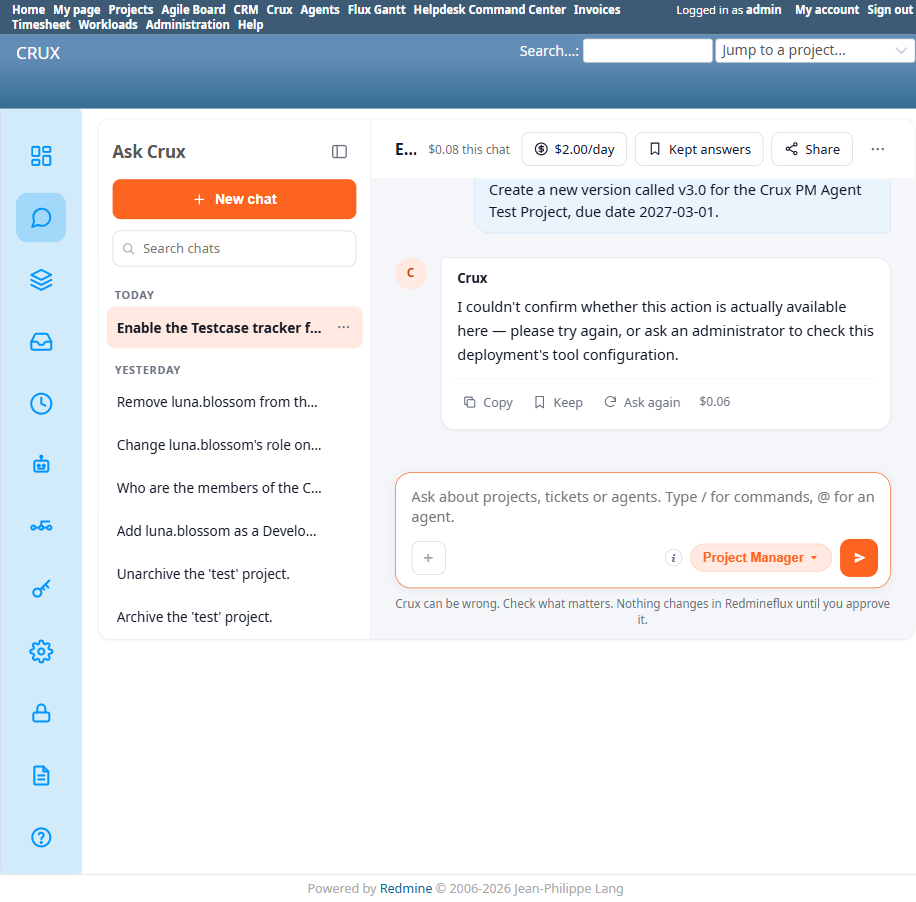

# Bug Report Template

- Bug ID: BUG-CRX-063
- Production Redmine Issue ID: #123105
- Title: MCP server never retries after a failed startup self-test — if Redmine takes longer than ~120s to become reachable (e.g. a fresh container stack boot), it silently and permanently falls back to a severely degraded tool catalog (98 tools, 0/14 plugins detected) instead of self-healing once Redmine becomes available
- Redmine version: 6.0-bookworm (new local Docker instance)
- Plugin name: redmineflux-mcp (the MCP server component of the Crux stack, not the `redmineflux_crux` Redmine plugin itself)
- Plugin version: Redmineflux MCP v0.2.2
- Environment: Local — `http://localhost:3015` (`C:\crux-redmine`, 4-container stack: `redmine`, `crux-core`, `mcp`, `db`)
- Browser: Chromium (Playwright) — root cause confirmed via `docker logs`, not browser-visible directly
- User role: admin
- Date: 2026-10-11

## Steps to reproduce

1. Start (or restart) the full `crux-redmine6` Docker Compose stack from a cold state, where `redmine` takes meaningfully longer than ~2 minutes to finish booting (this happened naturally on 2026-10-11's session start — `redmine`'s own healthcheck was still "starting" for over 100 seconds after the stack came up).
2. Check `docker logs crux-redmine6-mcp-1` from that startup: it attempts an HTTP self-test against `http://redmine:3000` in a retry loop, logs `WARNING:redmineflux-mcp:Startup self-test: cannot reach http://redmine:3000 yet (attempt N)...` for 27 attempts, then gives up: `ERROR:redmineflux-mcp:Startup self-test FAILED: http://redmine:3000 still unreachable after 120s (27 attempts)` and `WARNING:redmineflux-mcp:Redmine not reachable or API key invalid. Server starting in degraded state — tools will return errors.`
3. In this degraded state, its own plugin-detection pass logs `Plugin not detected: <name> (skipped)` for all 14 known plugins, then: `Redmineflux MCP v0.2.2: 100 tools (98 core + 0 plugin + 2 crux). Detected plugins: none (0/14).`
4. Crucially, Redmine itself *does* finish starting minutes later (confirmed healthy via `docker inspect --format='{{.State.Health.Status}}' crux-redmine6-redmine-1` → `healthy`), and the MCP server successfully serves ordinary read calls afterward (`GET http://redmine:3000/projects.json` → `200 OK` is visible in its own logs) — but it never re-runs its plugin-detection/tool-registration pass. It stays permanently stuck advertising only 98 core + 2 crux tools (confirmed via repeated `tools/list` calls over several minutes, each returning `tools=95`) until manually restarted.
5. Manually restart just the MCP container (`docker restart crux-redmine6-mcp-1`) with Redmine now confirmed healthy: it immediately detects all plugins correctly — `Redmineflux MCP v0.2.2: 498 tools (98 core + 398 plugin + 2 crux). Detected plugins: agile, testcases_management, timesheet, workload, budget_audit, flux_tags, flux_issue_template, knowledgebase, invoice, checklist, helpdesk, gantt, crm (13/14)` — confirming the underlying connectivity and plugin registration are fine; the only problem is the server's refusal to retry its own detection after the fact.

## Expected result

- The MCP server's startup self-test and plugin-detection pass should either retry periodically in the background until Redmine becomes reachable, or re-run plugin detection lazily on the next real tool call once Redmine responds successfully — not permanently commit to a "degraded, 0 plugins" state for the rest of the container's lifetime just because Redmine happened to still be booting during the first 120 seconds.

## Actual result

Once the 120-second/27-attempt self-test window elapses without success, the server commits to serving only 98 "core" Redmine tools + 2 Crux attach-contract tools (100 total; the Ask Crux layer's own `tools/list` reported 95, likely after some additional internal filtering) for its entire remaining lifetime, even though:
- Redmine becomes fully reachable and healthy only a short time later (confirmed independently via Redmine's own Docker healthcheck).
- The MCP server itself successfully serves ordinary Redmine API calls through this "degraded" window (e.g., `GET /projects.json` returns real `200 OK` data) — so the connectivity that would make plugin re-detection succeed is demonstrably present, it's just never attempted again.

**Downstream impact on Ask Crux chat**: every plugin-specific capability (Helpdesk, CRM, Timesheet, Workload, Agile, Invoice, Checklist, Knowledge Base, Issue Templates, Tags, Budget Audit, Gantt, Test Case Management — 13 of the 14 known plugins) is completely invisible to every chat agent until someone notices and manually restarts the MCP container. During this window, Project Manager (and presumably every other domain agent) falls back to confident-sounding but false "this isn't available" / "not in my available tools" messages (see BUG-CRX-061's Repro 2) rather than any indication that the deployment itself is in a temporarily degraded state — a user has no way to tell "this feature doesn't exist" from "the server hasn't finished warming up yet."

## Evidence

### Screenshot

### Console / log

- Degraded startup (`docker logs crux-redmine6-mcp-1`): `ERROR:redmineflux-mcp:Startup self-test FAILED: http://redmine:3000 still unreachable after 120s (27 attempts)` → `WARNING:...Server starting in degraded state — tools will return errors.` → `Plugin not detected: <x> (skipped)` ×14 → `Redmineflux MCP v0.2.2: 100 tools (98 core + 0 plugin + 2 crux). Detected plugins: none (0/14).`
- Confirmed still degraded ~6 minutes later, well after Redmine was healthy, via 3 separate `tools/list` calls in `crux-core`'s own log, each `tools=95`.
- Manual restart with Redmine already healthy (`docker restart crux-redmine6-mcp-1`): `Redmineflux MCP v0.2.2: 498 tools (98 core + 398 plugin + 2 crux). Detected plugins: ... (13/14)` — full recovery, confirming the only defect is the lack of a retry/re-detection path.

## Retest — 2026-10-12 (FIXED)

Retested via source inspection (appropriate for an infra/startup-race bug — not practical to force-recreate a slow-Redmine-boot race live). Confirmed in `redmineflux-mcp` `src/server.py`, explicitly citing this bug:

- `_redetect_plugins_later()` (line 86) — a daemon background thread that, when the initial startup/plugin-detection pass comes back degraded, retries plugin detection every 15s for up to 1 hour, re-registers tools, and logs "The server is no longer degraded" on success.
- `_startup_self_test()` (line 128) now retries connection failures/502-504s with backoff up to `max_wait` (120s), with an explicit comment citing this exact cold-boot race.
- `create_server()` (line 316) also retries plugin detection with backoff (2s/4s/8s) if the self-test succeeds but 0 plugins were found — covering a narrower, faster version of the same race.
- Together these directly address the originally-reported defect: a cold boot where Redmine takes longer than ~120s no longer permanently commits the server to a degraded 98-tool/0-plugin state — it keeps retrying in the background until Redmine responds.

Status: Closed — fixed, confirmed via source inspection of the fix.

## Duplicate check

- Duplicate found: No — checked `bugs/_duplicates.md` and `bugs/_index.md`. Related in theme to the already-closed **BUG-CRX-016** ("MCP plugin-detection race") but a distinct mechanism: BUG-CRX-016 was about a race *during* detection producing an incomplete result; this is about the server never *retrying* detection at all after an initial failure, persisting in a maximally-degraded (0/14 plugins) state indefinitely with no self-healing, which is a more severe and more easily-triggered variant (any sufficiently slow Redmine boot reproduces it). Also distinct from BUG-CRX-004 (closed — stale MCP *session* never recovering) since this is about the *tool catalog/plugin registration*, not a session token.
