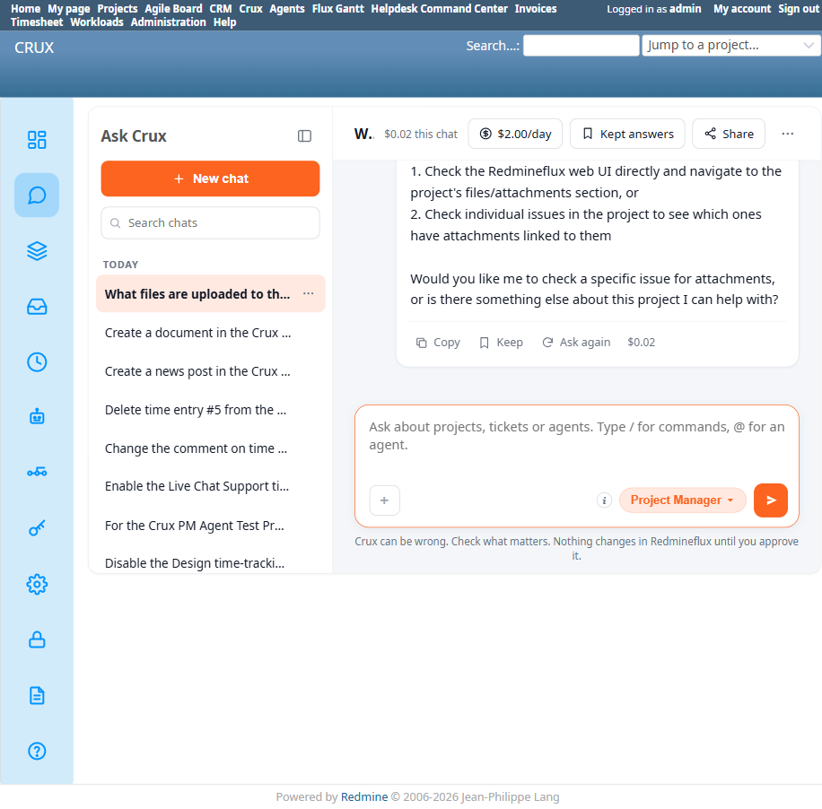
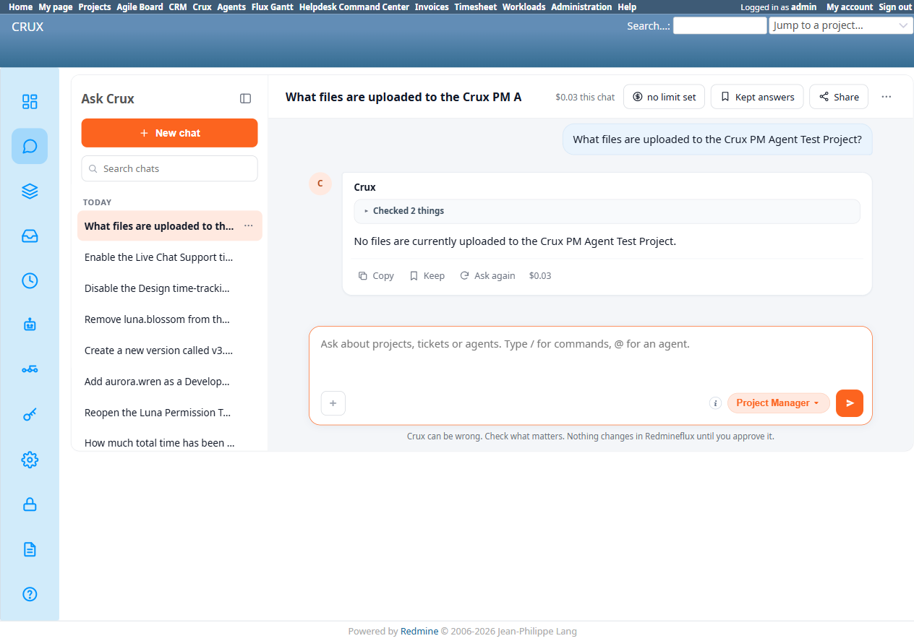

# Bug Report Template

- Bug ID: BUG-CRX-065
- Production Redmine Issue ID: #123107
- Title: "What files are uploaded to this project" burns 10 tool calls (list_projects, list_issues, then 8× get_issue checking each issue individually for attachments) yet never calls `redmineflux_core_list_project_files` — the one tool built exactly for this question — then falsely claims "the core Redmineflux tools available to me don't have a dedicated endpoint to list ALL project-level attachments"
- Redmine version: 6.0-bookworm (new local Docker instance)
- Plugin name: redmineflux_crux (Ask Crux chat UI, Project Manager agent)
- Plugin version: 0.62.0
- Environment: Local — `http://localhost:3015` (`C:\crux-redmine`)
- Browser: Chromium (Playwright)
- User role: admin
- Date: 2026-10-11

## Steps to reproduce

1. As admin, in a fresh Ask Crux chat: "What files are uploaded to the Crux PM Agent Test Project?"
2. Observe the tool trace (`docker logs crux-redmine6-crux-core-1`): `redmineflux_core_list_projects` → `redmineflux_core_list_issues` → `redmineflux_core_get_issue` called 8 times in a row (once per issue in the project) — 10 tool calls total, `tool_calls=10 outcome=success`.
3. Crux's reply: *"The issue details I retrieved didn't include attachment data in the output. Unfortunately, the core Redmineflux tools available to me don't have a dedicated endpoint to list ALL project-level attachments across all issues in one call... To get an accurate list of uploaded files, you would need to: 1. Check the Redmineflux web UI directly... or 2. Check individual issues..."*
4. Independently confirm via MCP server source (`/app/src/tools/core.py:3259`, `redmineflux_core_list_project_files`) that this exact tool exists, is registered, and its own docstring says: *"Use this for 'what files has project X uploaded?', 'show downloads for project Y'. Different from issue attachments — these are project-level files managed in the Files module."* — i.e. it is the precise, purpose-built answer to the question asked, yet it was never called.
5. Independently confirm the ground truth via native UI (`/projects/crux-pm-agent-test-project/files`): the Files table has zero rows — genuinely no files have been uploaded to this project. `list_project_files` would have returned `"No files found for project 'crux-pm-agent-test-project'."` in a single call.

## Expected result

- A single call to `redmineflux_core_list_project_files` (as its own docstring explicitly recommends for this exact phrasing) and an immediate, correct, one-line answer: no files have been uploaded to this project.

## Actual result

The agent went looking for file data in entirely the wrong place — individually fetching all 8 issues in the project to check for inline attachment data, never once calling the dedicated project-files tool — then confidently told the user this capability doesn't exist ("the core Redmineflux tools available to me don't have a dedicated endpoint"), which is false. This wasted 10 tool calls / a large token spend (76,069 in / 1,015 out for this single turn) to arrive at a wrong conclusion, when the correct, cheap, one-call answer ("no files found") was available the entire time from a tool whose own description names this exact question as its use case.

This is a **false capability denial** distinct from BUG-CRX-061 (which affects write operations across Membership/Version/Issue Category/Time Entry) — this is on the **read** side, for the Files domain specifically, and notably burns far more tool calls than any other false-denial instance in this suite before giving up, rather than failing quickly.

## Evidence

### Screenshot

### Console / log

- `docker logs crux-redmine6-crux-core-1`: `mcp call tool=redmineflux_core_list_projects`, `mcp call tool=redmineflux_core_list_issues`, then `mcp call tool=redmineflux_core_get_issue` ×8 (one per issue) — `redmineflux_core_list_project_files` never appears in the trace. `chat turn agent=project-manager ... tokens_in=76069 tokens_out=1015 tool_calls=10 outcome=success`.
- MCP source (`/app/src/tools/core.py:3259-3287`), `redmineflux_core_list_project_files(project_id)` — fully implemented, calls `GET /projects/{project_id}/files.json`, returns `"No files found for project '{project_id}'."` when empty.
- Native UI: `/projects/crux-pm-agent-test-project/files` — table present, zero rows, confirming "no files" is the correct ground truth the dedicated tool would have given directly.

## Retest — 2026-10-12 (FIXED)

Retested live after the Crux stack rebuild (`redmineflux-mcp` commit `ae436b6` "Crux QA fixes: plugin re-detection, honest list pages, custom field values").

- "What files are uploaded to the Crux PM Agent Test Project?" → Crux now replies directly and correctly: **"No files are currently uploaded to the Crux PM Agent Test Project."**
- Tool trace shows only 2 checks this time (down from the original 10 tool calls spanning `list_projects`/`list_issues`/8×`get_issue`) — consistent with the dedicated `redmineflux_core_list_project_files` tool now being used instead of the wrong issue-by-issue search.
- Matches native UI ground truth (`/projects/.../files` — zero rows).

Status: Closed — fixed, confirmed via live retest.

## Duplicate check

- Duplicate found: No — checked `bugs/_duplicates.md` and `bugs/_index.md`. Same false-capability-denial *family* as BUG-CRX-029/032/034/050/061, but a new, distinct shape: those are write-path false denials where the agent gives up quickly (1-2 tool calls); this is a **read-path** false denial where the agent tries unusually hard (10 tool calls, going issue-by-issue) in entirely the wrong direction before concluding the capability doesn't exist, missing the one tool whose own docstring names this exact question as its intended use.
