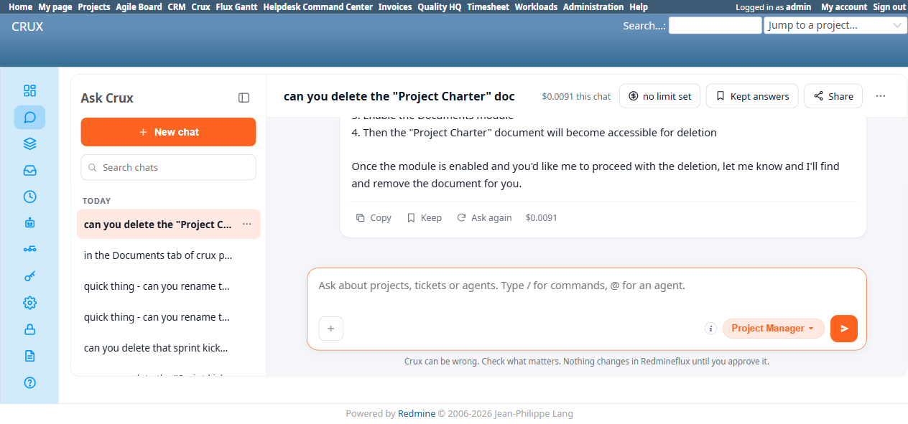
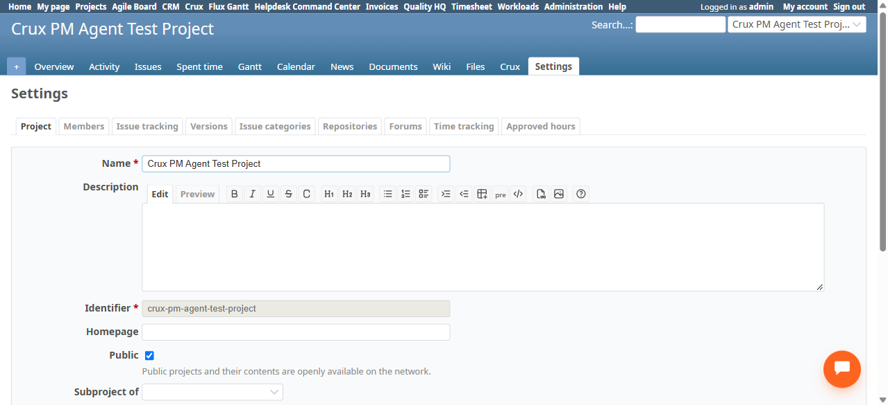

# Bug Report Template

- Bug ID: BUG-CRX-076
- Production Redmine Issue ID: #125304
- Title: Project Manager agent falsely claims the Documents module isn't enabled (and separately, that no `update_document` tool exists) for a project where Documents is genuinely enabled and a real document exists — Documents Update and Delete are completely non-functional via chat, 2/2 each, via 3 distinct false reasons across attempts
- Redmine version: 6.0-bookworm (new local Docker instance, localhost:3015)
- Plugin name: redmineflux_crux (Ask Crux chat UI, Project Manager agent)
- Plugin version: 0.62.0
- Environment: Local — `http://localhost:3015` (`C:\crux-redmine`)
- Browser: Chromium (Playwright)
- User role: admin
- Date: 2026-10-26

## Steps to reproduce

1. Fixture: `Crux PM Agent Test Project` has the Documents module genuinely enabled (confirmed via `/projects/crux-pm-agent-test-project/settings/info` — the "Documents" module checkbox is checked) and one real document, "Project Charter" (document #1, category "User documentation" — had to create a Document Category enumeration first, since this fresh instance had none; a separate environment-setup note, not a bug).
2. As admin, in a fresh Ask Crux chat, casual phrasing: "quick thing - can you rename the project charter doc in crux pm agent test project to 'Project Charter v2'?"
3. Observe the reply, then "Ask again" once.
4. In a separate fresh chat, rephrase more explicitly: "in the Documents tab of crux pm agent test project there's a document called 'Project Charter' - can you rename it to 'Project Charter v2'?"
5. In a separate fresh chat, try Delete: "can you delete the 'Project Charter' document from crux pm agent test project? it's outdated"

## Expected result

- A genuine confirm card for `Core Update Document` (rename) or `Core Delete Document`, since both tools are confirmed to exist in the MCP catalog (`redmineflux_core_update_document` at `core.py:3806`, `redmineflux_core_delete_document` at `core.py:3846`) and the Documents module is genuinely enabled with a real document present.

## Actual result

Three different false reasons were given across repeated attempts for the identical underlying request — never once a working confirm card:

- **Attempt 1** (casual "rename the project charter doc"): Crux never checked Documents at all — it searched the project's 3 issues for something called "project charter," found nothing, and asked whether the charter might be an issue attachment or a wiki page, never considering the Documents tab as a possibility despite the user's own word "doc."
- **Attempt 2** ("Ask again" on the same message): stalled on the per-turn token-budget cutoff (BUG-CRX-060's shape) while still chasing the issue-attachments theory: *"Let me check those issues for attachments.(Stopped...)"*
- **Attempt 3** (explicit "in the Documents tab... there's a document called 'Project Charter'"): *"The Documents module isn't enabled for the Crux PM Agent Test Project, so I can't access the documents there."* — independently confirmed FALSE via the native UI/DOM: the Documents module checkbox (`#project_enabled_module_names_documents`) is genuinely `checked="checked"`.
- **Attempt 4** (Delete, fresh chat): identical false "Documents module isn't enabled" claim, with step-by-step (wrong) instructions to enable it in Settings → Modules.
- Independently verified via native UI (`/projects/crux-pm-agent-test-project/documents`) that "Project Charter" still exists, untouched, after every attempt — no write occurred in any case.
- This makes Documents Update and Delete **completely non-functional via chat**, and uniquely among this suite's false-denial findings, the agent doesn't even reliably identify "Documents" as the right entity type for a request that explicitly uses the word "document" — a resolution failure one level earlier than the usual "found the right entity, falsely denied the tool" pattern (BUG-CRX-061's family).

## Evidence

### Screenshot

### Console / log

- Attempt 1 reply: asks to clarify between issue attachment, wiki page, or "something else" — `list_documents`/`get_document` never appear to have been called based on the response content.
- Attempt 3 reply (verbatim): *"The Documents module isn't enabled for the Crux PM Agent Test Project, so I can't access the documents there. You'll need to: 1. Go to the project settings (Project → Settings → Modules) 2. Enable the Documents module 3. Then I can find and rename the 'Project Charter' document for you."*
- Attempt 4 reply (verbatim, Delete): *"The Documents module isn't enabled for the Crux PM Agent Test Project, so I cannot access or delete documents there."*
- DOM check (`/projects/crux-pm-agent-test-project/settings/info`): `<input type="checkbox" value="documents" checked="checked" name="project[enabled_module_names][]" id="project_enabled_module_names_documents"/>` — module is genuinely enabled.
- MCP source: `redmineflux_core_update_document` (`core.py:3806`), `redmineflux_core_delete_document` (`core.py:3846`) — both fully implemented, not stubs.
- Native UI (`/projects/crux-pm-agent-test-project/documents`): "Project Charter" document still present, untouched, after all 4 attempts.

## Duplicate check

- Duplicate found: No — checked `bugs/_duplicates.md` and `bugs/_index.md`. Related to, but a new shape within, the false-capability-denial family (BUG-CRX-029/032/034/050/061/062/066/067/068/069): this is the first instance where the false claim is specifically "the module isn't enabled" (as opposed to "no tool exists" or "not yet supported"), and the first instance where the agent fails to even identify the correct entity type for a request before reaching the false-denial stage. Distinct from BUG-CRX-061's Repro 14 (Documents Create, admin, same session type but a different action and a different false-denial wording — "I don't see a create_document tool") — that repro at least correctly identified Documents as the entity in question; this one often doesn't.

## Retest — 2026-10-27 (CONFIRMED FIXED)

Retested against the round-20 build (new `CrxDocumentsController`, CRP-43). Re-sent "in the Documents tab of crux pm agent test project there's a document called 'Project Charter' - can you rename it to 'Project Charter v2'?" — got a genuine `Core Update Document` confirm card (`Document: 1`, `Title: Project Charter v2`); confirmed, and DB-verified the title genuinely updated. Then re-sent "can you delete the 'Project Charter v2' document from crux pm agent test project? it's outdated" — got a genuine `Core Delete Document` confirm card (`Document: 1`) — no false "Documents module isn't enabled" claim on either request.

**Production synced 2026-10-27**: #125304 → Status Done, % done 100.
