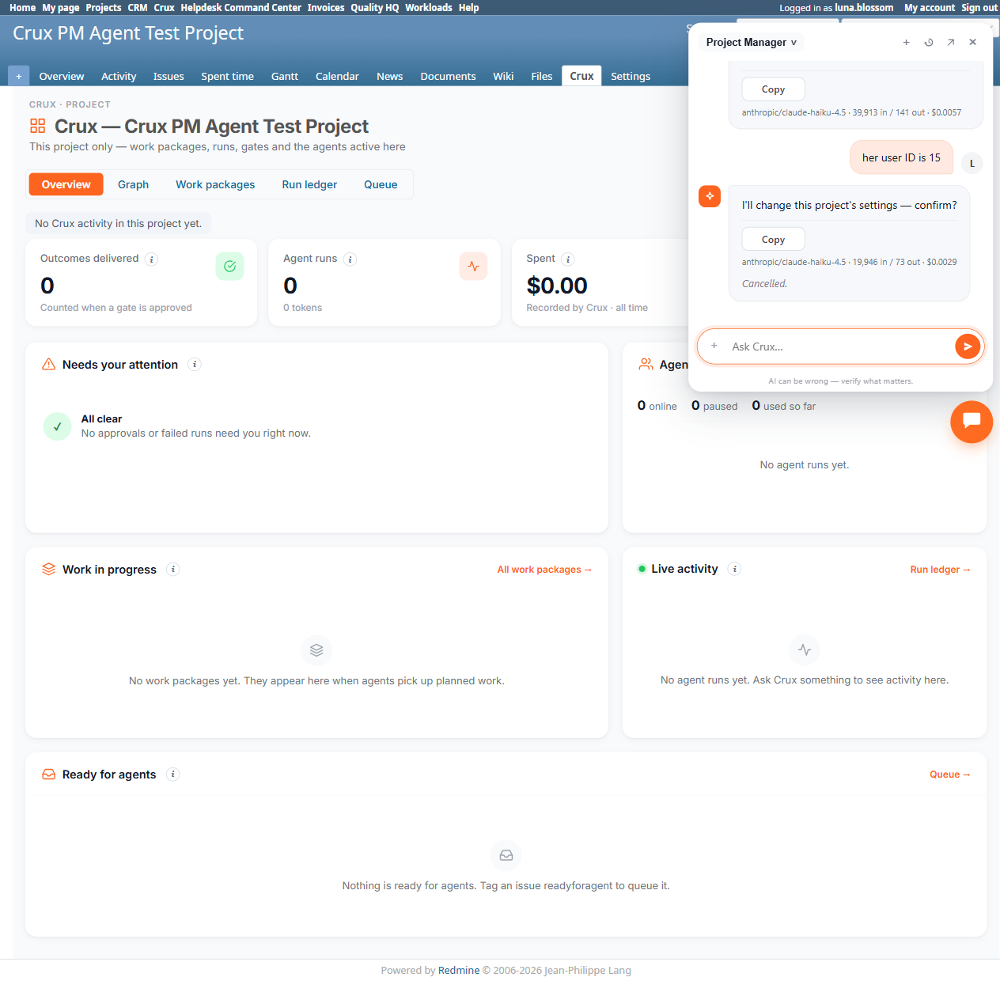

# Bug Report Template

- Bug ID: BUG-CRX-077
- Production Redmine Issue ID: #125305
- Title: Project Manager agent produces a fabricated "I'll change this project's settings — confirm?" card with no mention of the actual request, when asked to change a member's role (Members Update) — same defect class as closed BUG-CRX-056, recurring on a new (Members-update) trigger path
- Redmine version: 6.0-bookworm (new local Docker instance, localhost:3015)
- Plugin name: redmineflux_crux (Ask Crux chat UI, Project Manager agent)
- Plugin version: 0.62.0
- Environment: Local — `http://localhost:3015` (`C:\crux-redmine`)
- Browser: Chromium (Playwright)
- User role: non-admin (`luna.blossom`, Manager role, WITHOUT `manage_members` permission — permission removed and verified via exact DB match `grep -w "manage_members"` on the role's permissions before this test)
- Date: 2026-10-26

## Steps to reproduce

1. As admin, confirm "Crux PM Agent Test Project" has two real members: `luna.blossom` (Manager) and `aurora.wren` (Reporter, user id 15).
2. As admin, remove `manage_members` from the Manager role (`/roles/4/edit`), save, and verify removal via DB (`SELECT permissions FROM roles WHERE id=4` → `manage_members` absent under exact/word-boundary match).
3. Log out of admin, log in as `luna.blossom`.
4. Open Ask Crux (Project Manager agent) on the project, start a fresh chat.
5. Send: "can you bump aurora wren up to developer on the crux pm agent test project? she's doing more than reporting now"
6. Crux replies it can't list users and asks for Aurora Wren's user ID or login (expected — `view_users` is scoped to luna's visible-project members and can't resolve the name; a separate, already-understood Redmine permission-scoping behavior, not this bug).
7. Reply: "her login is aurora.wren" — still can't resolve (same scoping behavior).
8. Reply: "her user ID is 15" (looked up via `SELECT id, login FROM users WHERE login='aurora.wren'`).
9. Crux's next reply is the fabricated card described below.

## Expected result

A genuine, tool-specific confirm card for the actual request — a Membership Update proposal naming Aurora Wren, the target role (Developer), and the project, with real Confirm/Cancel buttons and a detail table showing the role change (old role: Reporter → new role: Developer). If the agent correctly detects it lacks `manage_members` and cannot actually perform the write, it should say so honestly (the already-documented BUG-CRX-061 false-denial shape would at least be topically related to the real request) — not fabricate an unrelated action.

## Actual result

1. Reply text is: **"I'll change this project's settings — confirm?"** — wrong. Nothing in the request was about project settings; the request was entirely about changing Aurora Wren's membership role.
2. The rendered card's only detail-table row is: `Project: Crux PM Agent Test Project` — no mention of Aurora Wren, no role field, no membership field at all.
3. This is the exact same defect shape as the already-closed **BUG-CRX-056** ("Every `update_project`-shaped write request produces the identical fabricated confirm text with no real correspondence to the request") — except BUG-056 was scoped to `update_project`-shaped requests (fields/modules/trackers/custom fields on Project Settings → Project/Info and Issue tracking tabs) and was retested FIXED on 2026-10-12. This reproduction is on a **Members-update** request — a completely different entity/tool path (`update_project_membership`, not `update_project`) — so it is a new recurrence on a new trigger path, not the same code path reopening.
4. Clicked **Cancel** on the card rather than Confirm, to avoid executing an unverified/unintended write.
5. Independently verified via native UI immediately after (logged back in as admin):
   - `/projects/crux-pm-agent-test-project/settings/members` — Aurora Wren is still listed as **Reporter**, not Developer. No unintended membership change occurred.
   - `/projects/crux-pm-agent-test-project/settings/info` — all fields/modules/flags unchanged (Name, Description, Homepage, Public, Subproject, module checkboxes all exactly as before). No unintended project-settings change occurred either.
   - So the card was non-functional as well as mislabeled — clicking Cancel was safe, and nothing executed silently under the hood.

## Evidence

### Screenshot

### Console / log

- Exact reply text (captured via accessibility snapshot): `I'll change this project's settings — confirm?` followed by a "Write" action labeled "Change project crux-pm-agent-test-project" and a one-row detail table: `Project: Crux PM Agent Test Project`.
- Chat turns before the fabricated card: 2 legitimate `view_users`-scoping clarifying replies (not part of this bug), then the fabricated card on the 3rd turn once a numeric user ID was supplied.
- Model/cost line on the fabricated-card turn: `anthropic/claude-haiku-4.5 · 19,946 in / 73 out · $0.0029`.

## Note for triage

This confirms BUG-CRX-056's "fabricated wrong-action confirm card" defect class is not fully closed across every write-proposal path — it was retested FIXED specifically for `update_project`-shaped requests (Project/Info and Issue-tracking-tab fields), but the same fallback/placeholder card ("I'll change this project's settings — confirm?", with only a `Project: <name>` row) now appears on a `update_project_membership`-shaped request instead. This suggests the write-proposal pipeline still has one or more entity types (Members, at minimum) that fall through to the same generic/fallback card-building code path that was supposedly fixed for Project itself. Worth checking whether Versions and Issue Categories (same permission-matrix audit, not yet tested as of this bug's filing) hit the same fallback when their own prerequisite "Create" test is attempted without permission.

## Duplicate check

- Duplicate found: No, but same defect **class** as the already-closed **BUG-CRX-056** (fabricated confirm proposal naming the wrong action/entity entirely) — recorded as a new, separate bug per the repo's established precedent (BUG-CRX-027/028 were filed the same way as new recurrences of BUG-CRX-020's pattern on new trigger paths, rather than reopening 020; BUG-CRX-056 itself was filed as a recurrence of BUG-CRX-020's class). This is on a new trigger path (Members Update) that was never part of BUG-056's original 8 reproductions (all Project/Info and Issue-tracking-tab fields). Also distinct from BUG-CRX-060/061 (stall / false-denial shapes) — this is a confirm card that renders but describes a completely different, unrelated action.
