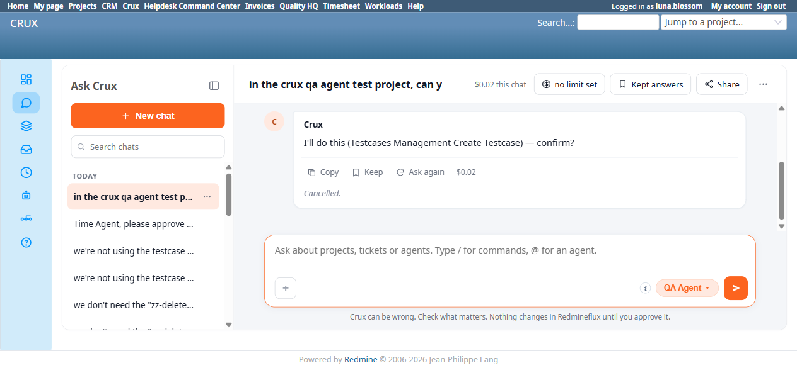

# Bug Report Template

- Bug ID: BUG-CRX-079
- Production Redmine Issue ID: #125487
- Title: QA Agent's Create Testcase AND Update Testcase both guess a hardcoded/assumed priority_id (3 and 5 respectively, each wrong) instead of resolving the named priority via list_enumeration, failing deterministically on any instance whose priority enumeration doesn't use the classic 1-4 ID scheme — same wrong-ID-hallucination class as BUG-CRX-015/019/038/043/050/052
- Redmine version: 6.0-bookworm (new local Docker instance, localhost:3015)
- Plugin name: redmineflux_crux (Ask Crux chat UI, QA Agent, Test Case Management plugin domain)
- Plugin version: redmineflux_testcase_management 7.2.0 / crux-core 0.128.0
- Environment: Local — `http://localhost:3015` (`C:\crux-redmine`)
- Browser: Chromium (Playwright)
- User role: non-admin (`luna.blossom`, "QA Full Access" role — all Testcase Management permissions + Add/Edit issues genuinely granted)
- Date: 2026-10-26

## Steps to reproduce

1. On a freshly seeded Redmine 6 instance where the Priority enumeration's real IDs are `[6=low, 7=medium, 8=high, 9=immediate]` (confirmed via DB) — not the "classic" Redmine seed IDs `[1=Low, 2=Normal, 3=High, 4=Urgent]` some older instances default to.
2. As `luna.blossom`, in a fresh Ask Crux chat (QA Agent), on "Crux QA Agent Test Project": "can you create a test case titled 'Verify login with valid credentials' with description '...', priority High, and two steps: ..."
3. Observe the resulting confirm card and its Priority field value.
4. Click Confirm.
5. Observe the failure, then click Confirm again (retry) to check whether it self-corrects.
6. Independently check the real Priority enumeration via DB (`SELECT id, name FROM enumerations WHERE type='IssuePriority'`).

## Expected result

The agent should resolve "High" to the real priority ID on **this** instance (8) by calling the genuinely-available `list_enumeration(kind='priorities')` (or `redmineflux_core_list_priorities`) tool first, the same way it already successfully resolves other named fields (Project, Subject) to their real values — not assume a fixed numeric ID from memory of a different, more commonly-seeded Redmine instance.

## Actual result

1. The confirm card's `Priority` field shows **`3`** — a numeric ID, not resolved via any `list_priorities`/`list_enumeration` call (the "Checked 1 thing" disclosure covers only 1 tool call, almost certainly just the project-name lookup — no priorities lookup was ever made).
2. Clicking **Confirm** genuinely attempts the write and fails with: **`Error: priority_id 3 not found. Valid IDs: [6, 7, 8, 9]. Use list_enumeration(kind='priorities') to see names.`** — the tool itself clearly expects the caller to resolve the name beforehand and says so explicitly in its own error message; the agent simply never did this.
3. **Clicking Confirm a second time (retry) reproduces the identical error** — the agent does not self-correct even after seeing its own tool's explicit remediation hint in the first failure; the stale, wrong `priority_id: 3` value is retried unchanged.
4. Independently verified via DB: no test case was ever created (`SELECT id FROM issues WHERE subject LIKE '%Verify login%'` → 0 rows) — the failure is honest, not a silent partial write.
5. Real priority enumeration on this instance: `6=low, 7=medium, 8=high, 9=immediate` — "High" should have resolved to `8`, not `3`.

## Evidence

### Screenshot

### Console / log

- Confirm card detail table (verbatim): `Project: Crux QA Agent Test Project`, `Subject: Verify login with valid credentials`, `Priority: 3`, `Description: ...`, `Steps: [...]`.
- Post-confirm error (verbatim, reproduced identically twice): `Error: priority_id 3 not found. Valid IDs: [6, 7, 8, 9]. Use list_enumeration(kind='priorities') to see names.`
- Model/cost line on the initial proposal turn: `anthropic/claude-haiku-4.5 · 29,012 in / 339 out · $0.02`.

## Note for triage

This is the same wrong/hallucinated-ID resolution defect class already extensively documented in `CRUX_MEMORY.md` for the Project Manager agent (BUG-CRX-015/019/038/043, and BUG-CRX-050/052's Priority-field-specific "High→Urgent" sub-variant) — "never guess a numeric id from a name" — now confirmed on a **different agent** (QA Agent) and a **different plugin domain** (Test Case Management's `create_testcase` tool) for the very first time this session. The specific trigger condition here is a non-classic Priority enumeration (IDs 6-9 instead of 1-4), which this QA Agent's `create_testcase` flow apparently never accounts for — it appears to hardcode or assume a priority ID rather than ever calling the lookup tool, unlike some other flows in this suite that do call `list_priorities` correctly (see CRUX_MEMORY.md's Project Manager Priority note, where the lookup tool genuinely WAS called but the wrong value was still picked — a related but distinct sub-shape; here, no lookup call is made at all).

## New repro — 2026-10-26, Update Testcase (same wrong-ID-hallucination, different guessed value)

Same instance, test case #4 (created cleanly via TC-CRX-295 with no priority specified, defaulting to `low`/id=6). Asked the QA Agent: "can you update test case #4 to set its priority to high and add the description '...'?" — the confirm card showed `Priority: 5` (a *different* wrong guess from Create's `3`, still not any of the real IDs `[6, 7, 8, 9]`) alongside a correctly-filled `Description`. Confirming produced a different failure shape this time — Redmine's own validation silently drops the invalid foreign key and reports: *"Validation error: Priority cannot be blank"* — since the Testcase tracker's workflow requires Priority. Verified via DB: neither the description nor the priority changed (`description` still empty, `priority_id` still `6`). This confirms the defect is not confined to Create — **Update Testcase independently guesses its own wrong priority_id** (a different wrong number than Create guessed for the identical "High" input), ruling out a single hardcoded constant shared between the two code paths — each write path appears to have its own unvalidated assumption about the priority ID scheme.

## New repro — 2026-10-27, Add Testcases To Suite (wrong suite_id resolution, same class, 3rd field type)

Same instance, real suites `1=Login and Auth, 2=Password Reset` (confirmed via DB). As `luna.blossom`: "can you move test case #5 into the 'Password Reset' test suite?" — the confirm card showed `Suite: 3` (a suite ID that doesn't exist at all — only 1 and 2 exist on this project). Confirming failed: *"Test suite #3 not found. (If you expected this add testcases to suite to exist, verify the ID with the corresponding list_* tool.)"* Verified via DB: no row created in `issue_test_suites` for issue #5 — genuinely failed, not silently applied to the wrong suite. This extends the wrong-ID-hallucination pattern to a **3rd distinct field type** on this agent in 2 days: Priority (this bug's original scope), Project (BUG-CRX-080), and now Suite ID — suggesting this agent's resolution step broadly doesn't reliably call the matching `list_*` tool before filling a numeric ID field, regardless of which field it is. (Separately, this same failure was also rendered with a misleading success ✓ prefix — filed as **BUG-CRX-082**, the well-established BUG-CRX-018-class defect, since that's a distinct rendering-layer issue from the wrong-ID resolution itself.)

## New repro — 2026-10-27, Create Run (assignee user ID, 4th field type) — root cause confirmed

Asking the QA Agent to create a test run assigned to "luna.blossom" (a username, not an ID — the real-user-phrasing-compliant way to refer to a person) produced: *"I don't have permission to look up users in this instance... Could you provide luna.blossom's numeric user ID... Alternatively, if you'd like to proceed without knowing the exact ID, I can attempt the run creation with a likely ID (often 1 or a small number for an active user), but that would be a guess."* The agent explicitly offered to guess a plausible-sounding but unverified ID rather than resolving the name. Notably, in an *earlier* turn of the same overall session (a different Create Run attempt, before a token-budget cutoff interrupted it), the agent HAD successfully resolved "luna.blossom" to user ID 5 via some lookup path — so the capability exists but is not reliably invoked, the same inconsistency already documented for Priority/Project/Suite. Supplying "luna.blossom's user ID is 5" directly let the run creation proceed and succeed (verified via DB: run #2 created, `run_issues` row issue 6 ↔ suite 1). This extends the wrong-ID-hallucination pattern to a **4th distinct field type** (after Priority, Project/Suite ID, and now Assignee User ID).

**Root cause confirmed via MCP source, 2026-10-27 (recurred a 2nd and 3rd time — TC-CRX-325's precursor and TC-CRX-329):** two genuinely different situations are being conflated by the agent's own "I don't have permission" excuse:
- **Resolving the current user (every repro in this suite — the run was always being assigned to the person asking, `luna.blossom`):** `redmineflux_core_get_current_user` exists specifically for this (`GET /users/current.json`), requires **no admin permission at all**, and the agent used it correctly exactly once in this session ("I found that Luna Blossom (you) has user ID 5"). On every other occasion it claimed no permission and asked the human for the ID instead — this is a pure reliability bug, not a capability gap, since the right tool exists and needs nothing the agent doesn't already have.
- **Resolving a *different* named user (e.g. "add daisy.skye as a watcher"):** `redmineflux_core_list_users`' own docstring states plainly: "requires an admin API key... Non-admin keys receive a 403." A non-admin user genuinely cannot resolve someone else's username to a numeric ID through any available tool — this part is a real, confirmed architectural limitation (same class as the Requirements/Report-scheduling/Run-fields gaps), not a bug, since no tool could fulfill it even if the agent tried every time.

## New repro — 2026-10-27, Update Environment (non-admin, fabricated nonexistent project ID)

As `daisy.skye` (QA No Access), asking to rename the "Staging" environment produced a confirm card with `Project: 30` — a project ID that **does not exist anywhere in this instance** (this project is id=3) — while `Environment: 2` and `Name: Staging-Daisy` were both correct. This is a more severe variant than the prior wrong-project reproductions (BUG-CRX-080), which always guessed a different *real* project — here the value is entirely fabricated. Confirming failed server-side ("Project '30' not found," folded into BUG-CRX-082 for the misleading ✓), verified via DB no change. Retried in a fresh chat: resolved correctly to the real project, and correctly denied for a different reason (lacking `manage_environment`).

## New repro — 2026-10-27, Create Run (multi-run), self-resolution still unreliable

Same self-resolution gap as the original Create Run repro above, reproduced a 2nd time in a separate session: asked to create two runs assigned to "me (luna.blossom)" — the agent again did not call `redmineflux_core_get_current_user` and instead asked for the numeric user ID directly. Supplying "luna.blossom's user ID is 5" let both runs proceed to a correct confirm card and succeed. Confirms this is not a one-off — the zero-permission `get_current_user` tool continues to go uncalled on a majority of "assign to me" requests across this entire session.

## Corroborating evidence — 2026-10-27, fresh-chat retry of the Add-Testcases-To-Suite repro succeeds

Immediately after the wrong-`Suite: 3`-id repro above (in a long-running chat with several prior turns), retried the identical request ("can you move test case #5 into the 'Password Reset' test suite?") in a **brand-new chat with zero prior context** — this time the confirm card correctly showed `Suite: 2` (the real id), and confirming genuinely succeeded (verified via DB: `issue_test_suites` row created, issue 5 → suite 2). This mirrors BUG-CRX-080's own pattern exactly (wrong in a long session, correct in a fresh one) for the **Project and Suite ID** fields specifically — strengthening the hypothesis that resolution reliability for those two fields measurably degrades as a chat session accumulates more turns/context. Note this doesn't (yet) extend to the Priority-field finding this bug was originally filed for — both the Create and Update priority failures happened on otherwise-fresh/early turns, so Priority's wrong-ID behavior looks like a separate, session-length-independent defect within the same broader "never calls list_enumeration" family, not necessarily sharing Project/Suite's specific session-length-dependent trigger.

## Duplicate check

- Duplicate found: No, but same defect **class** as the already-documented wrong-ID-hallucination family (BUG-CRX-015/019/038/043/050/052) — recorded as a new bug per the repo's established precedent for the same pattern recurring on a new agent/tool combination. This is the first instance of this class confirmed on the QA Agent / Test Case Management domain.

## Retest — 2026-10-28 (CONFIRMED FIXED — round 22/23)

Retested against round-21 build (crux-core 0.130.0 @1140e8a, MCP crux_development @49b50b1, Testcase Management @028663a). As `luna.blossom`, "create a test case titled 'Verify login with valid credentials'... priority High" produced a confirm card showing `Priority: high` (resolved by name, not a guessed numeric id). Confirming created testcase #11 with `priority_id=8` (verified via DB) — the real "high" id on this instance, not 3.

**Production synced 2026-10-28**: #125487 → Status Done, % done 100.
