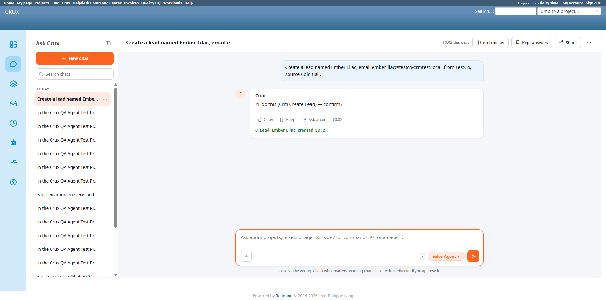

# Bug Report Template

- Bug ID: BUG-CRX-092
- Production Redmine Issue ID: #125544
- Title: CRM API permission checks (`authorize_global`/`authorize_manage`/`authorize_delete` in `Api::CrmBaseController`) use `allowed_to?(permission, nil, global: true)` — a GLOBAL check across every project the user is a member of — instead of scoping to the CRM project itself, so a user with zero CRM permission on the CRM project can create/write CRM records as long as they hold an elevated role (that happens to include the CRM permission) on ANY unrelated project
- Redmine version: 6.0-bookworm (new local Docker instance, localhost:3015)
- Plugin name: redmineflux_crm (API layer used by both the native CRM UI and the Sales Agent via MCP)
- Plugin version: unchanged at `cef6504` per this round-20 rebuild's own verification notes
- Environment: Local — `http://localhost:3015` (`C:\crux-redmine`)
- Browser: Chromium (Playwright)
- User role: `daisy.skye` — **Reporter** on `Crux CRM Agent Test Project` (project id 2; Reporter role genuinely has `manage_leads=false`, `view_crm=false`, DB-verified), but also a **Developer** on the unrelated `Crux PM Agent Test Project` (project id 1; Developer role genuinely has `manage_leads=true`, `view_crm=true`, DB-verified)
- Date: 2026-10-27

## Steps to reproduce

1. Fixture (DB-verified): `daisy.skye` (user id 6) has 3 project memberships — Reporter on `Crux CRM Agent Test Project` (id 2, zero CRM permissions), Developer on `Crux PM Agent Test Project` (id 1, full CRM permissions), QA No Access on `Crux QA Agent Test Project` (id 3).
2. As `daisy.skye`, in a fresh Ask Crux chat (Sales Agent), on the CRM project: "Create a lead named Ember Lilac, email ember.lilac@testco-crmtest.local, from TestCo, source Cold Call."
3. Crux produces a genuine `Crm Create Lead` confirm card (all fields correctly populated). Click Confirm.
4. Observe the result, then independently verify server-side via DB.

## Expected result

- Since `daisy.skye`'s role on the CRM project (`Crux CRM Agent Test Project`) is Reporter with no `manage_leads`/`view_crm`, the create must be refused with a genuine `Forbidden` response — matching this exact fixture's own prior documented behavior (BUG-CRX-067, originally and repeatedly reproduced with the identical request against the identical Reporter-role user, before she held any other project's elevated role).
- A permission check for a CRM write must be scoped to the user's role on the relevant CRM-enabled project, not to whether the user holds that permission *anywhere at all* in the whole Redmine instance.

## Actual result

The write **genuinely succeeded**:

- Chat reply: `"✓ Lead 'Ember Lilac' created (ID: 2)."` — no Forbidden error, no misleading checkmark-on-failure (BUG-CRX-067's defect) — this time the checkmark is accurate, because the write really did happen.
- DB verification (`rf_crm_leads`): row `id=2, first_name=Ember, last_name=Lilac, email=ember.lilac@testco-crmtest.local, company_name=TestCo` — genuinely created, with `author_id=6` (daisy.skye) correctly attributed (ruling out a shared/service-account identity issue — the request authenticated as the real acting user).
- crux-core log confirms the MCP tool call itself succeeded: `mcp call tool=redmineflux_crm_create_lead duration_ms=192.9 ok=true` / `proposal executed id=prop-075 tool=redmineflux_crm_create_lead run=run-252 approver=daisy.skye`.
- Role-permission DB check, confirmed before and after the attempt: Reporter role (daisy's only role on the CRM project) has `manage_leads=false` and `view_crm=false`. No role anywhere in the system (including Non-member/Anonymous) other than Developer and Manager has `manage_leads`/`view_crm` — and daisy only holds Developer on the **unrelated PM project**, never on the CRM project itself.

### Root cause (source-traced)

`plugins/redmineflux_crm/app/controllers/api/crm_base_controller.rb`:

```ruby
def authorize_global
  render_forbidden unless User.current.allowed_to?(:view_crm, nil, global: true)
end

def authorize_manage(permission)
  render_forbidden unless User.current.allowed_to?(permission, nil, global: true)
end

def authorize_delete
  render_forbidden unless User.current.allowed_to?(:delete_crm_data, nil, global: true)
end
```

Redmine's `User#allowed_to?(permission, nil, global: true)` checks whether the user holds `permission` via **any** role on **any** project they belong to — it is not scoped to a specific project at all. Since `daisy.skye` holds the Developer role (which includes `manage_leads`/`view_crm`) on `Crux PM Agent Test Project`, the global check passes for **every** CRM write anywhere in the instance, completely independent of her actual (permission-less) Reporter role on the CRM project where the write is nominally happening. CRM entities (`CrmLead`, etc.) in this plugin are not themselves project-scoped Redmine objects, but the authorization check should still be scoped to the specific project the agent/user is operating in (the same project context the chat UI and MCP tool call both carry), not a blanket "does this user have this permission literally anywhere."

This means: **any user who holds an elevated role on even one unrelated project anywhere in the instance can create/update/delete CRM records via the API (and therefore via the Sales Agent) regardless of their actual, far more restricted role on the CRM project itself.** This is a broken-access-control defect, not merely a UI inconsistency.

### Why this wasn't caught by the original BUG-CRX-067

BUG-CRX-067's `daisy.skye` fixture (as originally built and in every prior retest) held **only** the Reporter role on the CRM project, with no other elevated-permission project membership anywhere — so the global check correctly failed for her in every prior test, and the only defect visible was the misleading ✓ icon on that correctly-enforced Forbidden. This round-20 fixture happens to also give her a Developer membership on the PM project (for unrelated PM-agent test coverage), which incidentally satisfies the broken global check and exposes the real authorization defect for the first time. The flaw itself was presumably always present in the code shown above; it was simply never reachable by a fixture lacking any other elevated project role until now.

## Evidence

### Screenshot



### Console / log

```
# DB: daisy.skye's role on the CRM project genuinely lacks manage_leads/view_crm
 id | login | project_id |            name             |     role
----+-------+------------+------------------------------+--------------
  6 | daisy.skye |       2 | Crux CRM Agent Test Project | Reporter
  6 | daisy.skye |       1 | Crux PM Agent Test Project  | Developer
  6 | daisy.skye |       3 | Crux QA Agent Test Project  | QA No Access

 id | name     | has_manage_leads | has_view_crm
  5 | Reporter | f                | f
  3 | Developer| t                | t

# DB: the lead was genuinely created
 id | first_name | last_name |               email               | company_name
  2 | Ember      | Lilac     | ember.lilac@testco-crmtest.local  | TestCo

# DB: real author attribution confirms the request authenticated as daisy.skye, not a shared/admin identity
 id | author_id |   login
  2 |         6 | daisy.skye

# crux-core log
2026-10-27T12:10:48.811+00:00 INFO mcp call tool=redmineflux_crm_create_lead duration_ms=192.9 ok=true
2026-10-27T12:10:48.828+00:00 INFO proposal executed id=prop-075 tool=redmineflux_crm_create_lead run=run-252 approver=daisy.skye
```

## Duplicate check

- Duplicate found: No. Distinct from BUG-CRX-067 (still a real, separate defect — a correctly-enforced Forbidden rendered with a misleading ✓; that defect's own precondition, a Reporter-only `daisy.skye` with no other project role, was not present in this fixture, so BUG-067 itself could not be retested here, only this new defect could be observed). This is a genuine server-side authorization-logic flaw (`global: true` permission scope) in `redmineflux_crm`'s own `CrmBaseController`, not a chat-UI rendering issue, and not previously documented anywhere in `bugs/_index.md` or `bugs/_duplicates.md`.

## Resolution — 2026-10-29, Won't Fix (working as designed)

Production #125544 closed by the dev (Prashant Chaurasia, 2026-10-27T14:10:16Z) as **Won't Fix — working as designed**, confirmed via `redmineflux_core_get_issue` journals. Developer's rationale, verbatim summary:

- **CRM is not project-based by design.** It opens from the top menu, not from inside a project — no project module, no project routes. Leads/contacts/companies/deals belong to the whole Redmine instance, not to any project (confirmed on the test instance: 0 of 10 leads, 0 of 11 companies, 0 of 64 deals have a project). Neither the CRM pages nor the CRM API filter by project.
- Every CRM permission is therefore declared as a **global** permission (`redmineflux_crm/init.rb`), and the plugin's own README states this explicitly: "All CRM permissions are global (not per-project), since CRM data isn't scoped to a single project."
- The `allowed_to?(..., nil, global: true)` checks in `Api::CrmBaseController` (and the native CRM browser controllers) are therefore **correct for this design** — a CRM permission on any role means "this person may use the CRM" for the whole instance, not just the project that role happens to be attached to.
- `daisy.skye`'s Developer role on the unrelated PM project has `manage_leads`/`view_crm` ticked → she is a CRM user instance-wide by design; her Reporter role on the CRM test project has no bearing on CRM access at all, since CRM isn't tied to that project.
- The **one genuinely project-scoped CRM action** is linking a contact/deal to a ticket (`link_crm_to_issues`), which correctly checks the issue's own project — and was confirmed to work correctly.
- Correct way to restrict CRM access: remove CRM permissions from general roles (Developer/Manager), or create a dedicated role (e.g. "Sales") carrying only CRM permissions, granted only to intended CRM users.
- Making CRM genuinely project-scoped would be a **new feature request**, not a bug fix.

**Local disposition:** moved to `bugs/closed/` per this resolution — **Won't Fix**, not a defect. No production sync needed beyond what the dev already set (status already Won't Fix, 0% done — not the usual Done/100% bug-closure pattern, since this isn't a fix). `_index.md` updated accordingly.

## Note for triage

- **Severity: Critical** — this is a broken-access-control vulnerability: a low-privilege user's writes to a sensitive business-data domain (CRM Leads/Contacts/Companies/Deals, and CRM data deletion via `authorize_delete`) succeed as long as they hold an unrelated elevated role anywhere in the instance, bypassing the intended per-CRM-project permission model entirely. This affects every `authorize_global`/`authorize_manage`/`authorize_delete` call site in `CrmBaseController`, i.e. all CRM entity types (Leads, Contacts, Companies, Deals, Activities), both via the native UI and via the Sales Agent/MCP.
- Fix: scope the `allowed_to?` check to the actual CRM-context project (e.g. the project the chat/API request is operating against) instead of `global: true`, or — if CRM is genuinely intended to be instance-wide and not project-scoped — document that explicitly and reconsider whether per-project Reporter/Developer roles should carry any CRM-permission meaning at all (in which case the entire BUG-CRX-067 Reporter-based "zero CRM permission" test design would need to be re-evaluated).
- This finding blocks a clean retest of BUG-CRX-067 under this round-20 fixture, since the precondition BUG-067 depends on (a user with CRM permission zero *everywhere*) no longer held once `daisy.skye` gained a second, unrelated project role. Recommend either rebuilding `daisy.skye` with no elevated role on any project before retesting 067, or using a different, single-project-only user for that specific retest.
