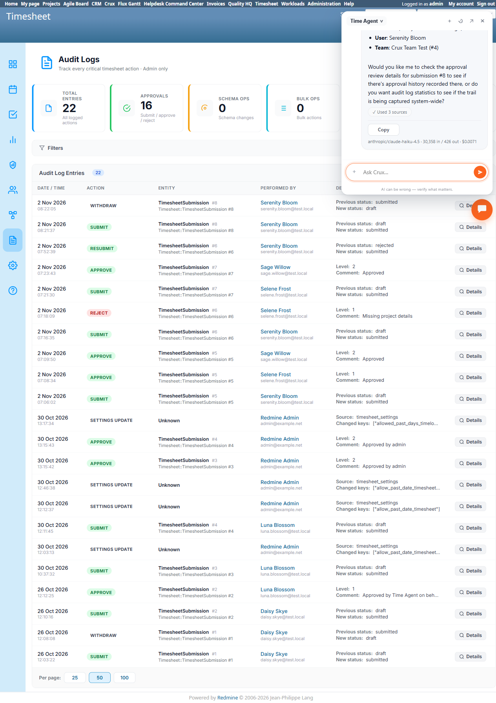

# Bug Report Template

- Bug ID: BUG-CRX-131
- Production Redmine Issue ID: #127324
- Title: Asking the Time Agent for a specific timesheet submission's audit log fails 2/2 with two different wrong answers — a false "no entries" claim and fetching an unrelated audit entry — while the native Audit Log genuinely has the real, correct entries both times
- Redmine version: 6.0-bookworm (local Docker instance, localhost:3015)
- Plugin name: redmineflux_crux (Ask Crux chat UI, Time Agent)
- Plugin version: crux-core 0.130.0
- Environment: Local — `http://localhost:3015` (`C:\crux-redmine`)
- Browser: Chromium (Playwright)
- User role: `admin`
- Date: 2026-11-02

## Steps to reproduce

1. As `admin`, with native `/audit_logs` showing 22 real entries total (confirmed by direct read before and after
   each attempt below), ask: "Who changed submission #8's timesheet and when?" — Submission #8 genuinely has 2
   real audit entries: `Submit` (2 Nov 2026 08:21:37, Serenity Bloom, draft→submitted) and `Withdraw` (2 Nov 2026
   08:22:05, Serenity Bloom, submitted→draft).
2. In a fresh chat, ask: "Show me the audit log for timesheet submission #6." — Submission #6 genuinely has 3
   real audit entries: `Submit` (07:16:35), `Reject` (07:18:09, Selene Frost, "Missing project details"), and
   `Resubmit` (07:52:39).

## Expected result

Both queries should retrieve and report the real, matching audit log entries for the named submission (per the
persona's own `audit_log`/`audit_log_show` tool family) — grounded in real data, never a fabricated "empty"
claim and never a mismatched, unrelated entry.

## Actual result

Two reproductions, two entirely different wrong answers — neither matching the real data:

1. **Attempt 1 (submission #8)**: *"Submission #8 exists... and the audit log returned no entries for it. This
   could mean: 1. No changes have been recorded yet... 2. The audit log is empty system-wide..."* — flatly
   false; the native Audit Log page, checked immediately before and after this query in the same browser
   session, shows exactly 2 entries for `TimesheetSubmission #8` (Submit and Withdraw), and 22 entries total
   system-wide (not empty). The agent also mischaracterized the submission's "Last activity" as *"submitted at
   2026-11-02T08:21"* when the genuinely last action was the Withdraw one minute later, at 08:22.
2. **Attempt 2 (fresh chat, submission #6)**: produced a response about an unrelated **Settings Update** entry
   (`auto_approve_threshold: changed from None → 0.0`) and then said *"This was a plugin-wide settings change,
   not a specific action on a timesheet submission... If you're looking for the approval/submission history of
   a specific timesheet (like submission #6 itself), I can show you the full details..."* — i.e. it fetched the
   WRONG audit entry entirely and only realized afterward that it didn't match, never actually surfacing any of
   submission #6's 3 real, matching entries (Submit, Reject, Resubmit) that are genuinely present in the native
   log at that moment.

Net effect: the audit-log-by-submission lookup capability is 0-for-2 reliable this session — once falsely
claiming no data exists when real data does, and once retrieving a completely unrelated record instead of the
real match. An admin relying on chat to investigate "who did what to this submission and when" would get no
useful answer either time, despite the underlying audit trail itself being complete and accurate (BUG-CRX-046's
original withdraw-audit-gap finding from the old suite appears genuinely fixed on this build — the data exists;
only the chat retrieval of it is broken).

## Evidence

### Console / log

- Attempt 1: *"...the audit log returned no entries for it... No changes have been recorded yet... The audit
  log is empty system-wide..."*
- Native `/audit_logs`, same session, same moment: Total Entries 22; rows for TimesheetSubmission #8 — "Withdraw"
  (2 Nov 2026 08:22:05, Previous status: submitted → New status: draft) and "Submit" (08:21:37, draft→submitted).
- Attempt 2: *"...auto_approve_threshold: changed from None → 0.0... This was a plugin-wide settings change, not
  a specific action on a timesheet submission."*
- Native `/audit_logs`, same moment: rows for TimesheetSubmission #6 — "Resubmit" (07:52:39), "Reject" (07:18:09,
  Selene Frost, "Missing project details"), "Submit" (07:16:35) — none of these were what attempt 2 actually
  surfaced.

### Screenshot

## Duplicate check

- Duplicate found: No — distinct from BUG-CRX-125 (false "all clear" on the Late Submission Unlock Queue) and
  BUG-CRX-130 (admin approve-bypass false refusal) in that this is specifically the `audit_log`/`audit_log_show`
  tool family failing to retrieve a submission-scoped entry set, with two different wrong framings (false-empty,
  then wrong-entry) rather than a stale-status read. Shares the general "confidently wrong read of real data"
  shape with those two bugs but on a distinct tool and distinct data family (audit trail retrieval, not
  deadline-lock or approval-authority status). Kept as its own bug per the one-bug-per-concrete-finding
  convention. Also directly relevant to this suite's TC-CRX-441 (audit log honesty) and TC-CRX-466 (BUG-CRX-046
  regression check) — the underlying data gap from BUG-CRX-046 appears fixed, but this new retrieval-accuracy
  defect replaces it as the active blocker for both TCs.

## Retest — 2026-11-02 — FIXED

Developer commit `ca1f81b` (redmineflux_timesheet, `api/audit_logs_controller.rb` + `timesheet_submissions_controller.rb`
— per-submission audit log endpoint), MCP tool-layer commit `9f477f2`, and crux-core commit `3812e0f` all pulled;
containers restarted.

Tested on a real, currently-existing submission with 2 genuine audit entries (#12 — Submit by Serenity Bloom
2026-11-02 09:09:13, Approve by Selene Frost 09:10:17 — confirmed natively on `/audit_logs` beforehand). Asked
the Time Agent: *"Show me the audit log for timesheet submission #12 - who changed it and when?"* — response
correctly named Submitted by: Serenity Bloom, Project, Period, Current status: Approved, and the timeline
correctly states both real events — *"submitted on 2026-11-02 at 09:09 and approved less than a minute later"*
by Selene Frost at Level 1/1 — matching the native audit log exactly, no fabricated or missing entries. **Confirmed
fixed.**
