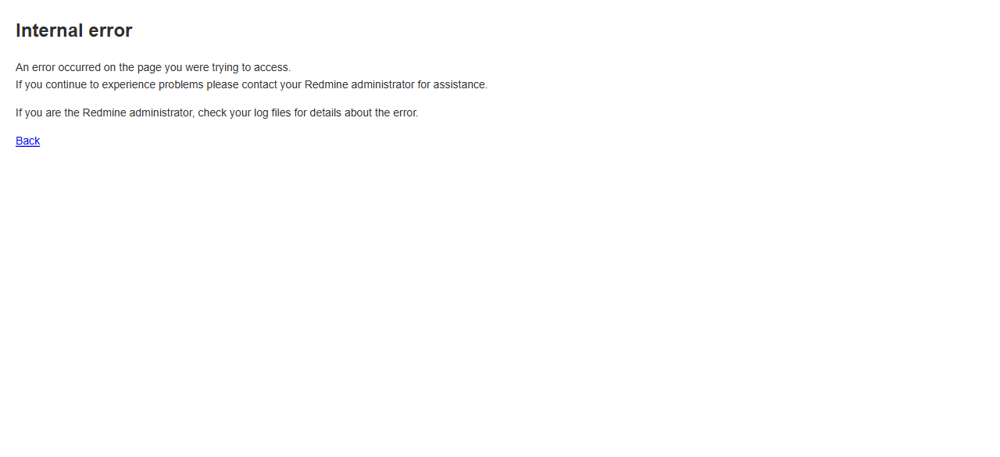

# Bug Report Template

- Bug ID: BUG-CRX-132
- Production Redmine Issue ID: #127459
- Title: Invoicing Agent's `create_invoice` never sets/warns about `due_date` — viewing the resulting invoice's native show page genuinely crashes with a 500 (`NoMethodError: undefined method 'strftime' for nil`)
- Redmine version: 6.0-bookworm (local Docker instance, localhost:3015)
- Plugin name: redmineflux_crux (Ask Crux chat UI, Invoicing Agent) / redmineflux_invoice (native plugin, root cause)
- Plugin version: crux-core 0.130.0 / redmineflux_invoice (see `/settings/plugin/redmineflux_invoice`)
- Environment: Local — `http://localhost:3015` (`C:\crux-redmine`)
- Browser: Chromium (Playwright)
- User role: admin
- Date: 2026-11-03

## Steps to reproduce

1. As `admin`, Invoicing Agent (pinned), fresh chat: "Create an invoice for the Crux Invoice Agent Test
   Project, client email test@example.com, tax rate 10%, one line item: 'Consulting', quantity 2, rate 100."
   — supply user_id and project identifier when prompted. Confirm the resulting `Invoice Create Invoice`
   confirm card. **No `due_date` is ever requested or set by the agent at any point in this flow.**
2. As `admin` (or any user), navigate natively to the created invoice's show page: `/invoices/<id>`
   (e.g. `/invoices/1`), or click its number from the `/invoices` list page.

## Expected result

Either the agent should require/default a `due_date` when creating an invoice (since the plugin's own native
"New Invoice" form, while not marking it required with an asterisk, clearly expects a real date to be
usable elsewhere in the plugin — e.g. the email-template macro system), or the native show page should
tolerate a nil `due_date` gracefully (e.g. render "No due date set" instead of calling `.strftime` on `nil`).
At minimum, viewing a real, successfully-created invoice should never produce a fatal error.

## Actual result

Viewing the invoice's native show page (`/invoices/1`) **always returns a genuine HTTP 500 Internal Server
Error** — 100% reproducible, confirmed via two separate navigations (direct URL and clicking the invoice
number from the `/invoices` list). The invoice itself is real and otherwise correctly persisted — it appears
correctly in the `/invoices` list (`INV-2026-0001`, `Crux Invoice Agent Test Project`, `Draft`, `USD 220.00`)
— but its own dedicated show page is completely unreachable.

Root-caused via the real Redmine container log (`docker logs crux-redmine6-redmine-1`):

```
NoMethodError (undefined method `strftime' for nil):
plugins/redmineflux_invoice/app/models/concerns/invoice_macro_processor.rb:15:in `process_invoice_macros'
plugins/redmineflux_invoice/app/models/invoice_email_template.rb:30:in `process_macros'
plugins/redmineflux_invoice/app/controllers/global_invoices_controller.rb:91:in `show'
```

`invoice_macro_processor.rb:15` unconditionally calls `invoice.due_date.strftime('%B %d, %Y')` with no nil
guard, while every other field in the same method is defensively wrapped in `.to_s` or has its own fallback.
The invoice's `due_date` is genuinely `nil` because:
1. The Invoicing Agent's `create_invoice` tool never asks for or defaults a `due_date` anywhere in its
   confirm-card flow (confirmed: the confirm card shown to the user lists Project/Client Email/Invoice
   Date/Tax Rate/Line Items — no Due Date field at all).
2. The native "New Invoice" form (`/invoices/new`) also has a "Due Date" field with **no asterisk** —
   confirming it's optional on the native path too, so this isn't purely an agent-side gap; a human using
   the native UI could trigger the identical crash by simply leaving Due Date blank.

So this is a genuine, 100% reproducible crash reachable via either the Invoicing Agent or the native UI,
whenever an invoice is created with no due date — which the plugin itself allows without warning.

## Evidence

### Screenshot



### Console / log

- Real Redmine container log (verbatim, two separate requests reproduced it identically):
  ```
  NoMethodError (undefined method `strftime' for nil):
  plugins/redmineflux_invoice/app/models/concerns/invoice_macro_processor.rb:15:in `process_invoice_macros'
  plugins/redmineflux_invoice/app/models/invoice_email_template.rb:30:in `process_macros'
  plugins/redmineflux_invoice/app/controllers/global_invoices_controller.rb:91:in `show'
  lib/redmine/sudo_mode.rb:78:in `sudo_mode'
  ```
- `/invoices` list page confirms the invoice itself is real and correctly persisted: `INV-2026-0001`,
  `Crux Invoice Agent Test Project`, `11/03/2026`, `USD 200.00` subtotal, `USD 220.00` total, `Draft` status
  — only the dedicated show page (`/invoices/1`) crashes.
- `invoice_macro_processor.rb` source (lines 11-15): every other field uses `.to_s`/`sprintf` defensively;
  only `invoice_date` and `due_date` call `.strftime` directly with no nil guard — `invoice_date` happens to
  always be set (defaults to "today" in the agent's own flow), so only `due_date` is reachable as nil.

## Duplicate check

- Duplicate found: No. First finding on the Invoicing Agent / `redmineflux_invoice` plugin domain — this
  suite (`CRUX_AGENT_INVOICE_BILLING.md`) is new as of 2026-11-03, no prior Invoice-domain bugs exist in
  `bugs/_index.md` or `bugs/_duplicates.md` to check against.

## Retest — 2026-11-04 (FIXED)

Developer's retest guide round pulled `redmineflux_invoice` (and the other named repos/services) to the
commits specified for this round; migrations run, services restarted. Retested the exact original repro, fresh
chat, Invoicing Agent pinned: "Create an invoice for the Crux Invoice Agent Test Project, client email
retest132@example.com, tax rate 10%, one line item: 'Consulting Retest', quantity 2, rate 100." (supplied
user_id 1 and the project identifier when prompted).

The confirm card still doesn't show an explicit Due Date field, but the result message this time read: *"✓
Invoice created: #6 — INV-2026-0006 for retest132@example.com (status: draft, total: 220.0, due:
2026-12-04)"* — a real due date (30 days after the invoice date) is now genuinely set automatically, not left
nil. Native-verified on `/invoices/6`: the show page renders correctly — no 500 — with `Due Date: 12/04/2026`
genuinely displayed.

**Status: FIXED.** `create_invoice` now defaults a real `due_date` instead of leaving it nil, closing the
crash path in `invoice_macro_processor.rb`. Moved to `bugs/closed/`.
