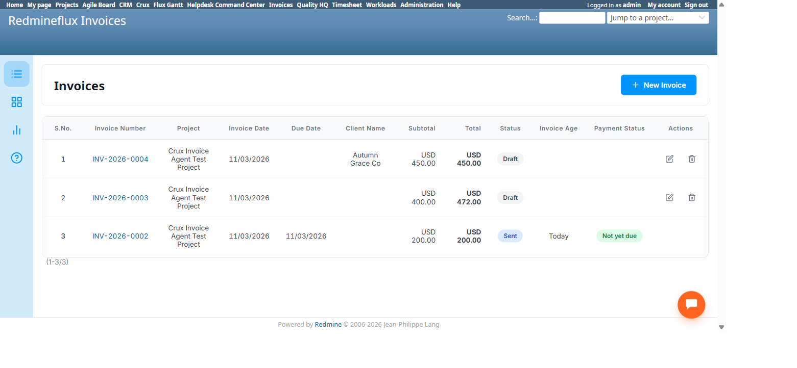

# Bug Report Template

- Bug ID: BUG-CRX-138
- Production Redmine Issue ID: #127471
- Title: Invoicing Agent's `record_payment` completely bypasses a real business rule — the native UI only ever offers "Add Payment" on a Sent invoice, but the agent can genuinely record a payment on a Draft (never-sent) invoice with no block or warning
- Redmine version: 6.0-bookworm (local Docker instance, localhost:3015)
- Plugin name: redmineflux_crux (Ask Crux chat UI, Invoicing Agent) / redmineflux_invoice (native plugin, root cause)
- Plugin version: crux-core 0.130.0
- Environment: Local — `http://localhost:3015` (`C:\crux-redmine`)
- Browser: Chromium (Playwright)
- User role: admin
- Date: 2026-11-03

## Steps to reproduce

1. Confirm the native UI's own real behavior: a Draft invoice's show page offers only **Edit**, **Send
   Invoice**, and **Download PDF** — no "Add Payment" action anywhere. Sending the invoice (via the native
   "Send Invoice" → Email Preview → Send Email flow) causes an **"Add Payment"** link to appear for the
   first time — confirming payment-recording is deliberately gated to Sent (or later) status only.
2. Create a fresh invoice via the Invoicing Agent and leave it Draft (do not send it).
3. As `admin`, Invoicing Agent pinned, same or fresh chat: "Record a payment of $100 against invoice #<id>
   for the Crux Invoice Agent Test Project, payment date 2026-11-03, method bank transfer."
4. Confirm the resulting `Invoice Record Payment` confirm card.

## Expected result

Since the native UI deliberately hides/blocks payment recording until an invoice has genuinely been sent,
the agent's `record_payment` tool should enforce the identical rule — refusing with a clear message (e.g.
"Cannot record a payment on a Draft invoice — send it first") rather than silently succeeding.

## Actual result

The confirm card proposed the payment normally, with no mention of the invoice's Draft status. Confirming it
returned: *"✓ Payment recorded: #2 — 100.0 on 2026-11-03 via bank transfer."* Native verification on
`/invoices?project_id=crux-invoice-agent-test-project` confirms invoice #4's own Status column still
genuinely reads **"Draft"** — the payment was recorded against an invoice that was never sent, that the
client has never even seen, with zero warning or block anywhere in the agent's flow.

This is a genuine business-rule bypass, not merely a missing nice-to-have: a real financial record (a
payment) now exists against an invoice the native UI's own workflow says shouldn't be payable yet — the
client could legitimately dispute a payment recorded before they were ever billed, and any report relying on
"only Sent+ invoices have payments" (which the native UI's own gating implies is a real invariant) would be
silently violated.

## Evidence

### Screenshot

### Console / log

- Native confirmation that payment-recording is status-gated: Draft invoice #2's action links were `Edit`,
  `Send Invoice` (no payment option); after using "Send Invoice" → "Send Email" to genuinely send it, the
  page's action links became `Edit`, **`Add Payment`**, `Download PDF` — i.e. `Add Payment` only appears
  post-send.
- Agent confirm card for invoice #4 (Draft, never sent): `Project`, `Invoice: 4`, `Amount: 100`, `Payment
  Date`, `Payment Method` — no status field, no warning.
- Result (verbatim): *"✓ Payment recorded: #2 — 100.0 on 2026-11-03 via bank transfer."*
- Native verification, `/invoices?project_id=crux-invoice-agent-test-project`: invoice #4's Status column
  still genuinely reads "Draft" after this payment.

## Duplicate check

- Duplicate found: No. Distinct from BUG-CRX-135 (Delete has no status check) — a different tool
  (`record_payment` vs. `delete_invoice`) and a different direction of the same general "lifecycle rule
  enforced natively but not via the agent's tool" pattern. Worth noting both bugs together suggest the
  Invoicing Agent's tool layer systematically under-enforces invoice status transitions compared to the
  native controller/UI.

## Retest — 2026-11-04 (FIXED)

Retested against invoice #7 (INV-2026-0007, Draft, created earlier this retest round): "Record a payment of
$100 against invoice #7 for the Crux Invoice Agent Test Project, payment date 2026-11-04, method bank
transfer." The confirm card still shows no status field, but confirming now correctly refuses: *"Validation
error: This invoice is still a draft and has not been sent to the client. Send it first, then record the
payment. Correct the value(s) above and try again."*

Native-verified on `/invoices/7`: Payment History genuinely reads "No payments recorded yet." **Status:
FIXED.** `record_payment` now enforces the same Sent-or-later gate the native UI's own action links imply.
Moved to `bugs/closed/`.
