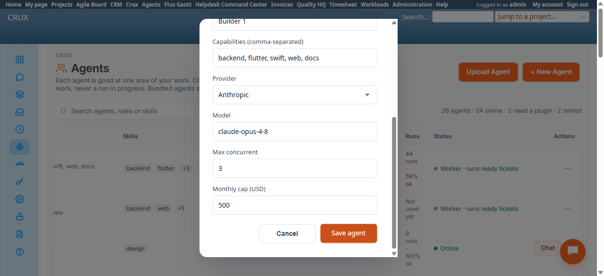

# Bug Report Template

- Bug ID: BUG-CRX-200
- Production Redmine Issue ID: #128846 (reported 2026-11-17, linked to Test Case #127937 / Run #607 / Environment "Window 11 + Chrome", marked Failed, assigned to Prashant Chaurasia)
- Title: Builder 1/Builder 2's own "Edit" action is completely non-functional — every save is refused as "the id of a built-in agent"
- Redmine version: 6.0-bookworm
- Plugin name: redmineflux_crux
- Plugin version: 0.98.0
- Environment: localhost:3015 (local Docker)
- Browser: Chromium (Playwright MCP)
- User role: admin
- Date: 2026-11-17

## Steps to reproduce

1. Log in as `admin` on `http://localhost:3015`, go to `/crux/agents`, switch to List view.
2. Confirm Builder 1 and Builder 2 are both shown with **Type: Custom** (not Bundled) — matching TC-CRX-827's
   documented rule that Edit is offered for Custom agents, never Bundled ones.
3. Open Builder 1's "More actions" (⋯) menu — it genuinely offers **Edit** (consistent with its Custom type).
4. Click "Edit". The dialog opens pre-filled with Builder 1's real current settings (Name "Builder 1",
   Capabilities "backend, flutter, swift, web, docs", Provider Anthropic, Model `claude-opus-4-8`,
   Max concurrent `3`, Monthly cap `500`).
5. Without changing anything, click "Save agent".

## Expected result

- Re-submitting an agent's own existing id with its own unchanged (or deliberately changed) field values should
  update it in place — this is explicitly the documented behavior ("Re-submitting an existing id updates that
  agent (only the fields you fill change)," shown as the dialog's own helper text) and is exactly what TC-831
  already confirmed works correctly for a disposable custom agent.

## Actual result

- `POST /crux/agents` returns **400 Bad Request** every time, with:
  `{"ok":false,"error":"'builder-1' is the id of a built-in agent. Built-in agents can't be replaced; choose a different id.","errors":["'builder-1' is the id of a built-in agent. Built-in agents can't be replaced; choose a different id."]}`
- The dialog shows the same error inline: *"⚠ 'builder-1' is the id of a built-in agent. Built-in agents can't
  be replaced; choose a different id."*
- Reproduced twice — once with a real field change (Max concurrent 3→1, Monthly cap 500→0.10) and once with
  **zero changes at all** (just opened Edit and immediately clicked Save) — both failed identically, confirming
  this isn't about the specific values changed, it's an unconditional refusal on the id itself.
- This makes the **Edit action completely non-functional for Builder 1 and Builder 2** — the only 2 agents in
  this deployment capable of claiming Ready Queue work (`WORKER_IDS = frozenset({"builder-1", "builder-2"})`,
  confirmed via source, `crux_core/agents_registry/plugin_agents.py`). There is no way to ever configure their
  Max concurrent or Monthly cap (or any other field) via this UI, despite the Edit button being genuinely
  present and the agents being genuinely labeled "Custom" type, not "Bundled."
- This directly blocks **TC-CRX-833** (monthly-cap-stops-queue-work test) and **TC-CRX-834** (max-concurrent
  limits simultaneous claims test) — both require editing one of these exact 2 agents' settings, which is
  impossible while this bug exists.

## Root cause (likely)

- Almost certainly an over-broad regression from the **BUG-CRX-177/189** fix (both closed), which correctly
  made `POST /crux/agents` refuse an attempt to create/overwrite a **bundled, read-only** agent by submitting
  its exact id (e.g. `reviewer`, `project-manager`). That fix's "built-in id" check appears to also catch
  `builder-1`/`builder-2` — which ARE in the server's internal `WORKER_IDS` set (a different, narrower concept:
  "pre-seeded Worker agents that can't be renamed/retyped," not "fully read-only bundled agents") — but the UI
  elsewhere (roster Type column, TC-827's own Edit-is-custom-only rule) treats them as editable Custom agents,
  and offers a genuinely working Edit button for them. The fix's check needs to distinguish "this id belongs to
  a fully read-only Bundled agent" from "this id belongs to a pre-seeded Worker agent whose config fields ARE
  meant to be editable."

## Evidence

### Screenshot

### Retest screenshot (fill after fix is verified)

### Console / log

- Browser console: `[ERROR] Failed to load resource: the server responded with a status of 400 (Bad Request) @ /crux/agents`
- Response body: `{"ok":false,"error":"'builder-1' is the id of a built-in agent. Built-in agents can't be replaced; choose a different id.","errors":["'builder-1' is the id of a built-in agent. Built-in agents can't be replaced; choose a different id."]}`
- Confirmed Builder 1's own settings remained genuinely unchanged after both failed attempts (Monthly cap still
  "$0.09 of $500", Max concurrent still 3) — no partial/corrupted save occurred.

## Duplicate check

- Duplicate found: No
- Existing bug reference (if duplicate): N/A — related to, but not a duplicate of, the closed BUG-CRX-177/189
  (those are about a NEW/different agent's create or upload call wrongly succeeding at overwriting a bundled
  agent's id; this is the opposite failure mode — a Worker agent's own genuine self-edit being wrongly refused
  as if it were such an overwrite attempt, a regression in the other direction from those fixes).

## Retest — 2026-11-18, CONFIRMED FIXED

- Build: `redmineflux-crux-core` pulled to `747af39` (includes CRC-115 1.10.0), `redmineflux_crux` plugin
  pulled to `3c5ffd2` (CRP-58 0.100.0), containers rebuilt/force-recreated, redmine restarted.
- Repeated the exact original repro: opened Builder 1's Edit dialog (fields pre-filled correctly), clicked
  "Save agent" with zero changes. Genuinely succeeded — **"✓ Agent \"Builder 1\" saved."** — no "built-in
  agent" refusal. Re-opened Edit afterward: all fields unchanged (Name, Capabilities, Provider, Model,
  Max concurrent 3, Monthly cap 500) — no corruption.
- Root cause per the dev's commit message (CRC-115): `is_editable()` now distinguishes non-built-in
  agents plus worker slots (not shipped as bundled) from genuinely read-only Bundled agents.
- Regression-checked the other direction: Reviewer (a genuinely Bundled agent) still correctly has **no**
  Edit option in its "More actions" menu — only Details/Pause/Create Redmineflux identity/Retire. The fix
  did not over-correct and expose Edit on protected agents.
- Production issue #128846 synced: status In QA → Done, % done → 100, retest-summary comment added.
- **Status: Closed.**
