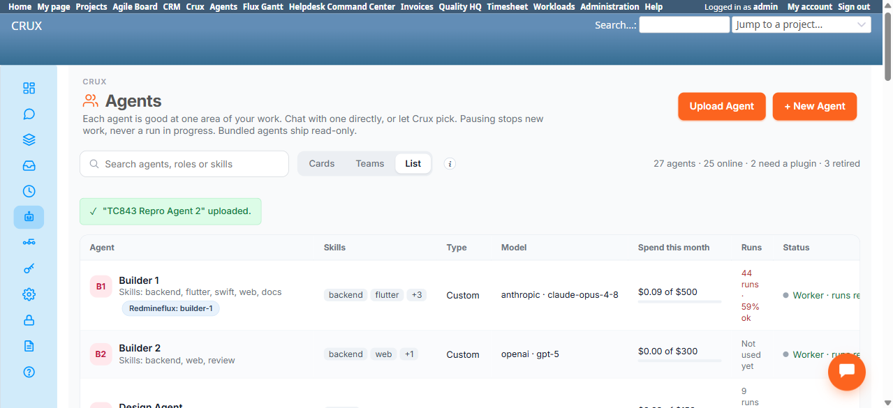

# Bug Report Template

- Bug ID: BUG-CRX-201
- Production Redmine Issue ID: #128847 (reported 2026-11-17, linked to Test Case #127937 / Run #607 / Environment "Window 11 + Chrome", marked Failed, assigned to Prashant Chaurasia)
- Title: Upload Agent accepts a non-.md file with no extension check at all, as long as its text content happens to parse as valid frontmatter
- Redmine version: 6.0-bookworm
- Plugin name: redmineflux_crux
- Plugin version: 0.98.0
- Environment: localhost:3015 (local Docker)
- Browser: Chromium (Playwright MCP)
- User role: admin
- Date: 2026-11-17

## Steps to reproduce

1. Log in as `admin` on `http://localhost:3015`, go to `/crux/agents`, click **Upload Agent**.
2. On the "Definition file" tab, choose a **`.txt`** file (not `.md`) whose content is valid frontmatter+prompt:
   ```
   ---
   id: tc843-repro2
   name: TC843 Repro Agent 2
   capabilities: [testing]
   ---

   # System prompt
   Reproduction for BUG-CRX-201 evidence screenshot.
   ```
3. The file picker accepts the `.txt` file with no warning and auto-fills "Raw content" from it.
4. Click "Upload".

## Expected result

- Per the dialog's own description ("A markdown file matching the agent template...") and **TC-CRX-843**'s
  documented expectation, a non-`.md` file should be refused with a clear rejection message, the same way a
  malformed-frontmatter `.md` file genuinely IS rejected (verified in the same session: a `.md` file with no
  `---` block produced a clean *"⚠ This file isn't in the agent template format..."* error).

## Actual result

- The upload **succeeds unconditionally**: `✓ "TC843 Repro Agent 2" uploaded.` — the agent is genuinely
  created (roster count incremented 26→27), fully functional (Chat link `/crux/ask?agent=tc843-repro2`
  present, 2 real runs logged in a first reproduction of this same scenario under a different id).
- Reproduced twice with two different `.txt` files (`tc843-bad-ext` and `tc843-repro2`), both succeeded
  identically — there is no file-extension validation of any kind. The only validation that exists is on the
  **content** (frontmatter format), not the file type, so any file whose text happens to parse as valid
  frontmatter is accepted regardless of its real extension (`.txt`, and by the same logic presumably `.json`,
  `.py`, `.anything`).
- This contradicts the dialog's own stated contract ("A markdown file matching the agent template") and
  **TC-CRX-843**'s explicit expectation that a non-`.md` file is refused.

## Evidence

### Screenshot



### Retest screenshot (fill after fix is verified)


### Console / log

- No console error on this path (the request succeeds, so there's nothing to log) — confirmed via a clean
  `POST /crux/agents` → 200, matching the same successful-create response shape as a genuine `.md` upload.
- Both fixture agents were retired immediately after reproduction to leave the environment clean (no paired
  Redmineflux user on either, so retiring needed no lock/cleanup beyond the checkbox confirmation).

## Duplicate check

- Duplicate found: No
- Existing bug reference (if duplicate): N/A — not a duplicate of the closed BUG-CRX-177/189 (those are about
  the **id** being a bundled agent's id, already correctly refused); this is a missing **file-type** check,
  an entirely separate validation gap on the same Upload Agent feature. First finding on file-extension
  enforcement specifically.

## Retest — 2026-11-18, CONFIRMED FIXED

- Build: `redmineflux_crux` plugin pulled to `3c5ffd2` (CRP-58 0.100.0), redmine restarted
  (`rails redmine:plugins:migrate` ran automatically).
- Repeated the exact original repro: created a fresh `.txt` file with valid frontmatter, chose it on the
  "Definition file" tab. Now correctly refused client-side: **"⚠ \"bug201-retest.txt\" isn't a Markdown
  file. Choose an agent file ending in .md."** — the Raw content box stayed empty (nothing auto-filled),
  Upload button never reachable with that file. No agent created.
- Per the dev's commit message (CRP-58): the controller also refuses a non-.md/.markdown filename
  server-side (400), so this isn't just a client-side-only check.
- Production issue #128847 synced: status In QA → Done, % done → 100, retest-summary comment added.
- **Status: Closed.**
