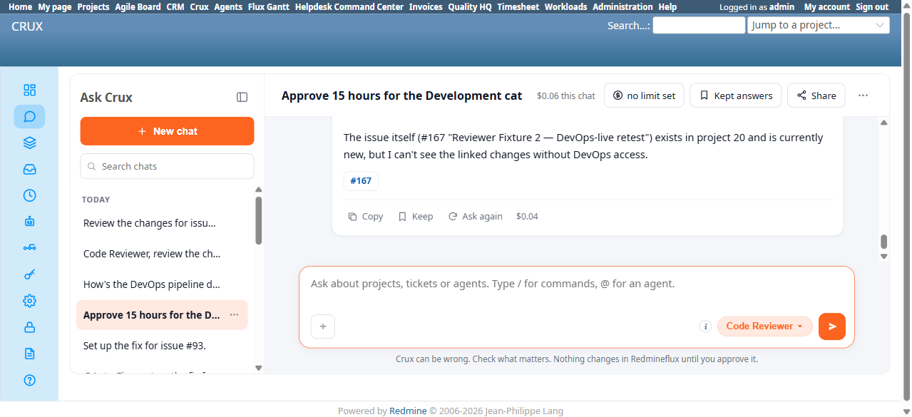

# Bug Report Template

- Bug ID: BUG-CRX-220
- Production Redmine Issue ID: #129140
- Title: Code Reviewer intermittently (1/3) falsely tells admin "DevOps plugin tools... are not available to your account" for a review that succeeds cleanly on the very next identical attempt
- Redmine version: 6.0-bookworm (local Docker, `C:\crux-redmine`, localhost:3015)
- Plugin name: redmineflux_crux
- Plugin version: crux-core 1.16.0 (CRC-122), mcp 1.0.13
- Environment: Local Docker QA stack
- Browser: Chromium (Playwright MCP)
- User role: admin
- Date: 2026-11-19

## Steps to reproduce

1. With the DevOps plugin installed and a real PR/commit/build linked to issue #167 (same fixture used by
   `CRUX_AGENT_CODE_REVIEWER.md` TC-CRX-625), pin Code Reviewer and ask (fresh chat each time): "Review the
   changes for issue #167" / "Code Reviewer, review the changes for issue #167 in the Crux DevOps Agent Test
   Project."
2. Repeat the identical question in 3 separate fresh chats, same session (admin), no changes to the
   underlying data between attempts.

## Expected result

- Every attempt should reach a genuine, evidence-grounded verdict — `ready` / `needs changes` / `can't tell`
  — per the agent's own manifest and TC-CRX-625's documented happy path. Admin should never be told a
  DevOps-plugin tool is unavailable to them; the MCP layer itself (`redmineflux_devops_project_summary`, same
  project) answers correctly every time when called directly.

## Actual result

- **Attempt 1:** *"Can't review #167. The DevOps plugin tools — pull requests, commits, and builds — are not
  available to your account. Your Redmineflux administrator needs to grant you permission to view those
  records."* — a false permission denial for the admin account itself.
- **Attempt 2** (fresh chat, identical question): *"Needs changes."* — correct, evidence-grounded verdict
  citing the real open PR #1, pending build #6, and commit `5fcd2015`. Matches TC-CRX-625's expected happy
  path exactly.
- **Attempt 3** (fresh chat, identical question again): *"Can't tell."* — also a valid, evidence-grounded
  verdict per the manifest's own accepted verdict set, citing the same real data.
- Only attempt 1's response is a defect — a false admin-permission denial, not a verdict at all. Confirmed via
  direct `redmineflux_devops_project_summary(project_id=20)` call (same admin-tied API key) that the DevOps
  data is genuinely reachable at the MCP/backend layer throughout — the denial is specific to this one chat
  turn, not a real permission gap.
- Non-deterministic: 1 false-denial out of 3 identical attempts. **Root-caused via `crux-core` server logs
  (not a Cloudflare tunnel/connectivity issue — ruled out: no tunnel was even running at the time, and the
  agent reads already-synced DevOps data from Redmineflux's own DB, not live from GitHub):**
  - Log trace for attempt 1 (`act:a52df53fd8b1`, `ses:ses-550`, 2026-11-19T12:19:29–40): the agent genuinely
    called and got real data back from `redmineflux_devops_list_pull_requests`, `list_commits`, and
    `issue_builds` (all `ok=true`) — yet its first-pass text output was the false denial anyway.
  - The server's own retry-on-false-denial mechanism caught this exact contradiction — log line:
    `chat retry (tool-unavailable) agent=code-reviewer first pass: 'Can't review #167...'` — and generated a
    retry response.
  - **The retry's (correct) answer was then discarded by design.** In `crux_core/askcrux/chat.py`
    (~line 3360-3373), the retry-preference logic is:
    ```python
    if retry_intent is not None or (retry_calls > 0 and (...)):
        text, proposal_intent = retry_text, retry_intent
    elif first_pass_reads > 0:
        pass   # keeps the ORIGINAL first-pass text
    ```
    Because the first pass already performed 3 real reads (`first_pass_reads > 0`), the `elif` branch fires
    and deliberately **keeps the original first-pass text** — on the documented assumption (comment
    references `CRC-117`) that "an answer built on what this turn read is kept when the retry adds nothing."
    That assumption doesn't hold here: the first pass *did* read real data but *still* emitted a
    self-contradictory denial, and the heuristic has no way to distinguish that from a legitimate
    read-grounded answer, so it protects the wrong text.
  - This is a genuine, reproducible server-side logic gap in the retry-preference heuristic — not environment
    flakiness, not a connectivity artifact, and not pure LLM non-determinism (the LLM's self-contradiction is
    plausibly non-deterministic, but the server then compounds it by actively suppressing its own correct
    retry).

## Evidence

### Screenshot



### Console / log

- Attempt 1 chat session: `ses-550`. Attempt 2: `ses-552` (needs changes, PASS). Attempt 3: `ses-553` (can't
  tell, also an acceptable verdict).
- Direct MCP verification (same admin key): `redmineflux_devops_project_summary(project_id=20)` → real data
  (1 build, 2 commits, 1 open PR, 1 connected repo) — confirms the backend/API layer never denied access.

## Duplicate check

- Duplicate found: No
- Existing bug reference (if duplicate): —
