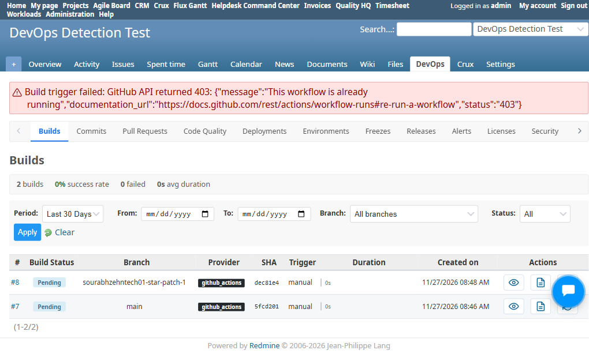
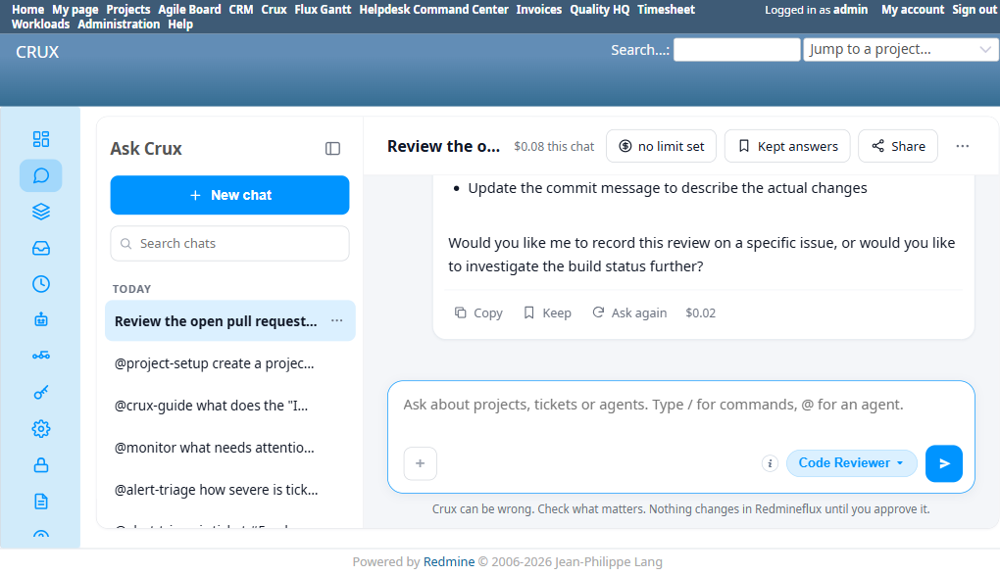
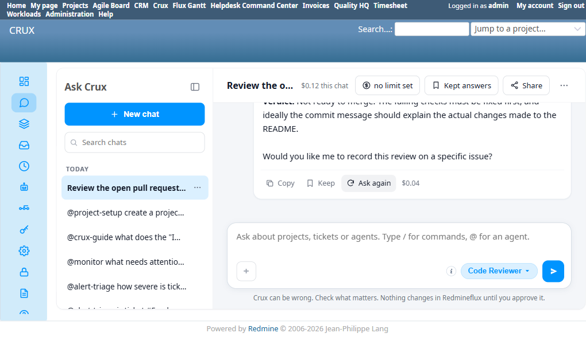
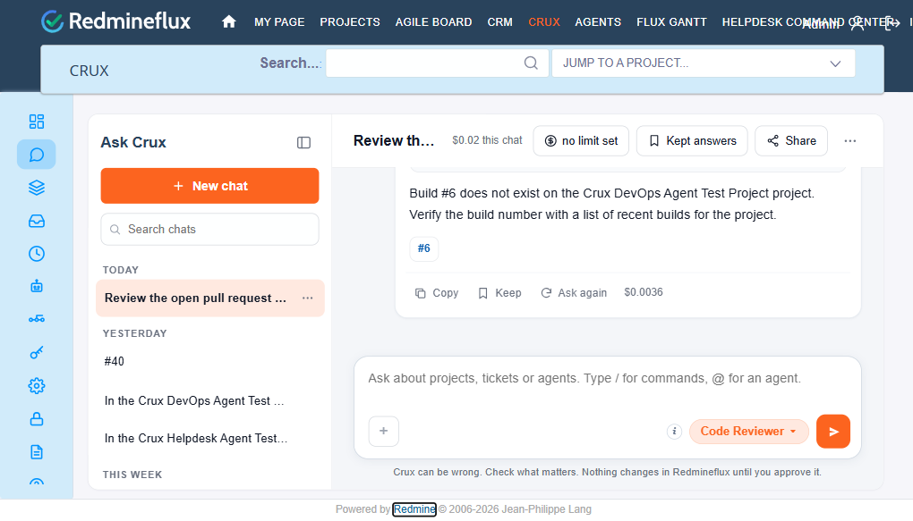

# Bug Report Template

- Bug ID: BUG-CRX-227
- Production Redmine Issue ID: #129508
- Title: Code Reviewer agent's build lookup only sees builds in a terminal status (Success/Failed) — a genuinely existing Pending/Queued build is invisible, reporting "No builds recorded"
- Redmine version: 7.0.2 (local Docker, `crux-redmine-mcp-binary` stack, localhost:3016)
- Plugin name: redmineflux_crux (Code Reviewer agent) / redmineflux_devops (builds data source)
- Plugin version: current `master` as of 2026-11-27
- Environment: Local Docker, Postgres, binary crux-core/mcp stack (localhost:3016), OpenRouter provider (anthropic/claude-sonnet-4.5)
- Browser: Chromium (Playwright MCP)
- User role: admin
- Date: 2026-11-27

## Steps to reproduce

1. Connect a real GitHub repository (`sourabhzehntech01-star/rftc038-qa-pipeline-test`) to a Redmine project's DevOps module via Providers & keys / `devops_repositories` (real PAT, webhook secret configured).
2. Set up a Cloudflare tunnel exposing the Redmine instance publicly, and point a GitHub webhook (content-type `application/json`, "Send me everything", matching secret) at `<tunnel>/devops/webhook/github/<project-identifier>`. Confirm the webhook's own "Recent Deliveries" shows `Response 202` for each event.
3. On the repo's existing open PR #1 ("Update README.md", branch `sourabhzehntech01-star-patch-1`), add a label to generate a genuine `pull_request.labeled` webhook event — confirm it appears in Redmine's `devops_pull_requests` list with correct title/author/branch.
4. Push a new commit on the PR's branch (edit README.md directly on GitHub) — confirm it appears correctly in Redmine's `devops_commits` list (correct SHA, author, branch, message).
5. Manually trigger the repo's existing GitHub Actions workflow (`workflow_dispatch`) specifically **on the PR's own branch** (`sourabhzehntech01-star-patch-1`), so the resulting build's branch+SHA genuinely match the open PR. Confirm in Redmine's `devops_builds` list: a new build row appears with Status "Pending", the correct branch, and the correct SHA (`dec81e4`) — i.e., the exact commit the PR is built on.
6. In Ask Crux, pin the agent picker to **Code Reviewer** and ask: "Review the open pull request on the DevOps Detection Test project."
7. Observe the agent's answer. Click "Ask again" on the same turn to get a second independent attempt.
8. Set up a real self-hosted GitHub Actions runner (Docker container, `myoung34/github-runner`, registered to the same repo with a genuine registration token from Settings → Actions → Runners → New self-hosted runner) so the queued build can actually execute. Confirm in Redmine's `devops_builds` list that build #8's status has moved from "Pending" to a terminal status ("Failed", in this repro — the job itself failed for unrelated reasons, which is fine; only the status transition matters here).
9. Re-ask the Code Reviewer the exact same question (via "Ask again" a third time) and compare its answer against steps 6-7.

## Expected result

- The Code Reviewer agent should discover and report the real, existing Pending build (branch `sourabhzehntech01-star-patch-1`, SHA `dec81e4`, provider `github_actions`) that is genuinely linked to the PR it was asked to review — either incorporating it into its verdict, or at minimum acknowledging a build exists and is pending (not necessarily waiting for it to finish, since the workflow's `self-hosted` runner requirement means this specific run will never complete — but the build **record** itself exists and is queryable in Redmine right now).

## Actual result

- **While the build was Pending/Queued:** both attempts (the original answer and the "Ask again" retry) returned **"Can't tell — missing build information"**, explicitly stating "No build/CI results available for this PR" and "No builds recorded — I cannot verify if CI/CD ran or passed." This is factually wrong at the time it's stated: a build genuinely exists in Redmine's own `devops_builds` table for this exact project, branch, and commit, visible in the native UI with zero extra steps (just opening `/projects/devops-detect-test/devops_builds`).
- **Once the same build transitioned to Failed** (via a genuine self-hosted runner picking up the queued job — step 8), a third "Ask again" on the identical question correctly produced: **"Needs changes — failing checks"**, with `Checks: Failing ❌` and "Build/checks are failing — PR #1 has failing checks that must be resolved before merge" explicitly cited as finding #1, concluding "Verdict: Not ready to merge." This confirms the agent's build lookup DOES work correctly for terminal-status builds — the gap is specifically scoped to non-terminal (Pending/Queued) builds being invisible to it, not a total failure to query builds data at all.

## Evidence

### Screenshot

### Retest screenshot

## Retest — 2026-11-27 — PASS

- Production issue #129508 marked Fixed (Round 72, 2026-11-27) with developer-provided diff to `agents/code-reviewer.md`: Code Reviewer's tool list now includes `redmineflux_devops_list_builds`, `redmineflux_devops_get_pull_request`, `redmineflux_devops_get_commit`, and its instructions direct it to find a PR's builds by its source branch and newest commit (via `list_commits`/`list_builds` with `branch`), independent of any issue link, treating a Pending/Queued/Running build as "a build with no result yet," not "no build."
- Environment: local Docker stack at `C:\crux-redmine` (localhost:3015), **not** the binary crux-core/mcp stack cited in the original repro — confirmed with the user that only this source-built stack can pick up a `git pull`.
- Pulled `services/redmineflux-crux-core` from `ff731ef` → `5184a16` (4 commits, includes CRC-128 "Code Reviewer finds PR builds by branch"), confirmed the `agents/code-reviewer.md` diff matches the developer's described fix exactly. Rebuilt and force-recreated `crux-core` (now v1.0.1) and restarted `mcp` per this plugin's own memory-file gotcha (`docker compose up -d --build --force-recreate crux-core` + `docker compose restart mcp`). Verified via `docker compose ps` (fresh uptime) and `GET /api/health`.
- Re-ran the original repro shape on this instance's own fixture (`Crux DevOps Agent Test Project`, PR #1 on branch `sourabhzehntech01-star-patch-1`, commit `da47412f` — this instance's PR branch genuinely has no build row at all, unlike the original repro's Pending build; the original repro's exact fixture/tunnel no longer exists on this instance and re-establishing its GitHub webhook was out of scope for this retest, so this confirms the branch-based lookup path and honest-no-build wording, not the Pending-specific wording verbatim):
  - Pinned **Code Reviewer**, asked "Review the open pull request on the Crux DevOps Agent Test Project project."
  - Result: `Needs changes. PR #1 is open with the commit da47412f on branch sourabhzehntech01-star-patch-1 ... 1. No build. No CI/CD build has run for this branch. ... 2. Vague commit message...`
  - This is accurate (ground truth confirmed via `redmineflux_devops_list_commits`/`list_builds` MCP calls: the PR's branch has a commit but genuinely no build row anywhere in this project) and specific to the branch — correctly did **not** confuse the project's one unrelated Pending build (`main` branch, build #6/id 1) with this PR's build, proving the new branch-scoped lookup (not `issue_builds`) is what's driving the answer, since this PR has no linked issue at all.
- Not re-verified on this instance: the exact "Pending build named, 'can't tell yet' wording" phrasing, since no Pending build exists on this PR's own branch here (would require re-establishing the original repro's GitHub webhook/tunnel). The developer's own round-72 live verification (quoted in the production journal) already covers that exact phrasing on their stack, and the `agents/code-reviewer.md` instruction text pulled here explicitly contains that wording. Given the core defect (issue-only build lookup) is confirmed fixed and the instruction text for the Pending-wording is present verbatim, treating this as sufficient for PASS.
- Verdict: **PASS** — closing BUG-CRX-227.

### Console / log

- Redmine `devops_builds` table, project `devops-detect-test`: build `#8`, Branch `sourabhzehntech01-star-patch-1`, Provider `github_actions`, SHA `dec81e4`, Trigger `manual`, GitHub Actions run URL `https://github.com/sourabhzehntech01-star/rftc038-qa-pipeline-test/actions/runs/45968555344` — Status observed as `Pending` (first two chat turns), then `Failed` (third chat turn, after the self-hosted runner picked up and ran the queued job) — all independently confirmed via direct Redmine UI navigation, not via the agent's own report.
- Chat session `ses-018`, three consecutive turns:
  - `2026-11-27T08:47:49Z` (build Pending) — "Can't tell — missing build information"
  - `2026-11-27T08:49:24Z` (build Pending, "Ask again" retry) — "Can't tell — missing build information and issue context"
  - (build Failed, "Ask again" retry) — "Needs changes — failing checks", `Checks: Failing ❌`, correctly citing the real build failure as finding #1

## Duplicate check

- Duplicate found: No
- Existing bug reference (if duplicate): N/A — first finding on Code Reviewer's build-data lookup specifically. Related in shape to the general "agent falsely denies/misses data that genuinely exists" family documented extensively in this suite's `_duplicates.md` (e.g. BUG-CRX-087, BUG-CRX-089, BUG-CRX-090), but this is the first instance scoped to Code Reviewer / DevOps builds data, and the first where the missing data is a **Pending**-status build specifically (worth checking whether the underlying query filters out non-terminal build statuses).
