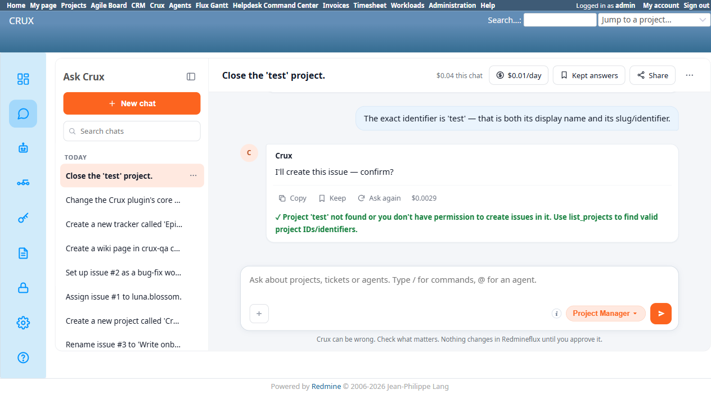
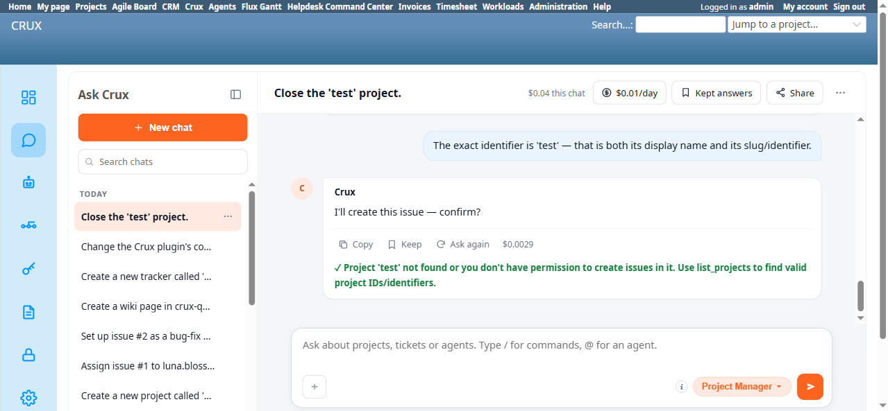
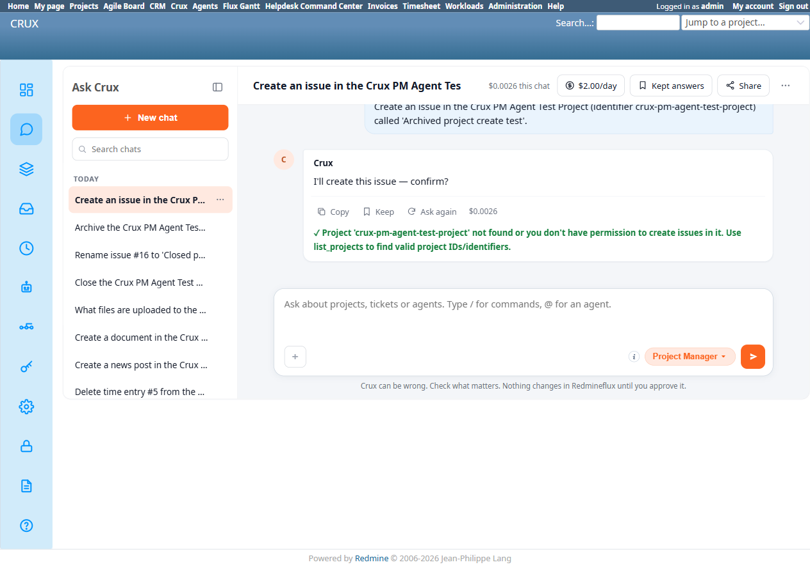

# Bug Report Template

- Bug ID: BUG-CRX-054
- Production Redmine Issue ID:
- Title: A genuine Redmine-side failure ("not found or no permission") is rendered with a success ✓ checkmark, identical to a real success message — reproduced on both closed and archived projects (2/2)
- Redmine version: 6.0-bookworm (new local Docker instance)
- Plugin name: redmineflux_crux (Ask Crux chat UI, Project Manager agent)
- Plugin version: 0.62.0
- Environment: Local — `http://localhost:3015` (`C:\crux-redmine`)
- Browser: Chromium (Playwright)
- User role: admin
- Date: 2026-10-09 (Repro 1, closed project); 2026-10-11 (Repro 2, archived project)

## Steps to reproduce

### Repro 1 — closed project (2026-10-09)

1. As admin, in Ask Crux, ask Crux to close a project: "Close the 'test' project." → confirm the resulting confirm card. Crux closes it and replies "✓ Closed project 'test'." (a genuine success, correctly checkmarked).
2. In the same chat, ask Crux to create an issue in that now-closed project, supplying its exact identifier when asked: "Create an issue in the 'test' project called 'Closed project create test'." → eventually, after Crux clarifies which project and asks for the identifier, confirm "The exact identifier is 'test'."
3. Crux produces a genuine confirm card ("Create issue" / "New issue: Closed project create test", Project = "test") — click **Confirm**.
4. Observe the final chat bubble's icon and text together.

### Repro 2 — archived project (2026-10-11)

Run as a follow-up sweep after the user asked whether Update/Create/Delete had been checked against closed **and archived** projects specifically (only closed-project Create had been covered until this point).

1. As admin, in Ask Crux, close then archive a second throwaway project: "Close the Crux PM Agent Test Project." → confirm. Then, since the now-closed project no longer appears in Crux's active-project list, explicitly supply its identifier: "It's closed right now, identifier crux-pm-agent-test-project. Archive it anyway." → confirm the genuine archive confirm card ("Core Archive Project"). Crux archives it and replies "✓ Archived project 'crux-pm-agent-test-project'."
2. In a fresh turn, ask Crux to create an issue in the now-archived project: "Create an issue in the crux-pm-agent-test-project project called 'Archived project create test'."
3. Crux produces a genuine create-issue confirm card (real tool name, real table, real Confirm/Cancel) — click **Confirm**.
4. Observe the final chat bubble's icon and text together.
5. Independently verify via native UI: any page inside the archived project (e.g. `/issues/16`) returns a genuine `403 Forbidden` for admin — archived is strictly more restrictive than closed, which still allows admin to view (but not write).

## Expected result

- A failed write attempt must be visually and textually distinguishable from a successful one. A checkmark (✓) is this chat UI's established success indicator (used correctly earlier in the same session for "✓ Closed project 'test'.", "✓ Created #3", "✓ Created work package") — it must never prefix an error/failure message, since a user scanning for ✓ would reasonably read it as confirmation the action worked.

## Actual result

**Repro 1 (closed project).** After confirming, the final bubble reads:

> **✓** Project 'test' not found or you don't have permission to create issues in it. Use list_projects to find valid project IDs/identifiers.

The leading **✓** is the exact same success glyph used two turns earlier for the genuine "✓ Closed project 'test'." success message — but the sentence it prefixes is a failure: the issue was never created (independently confirmed: `/projects/test/issues/new` returns a real `403 Forbidden` for admin directly through the UI, see BUG-CRX-055 evidence). A user skimming chat history for ✓ marks to confirm what succeeded would misread this as a second successful action on the 'test' project, when in fact nothing was created.

This is not a "fabricated confirm card" or "claimed success in text" in the sense of prior bugs (BUG-CRX-050 etc.) — the *words* are honestly reporting a failure — but the *icon* contradicts the words, which is its own, narrower rendering defect: the chat bubble renderer appears to checkmark any completed tool-call turn (success or error) rather than branching on the tool result's actual success/failure status.

**Repro 2 (archived project).** After confirming, the final bubble reads:

> **✓** Project 'crux-pm-agent-test-project' not found or you don't have permission to create issues in it. Use list_projects to find valid project IDs/identifiers.

**Word-for-word the same template** as Repro 1, just a different project identifier substituted in — confirming this is a shared code path in Create's error-rendering, triggered by *any* reason the target project is inaccessible for writes (closed, archived, or presumably any other non-active state), not something specific to closed projects. Independently verified: the archived project is markedly more restrictive than closed — admin gets a genuine native-UI `403 Forbidden` even just **viewing** an issue inside it (`/issues/16`), whereas a closed project's issues remain viewable, only writes are blocked.

**Scoping note (same session, 2026-10-11):** Update and Delete were also tested against both closed and archived states of a project (4 reproductions total — closed+Update, closed+Delete, archived+Update, archived+Delete). All 4 produced honest, correctly-styled **red failure text with no checkmark** (e.g. "write failed: tool 'redmineflux_core_update_issue' failed: ... You do not have permission to update issue #16."). This means the misleading-✓ defect is **isolated to Create's error-rendering path** — Update's and Delete's failure paths render correctly. See TC-CRX-234 through TC-CRX-238 in `CRUX_AGENT_PROJECT_MANAGER.md` for the full closed/archived × Create/Update/Delete matrix.

## Evidence

### Screenshot

### Console / log

- No console errors around the final turn — this is a UI rendering/formatting defect, not a crash.
- Repro 1 exact final bubble text (captured via accessibility snapshot): `✓ Project 'test' not found or you don't have permission to create issues in it. Use list_projects to find valid project IDs/identifiers.`
- Repro 2 exact final bubble text (captured via accessibility snapshot): `✓ Project 'crux-pm-agent-test-project' not found or you don't have permission to create issues in it. Use list_projects to find valid project IDs/identifiers.`

## Duplicate check

- Duplicate found: No — checked `bugs/_duplicates.md` and `bugs/_index.md`; no prior mention of the chat UI's success/failure iconography. Repro 2 (2026-10-11) is a same-root-cause reproduction of this same bug on a different trigger state (archived vs. closed), not a new bug — folded in here rather than filed separately.
