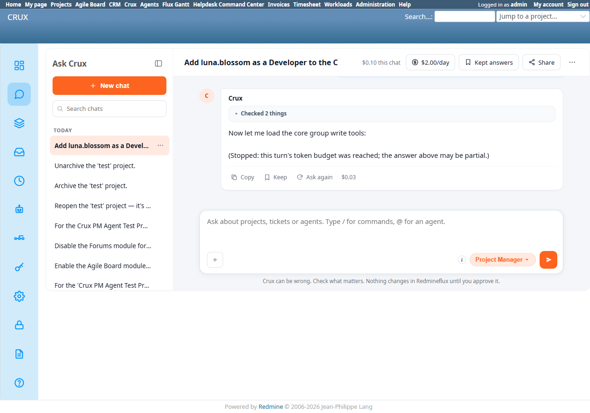
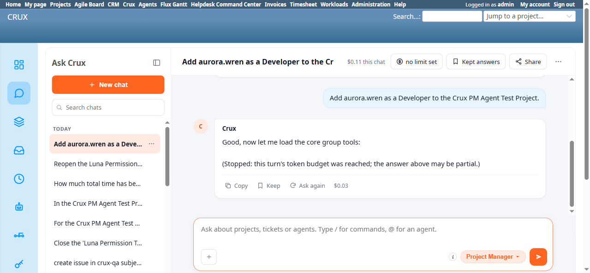

# Bug Report Template

- Bug ID: BUG-CRX-060
- Production Redmine Issue ID: #123102
- Title: Per-turn token-budget stall during tool-discovery, before the real write tool is ever reached — 6/6 reproductions across 2 entity domains (Members Create, Version Create), confirmed independent of permission state
- Redmine version: 6.0-bookworm (new local Docker instance)
- Plugin name: redmineflux_crux (Ask Crux chat UI, Project Manager agent)
- Plugin version: 0.62.0
- Environment: Local — `http://localhost:3015` (`C:\crux-redmine`)
- Browser: Chromium (Playwright)
- User role: admin
- Date: 2026-10-10

## Steps to reproduce

### Repro 1 — Members Create, admin (2026-10-10)

1. As admin, in a fresh Ask Crux chat (Project Manager agent): "Add luna.blossom as a Developer to the Crux PM Agent Test Project."
2. Observe the reply never reaches a proposal/confirm card — it cuts off mid-sentence with "(Stopped: this turn's token budget was reached; the answer above may be partial.)"
3. Click "Ask again" on the same message.
4. Observe the exact same stall again, on a different sentence this time, but the same outcome: no confirm card, no Confirm/Cancel buttons, nothing actionable produced.

### Repro 2 — Version Create, non-admin, both without and with the real permission (2026-10-12, `CRUX_AGENT_PROJECT_MANAGER.md` TC-CRX-243)

Run as a spot-check after BUG-CRX-056 was found to be permission-independent (TC-242), to check whether other entity-domain write failures in this suite share that same characteristic.

1. As a non-admin user (`luna.blossom`, Manager role, `manage_versions` confirmed `false` via Rails) on her own project: "Create a new version called v1.0 for the Luna Permission Test Project, due date 2027-01-01." → stalled identically to Repro 1: *"Good — the `core` group has 37 write tools. Let me load them.(Stopped...)"*
2. "Ask again" → stalled again: *"Now let me load the core group's 37 write tools.(Stopped...)"* — 2/2 without permission.
3. Granted `manage_versions` on the Manager role (verified via Rails `allowed_to?` → `true`).
4. Identical request, fresh chat → stalled again: *"Now let me load the core group tools to access version creation.(Stopped...)"*
5. "Ask again" → stalled a 4th time: *"Let me get the full group list first:(Stopped...)"* — 2/2 with permission, 4/4 total.
6. Independently verified via native UI (`/projects/luna-permission-test-project/settings/versions`) both before and after granting the permission: "No data" — nothing created either time.

## Expected result

- A genuine confirm card naming a real member-creation tool (e.g. `Core Create Project Membership`), with a detail table (project, user, role) and real Confirm/Cancel buttons — consistent with every other successful write this session (Close/Reopen/Archive/Unarchive all produced a clean confirm card on the first try).
- If the request genuinely cannot be fulfilled, an honest, clear refusal message — not a silent mid-sentence cutoff.

## Actual result

**Repro 1 (Members Create, admin).** Both attempts (2/2) stall identically, never reaching a confirm card or any actionable output:

- **Attempt 1:** "Great — the **core** group has 37 write tools. Let me load them to find the `create_project_membership` tool:(Stopped: this turn's token budget was reached; the answer above may be partial.)"
- **Attempt 2 ("Ask again"):** "Now let me load the **core** group write tools:(Stopped: this turn's token budget was reached; the answer above may be partial.)"

Both turns show `tool_calls=7` in the crux-core log (`docker logs crux-redmine6-crux-core-1`), each making 6 OpenRouter LLM round-trips before the server-side turn budget cuts it off — the agent is burning its entire per-turn budget discovering which of the "core" group's 37 write tools is the right one, and never gets far enough to actually call `create_project_membership` or propose anything. Confirmed via log: both turns end `outcome=success` at the HTTP layer (the API call itself didn't error) but the chat content is genuinely incomplete, not a fabricated success — no write was attempted, and the project's Members tab independently shows "No data" both before and after (verified via native UI, `/projects/crux-pm-agent-test-project/settings/members`).

**Repro 2 (Version Create, non-admin, without AND with permission).** All 4 attempts stall identically — 2 without `manage_versions`, 2 more after it was genuinely granted. Granting the permission made zero observable difference to the stalling behavior, same conclusion independently reached for BUG-CRX-056 (project field updates) and BUG-CRX-061 (the false-denial family, see its own file). **This is the most significant finding of this bug's extension**: the identical Version-create request gets a **different failure shape depending on who's asking** — admin gets BUG-CRX-061's quick 1-2-tool-call false denial for this exact request (see that suite's earlier admin-tier Version-create repros), while non-admin burns the entire turn budget on tool discovery before reaching either a real tool call or even a false-denial conclusion. This suggests non-admin requests carry additional permission-scoping/context overhead in the agent's own reasoning, which can push an already-broken request from "fails fast with a wrong answer" (BUG-CRX-061) to "never finishes at all" (this bug) — a plausible shared root cause between the two bugs worth the dev team investigating together, not as unrelated defects.

This makes "add a member" and "create a version" via chat **completely non-functional** — not a false-success or false-failure, but a dead end: the user gets a half-sentence and a token-budget notice with no way to proceed, no confirm card to act on, and no clear statement that the action failed or needs to be retried differently. **Now confirmed across 2 entity domains (Members, Versions) and 3 caller states (admin, non-admin without permission, non-admin with permission) — 6/6 reproductions, zero dependency on who's asking or what they're allowed to do.**

## Evidence

### Screenshot

### Console / log

- crux-core (`docker logs crux-redmine6-crux-core-1`), Repro 1 attempt 1: `chat turn agent=project-manager ... tokens_in=159615 tokens_out=662 tool_calls=7 outcome=success` (19.5s latency, 6 LLM round-trips).
- crux-core, Repro 1 attempt 2 (Ask again): `chat turn agent=project-manager ... tokens_in=159865 tokens_out=585 tool_calls=7 outcome=success` (14.0s latency, 6 LLM round-trips).
- Both Repro 1 calls' tool trace shows only `redmineflux_core_list_projects` and `redmineflux_core_list_users` actually executing — never reaching a membership-creation tool call before the budget cutoff.
- Repro 2: all 4 attempts (2 without `manage_versions`, 2 with) produced the same `(Stopped: this turn's token budget was reached...)` cutoff text, each on a different partial sentence. Native UI (`/projects/luna-permission-test-project/settings/versions`) confirmed "No data" both before and after granting the permission — no version was ever created in any of the 4 attempts.

## Retest — 2026-10-12 (STILL BROKEN)

Retested live after the Crux stack rebuild (fresh `mcp`/`crux-core` builds, confirmed healthy via 498-tool catalog).

- Re-sent "Add luna.blossom as a Developer to the Crux PM Agent Test Project." — stalled again with the same per-turn token-budget cutoff before ever reaching a confirm card, reproduced 2/2.
- Independently confirmed via native UI that no membership was created.

Not reported as fixed — left in `bugs/open/`, no production status sync performed.

## Retest — 2026-10-26 (STILL BROKEN)

Retested live on a freshly rebuilt instance (new laptop, Docker stack recreated from `C:\crux-redmine`, fresh pulled code for `redmineflux_crux`/`redmineflux-crux-core`/`redmineflux-mcp`; empty DB reseeded with the minimum fixture — `Developer` role, `luna.blossom` user, `Crux PM Agent Test Project`). Confirmed healthy infra first: MCP catalog 488 tools/12-14 plugins, OpenRouter key verified live, Core service URL fixed.

- Re-sent "Add luna.blossom as a Developer to the Crux PM Agent Test Project." — stalled identically: *"Now let me load the core write tools to access project membership creation.(Stopped: this turn's token budget was reached; the answer above may be partial.)"*
- "Ask again" — stalled again on a different sentence: *"Let me check what groups are actually available:(Stopped: this turn's token budget was reached; the answer above may be partial.)"* — 2/2, same outcome as every prior retest.
- Independently confirmed via native UI (`/projects/crux-pm-agent-test-project/settings/members`) — "No data", no membership ever created.

Not reported as fixed — left in `bugs/open/`, no production status sync performed.

## New repro — 2026-10-26, Spent Time domain, non-admin WITH `log_time` permission (TC-CRX-269)

Per explicit user request to check whether Spent Time / Log Time had ever been tested as non-admin (without/with permission) — it had not; only admin (TC-CRX-226–228). Closed the gap: `luna.blossom` (Manager role, `log_time` permission genuinely granted, confirmed via exact-match DB check) sent "Log 2 hours of Technical Support time on issue #1 in the Crux PM Agent Test Project, dated today, with a comment 'testing time log via chat'." Stalled identically: *"Time entry creation should be in the `core` group's write tools. Let me load those.(Stopped: this turn's token budget was reached; the answer above may be partial.)"* Independently verified via native UI (`/projects/crux-pm-agent-test-project/time_entries`) — "No data", no write occurred. This is a 4th entity domain (after Members, Version, and now Spent Time) where the stall reproduces, and it reproduces specifically on the "with the real permission genuinely present" half — consistent with this being permission-independent. See `testcases/CRUX_AGENT_PROJECT_MANAGER.md` TC-CRX-268–269 for the full without/with pair (the "without" half hit BUG-CRX-061's false-denial shape instead — see that bug's file).

## New repro — 2026-10-26, Members Create, non-admin WITHOUT `manage_members` permission (TC-CRX-270)

Closing the same coverage gap for Members Create (previously only ever tested as admin, TC-CRX-207). `luna.blossom` with `manage_members` explicitly removed (confirmed via exact-match DB check) sent "The login is \"admin\". Add them as a Reporter to the Crux PM Agent Test Project." — stalled identically: *"Let me check the actual group names:(Stopped: this turn's token budget was reached...)"* No membership was created (verified via native UI). Notably, the WITH-permission half of this same pair (TC-CRX-271) instead hit BUG-CRX-061's false-denial shape — the opposite assignment from the Spent Time pair (TC-268/269), reinforcing that which shape fires is not tied to permission state at all.

## New repro — 2026-10-26, Issue Categories Create, non-admin WITHOUT `manage_categories` permission (TC-CRX-272)

Same coverage gap closed for Issue Categories (previously only admin, TC-CRX-216). `luna.blossom` with `manage_categories` removed sent "Create a new issue category called 'Permission Test Category'..." — stalled identically: *"Good — the `core` group has 37 write tools. Let me load it to find the issue category creation tool.(Stopped...)"* No category was created (verified via native UI — still exactly the original 13). The WITH-permission half (TC-CRX-273) hit BUG-CRX-061's false-denial shape instead.

## New repro — 2026-10-26, Documents Create, non-admin WITHOUT `add_documents` permission (TC-CRX-276)

Same coverage gap closed for Documents (previously only admin, TC-CRX-230). `luna.blossom` with `add_documents` removed sent "Create a document in the Crux PM Agent Test Project titled 'Permission Test Document'..." — stalled identically: *"Great. The core group has 37 write tools. Let me load those tools:(Stopped...)"* No document was created (verified via native UI). The WITH-permission half (TC-CRX-277) hit BUG-CRX-061's false-denial shape instead (see full audit summary in `testcases/CRUX_AGENT_PROJECT_MANAGER.md` after TC-CRX-277 — 5 entity domains now confirmed permission-independent total).

## New repros — 2026-10-26, closing the admin-tier CRUD gap for News/Wiki Update (TC-CRX-281, 282, 285)

Per explicit user follow-up to test every remaining CRUD gap: **News Update** ("can you update the 'Sprint kickoff' news post...") stalled identically to this bug's standard shape — *"Good — the `core` group has write tools. Let me load them:(Stopped...)"*. **News Delete** stalled too (*"Let me check the available groups again:(Stopped...)"*). **Wiki Update** ("add a line to the team norms wiki page...") also stalled (*"Let me list the actual available groups:(Stopped...)"*). All 3 independently verified via native UI as unchanged. News and Wiki previously only had Create tested (both already known-broken via BUG-CRX-061) — their Update/Delete write paths are now also confirmed broken, via this bug's stall shape specifically.

## New repro — 2026-10-26, Members Delete, non-admin WITHOUT `manage_members` permission (TC-CRX-288)

`luna.blossom` with `manage_members` removed and DB-verified absent sent "aurora wren (user id 15) isn't working on the crux pm agent test project anymore, can you remove her from the project members?" — got the standard stall: *"Good— `core` has 37 write tools. Let me load them.(Stopped: this turn's token budget was reached; the answer above may be partial.)"* — at **$0.08, 167,684 input tokens** for a turn that never reached an answer. Verified via native UI: Aurora Wren still a member (Reporter). This mirrors Members Create's already-established stall (this bug's original scope) and completes Members' CRUD-pair symmetry with Update (BUG-CRX-077/061 split, TC-CRX-287): Members now has every write operation (Create, Update, Delete) confirmed broken, with the specific failure shape varying by permission state.

## New repro — 2026-10-26, Versions Delete, non-admin WITH `manage_versions` permission (TC-CRX-290)

`luna.blossom` with `manage_versions` genuinely re-granted and DB-verified present sent the identical Versions Delete request — got the standard stall: *"Now let me load the core group's write tools:(Stopped: this turn's token budget was reached; the answer above may be partial.)"* at $0.03, 166,913 input tokens. Verified via DB: v1.0 still exists, unchanged. This is the inverse pairing of the WITHOUT-permission half (which instead hit BUG-CRX-061's false-denial shape, naming and denying the genuinely-existing `delete_version` tool) — Versions Delete now joins Members Update/Delete as entity operations where the specific broken-answer shape flips depending on permission state, with neither state ever reaching a working outcome.

## Duplicate check

- Duplicate found: No — checked `bugs/_duplicates.md` and `bugs/_index.md`. Not the same as the cost/day-level spend-reminder issue (BUG-CRX-053, which is about a *daily* spend threshold never firing) — this is a *per-turn* token-budget ceiling being hit during tool discovery, a different mechanism and a different, more severe symptom (the action never completes at all, regardless of cost). Also distinct from the fabricated-confirm family (BUG-CRX-020/056) — those produce a fake confirm card with no real buttons; this produces no confirm card of any kind, fake or real, and visibly tells the user it was cut off rather than pretending to have an answer.
