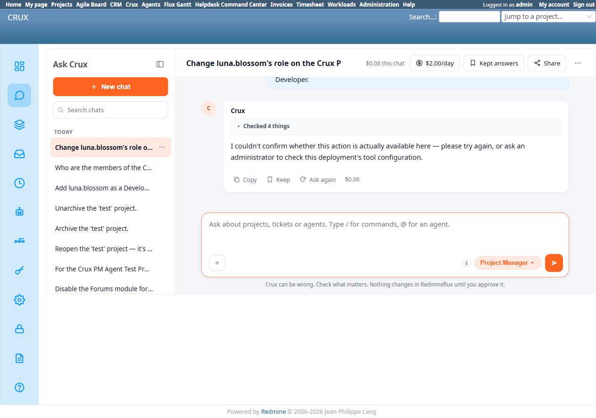
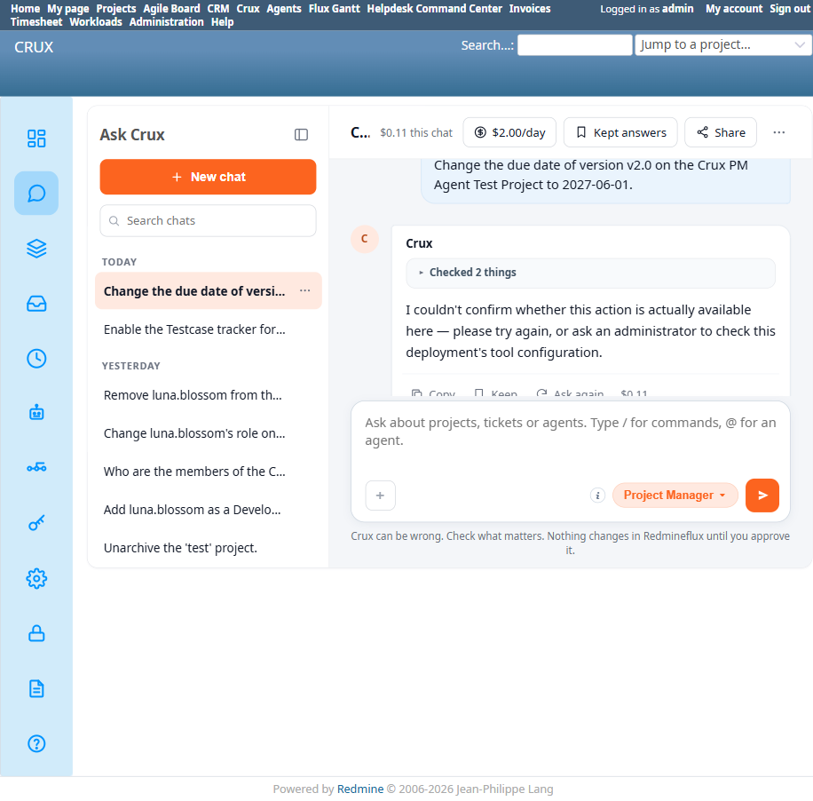
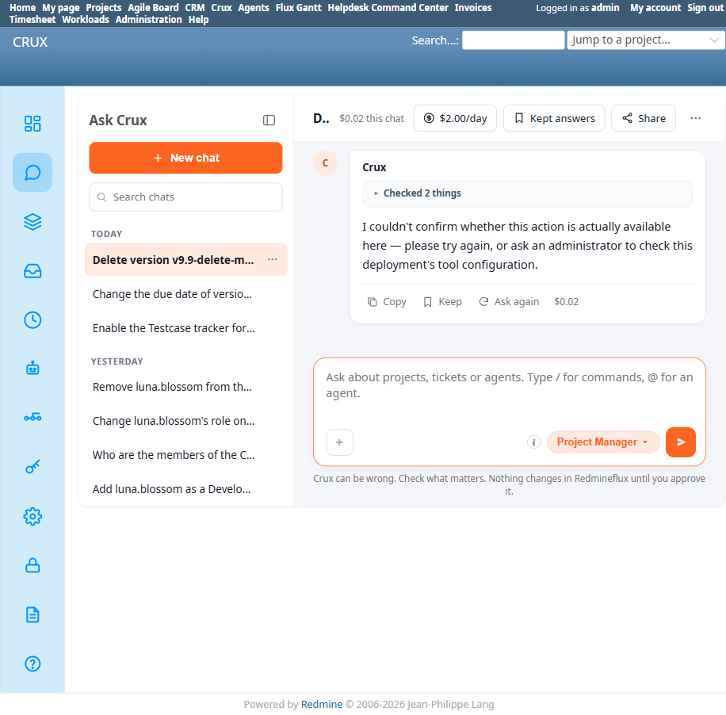
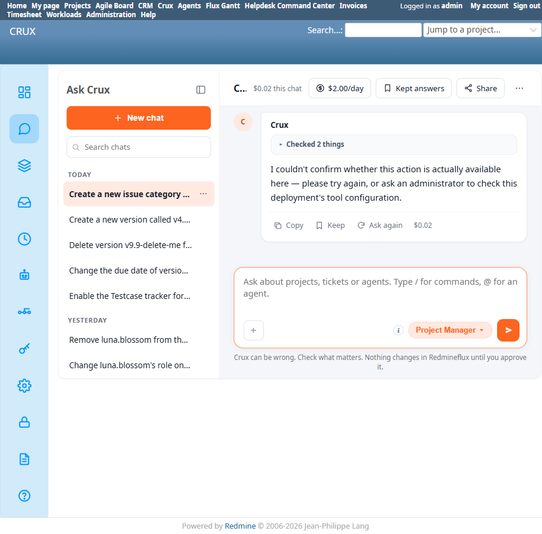
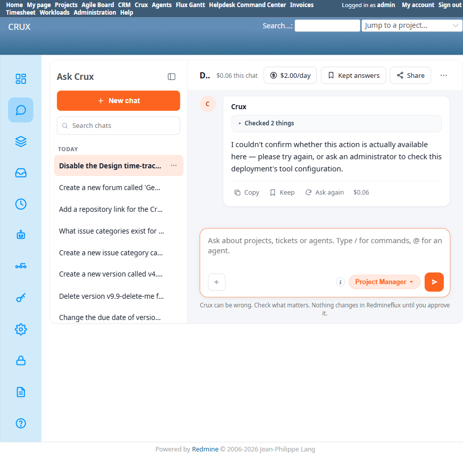
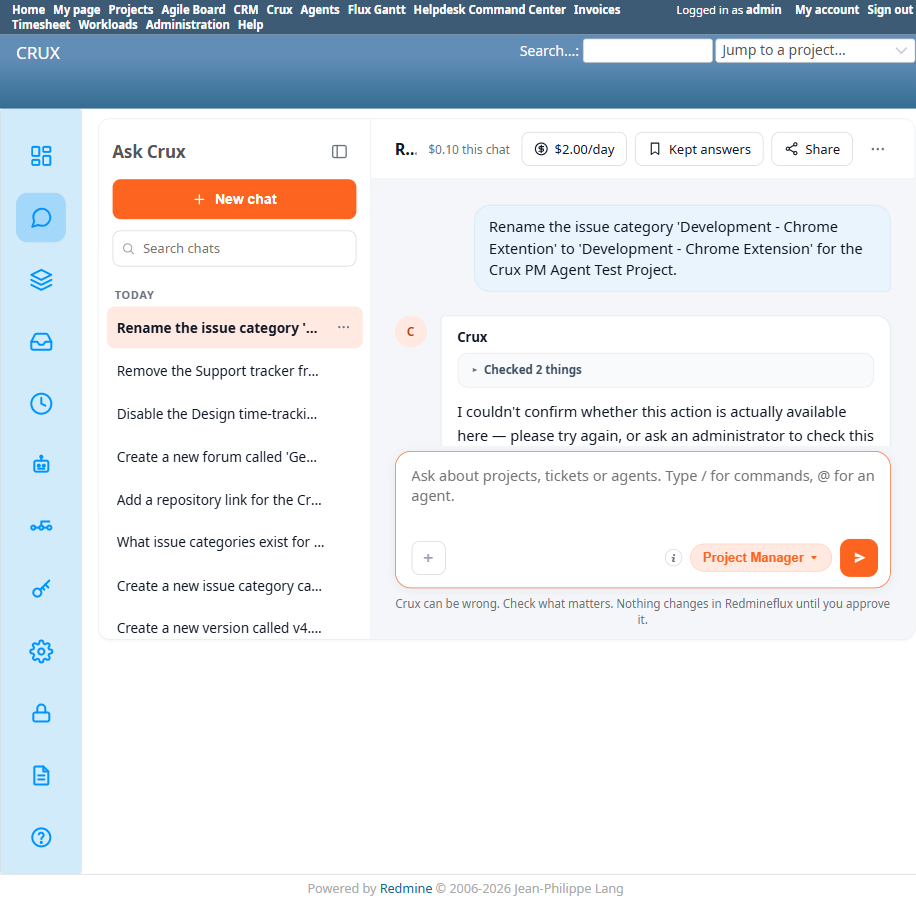
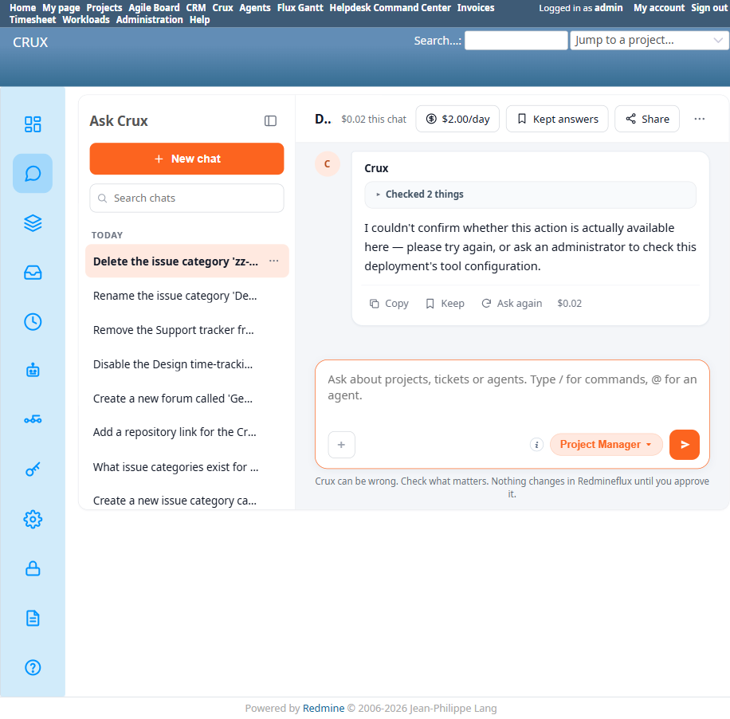

# Bug Report Template

- Bug ID: BUG-CRX-061
- Production Redmine Issue ID:
- Title: Project Manager falsely claims it "couldn't confirm whether this action is actually available here" — 9/9 reproductions across 4 entity domains (membership role-update, version create ×2/update/delete, issue-category create/update/delete, time-tracking-activity disable) — 7 of the 9 under a freshly-restarted, confirmed-healthy 495-tool MCP catalog — even though the real tools genuinely exist and the agent had already resolved every id it needed; Issue Categories is the first entity type where the entire CRUD set fails identically
- Redmine version: 6.0-bookworm (new local Docker instance)
- Plugin name: redmineflux_crux (Ask Crux chat UI, Project Manager agent)
- Plugin version: 0.62.0
- Environment: Local — `http://localhost:3015` (`C:\crux-redmine`)
- Browser: Chromium (Playwright)
- User role: admin
- Date: 2026-10-10

## Steps to reproduce

**Repro 1 — member role update:**
1. As admin, via native UI, add `luna.blossom` to the "Crux PM Agent Test Project" with the **Reporter** role (fixture setup — confirmed via `/memberships/3/edit`, membership id=3).
2. In a fresh Ask Crux chat: "Change luna.blossom's role on the Crux PM Agent Test Project from Reporter to Developer."
3. Observe Crux's tool trace (`docker logs crux-redmine6-crux-core-1`): it calls `redmineflux_core_list_users`, `redmineflux_core_list_projects`, `redmineflux_core_list_project_memberships`, and `redmineflux_core_list_roles` — i.e. it successfully looked up the exact membership id (3) and the Developer role's id — then gives up.
4. Independently confirm via MCP server source (`/app/src/tools/core.py:2129`, `redmineflux_core_update_project_membership(membership_id, role_ids)`) that the exact tool needed for this request is registered and available.
5. Confirm via native UI (`/memberships/3/edit`) that the role is still "Reporter" — unchanged.

**Repro 2 — version create (fresh session, next day; ⚠️ NOTE — this repro's environment was later found to be confounded, see caveat below):**
1. As admin, in Ask Crux: "Create a new version called v3.0 for the Crux PM Agent Test Project, due date 2027-03-01."
2. Crux's tool trace (`docker logs crux-redmine6-crux-core-1`) shows it called only `redmineflux_core_list_projects` before replying with the **word-for-word identical** sentence: *"I couldn't confirm whether this action is actually available here — please try again, or ask an administrator to check this deployment's tool configuration."*
3. Independently confirmed via MCP server source (`/app/src/tools/core.py:1198`, `redmineflux_core_create_version`) that version creation is fully implemented and registered.
4. Confirmed via native UI (`/projects/crux-pm-agent-test-project/settings/versions`, Status filter set to "All") that only the 3 pre-existing versions (v1.0, v1.1, v2.0) exist — no "v3.0" was created.
5. A follow-up read question in the same chat ("What versions exist...") correctly and accurately listed all 3 real versions with correct statuses/due dates (confirmed via screenshot against native UI — a clean Read result, no bug there), but then added, unprompted: *"No v3.0 exists yet. **Version creation is not in my available tools** — you'll need to create it directly in Redmineflux or ask an administrator to enable that capability for this chat."*
6. **⚠️ Caveat discovered after the fact**: `docker logs crux-redmine6-crux-core-1` showed `tools/list ... tools=95` for this entire session — the MCP server had started before Redmine was reachable that morning (self-test failed after 120s/27 attempts) and fell back to a degraded state with **0/14 plugins detected**. This genuinely reduced tool catalog could, on its own, explain Repro 2's specific "not in my available tools"/"missing from the discovered schema" wording. Filed separately as **BUG-CRX-063** (MCP server's no-retry degraded state). Repro 2 is kept here as supporting color (the exact phrasing match to Repro 1 is still notable) but **Repro 3 below is the clean, unconfounded reproduction** that settles whether this is a real model-level bug independent of that infra issue.

**Repro 3 — version due-date update, under a freshly-restarted, confirmed-healthy MCP (495 tools, 13/14 plugins) — the decisive repro:**
1. `docker restart crux-redmine6-mcp-1` after confirming Redmine was fully up; verified via its own startup log: `Redmineflux MCP v0.2.2: 498 tools (98 core + 398 plugin + 2 crux). Detected plugins: ... (13/14)`.
2. In a brand-new Ask Crux chat (`session=ses-029`): "Change the due date of version v2.0 on the Crux PM Agent Test Project to 2027-06-01." First attempt hit an unrelated transient "MCP session expired (404)" (expected right after a container restart); clicked "Ask again."
3. The retry's own log line confirms a fully healthy call: `mcp call tool=tools/list ... tools=495`, followed by successful `redmineflux_core_list_projects` and `redmineflux_core_list_versions` calls (so the agent correctly found the project and the real v2.0 version) — then, despite that, the **exact same** fallback: *"I couldn't confirm whether this action is actually available here — please try again, or ask an administrator to check this deployment's tool configuration."* Never called `redmineflux_core_update_version`.
4. Independently confirmed via MCP source (`/app/src/tools/core.py:1264`, `redmineflux_core_update_version`) that the tool is fully implemented and was present in this session's own 495-tool catalog.
5. Confirmed via native UI (`/projects/crux-pm-agent-test-project/settings/versions`) that v2.0's due date is still `12/01/2026` — unchanged.

**This is conclusive**: with the tool catalog confirmed complete and the exact target entity (v2.0) confirmed resolved via the agent's own successful `list_versions` call, the write still fails with the same generic false denial. BUG-CRX-061 is a genuine, reproducible model/pipeline-level defect, not an artifact of the morning's degraded MCP registration.

**Repro 4 — version delete, same healthy MCP session, immediately after Repro 3:**
1. Fixture: created a disposable version "v9.9-delete-me" via native UI (`/projects/crux-pm-agent-test-project/versions/new`).
2. In a fresh chat: "Delete version v9.9-delete-me from the Crux PM Agent Test Project." Log confirms `tools/list ... tools=495` (same healthy catalog as Repro 3), then successful `redmineflux_core_list_projects` and `redmineflux_core_list_versions` calls (so the agent found the fixture version), then `chat turn ... tool_calls=4 outcome=success` ending in the identical false denial text — `redmineflux_core_delete_version` never called, despite being implemented (`core.py:1337`) and present in this session's confirmed 495-tool catalog.
3. Native UI confirms "v9.9-delete-me" is still listed — no deletion occurred.

**Repro 5 — version create, retried under the now-confirmed-healthy MCP (closing the loop on Repro 2's confound):**
1. In a fresh chat: "Create a new version called v4.0 for the Crux PM Agent Test Project, due date 2027-09-01." Log confirms `tools/list ... tools=495` (healthy), `redmineflux_core_list_projects ok=true`, `chat turn ... tool_calls=3 outcome=success`, ending in the identical false denial text.
2. Native UI confirms no "v4.0" version exists.

**Repro 6 — a third entity domain, Issue Categories, under the same confirmed-healthy MCP:**
1. In a fresh chat: "Create a new issue category called 'Security Testing' for the Crux PM Agent Test Project." Log confirms `tools/list ... tools=495`, `chat turn ... tool_calls=2 outcome=success`, ending in the identical false denial text.
2. Native UI (`/projects/crux-pm-agent-test-project/settings/categories`) confirms no "Security Testing" category was created (the project's existing 12 categories — DevOps, Development ×7, Digital Marketing, Project Management ×2, UI/UX — are a pre-existing fixture set, unrelated to this request).

**Repro 7 — a fourth entity domain, Time Tracking Activities, same confirmed-healthy MCP:**
1. In a fresh chat: "Disable the Design time-tracking activity for the Crux PM Agent Test Project." Log confirms `tools/list ... tools=495`, `chat turn ... tool_calls=2 outcome=success`, ending in the identical false denial text.
2. Native UI (`/projects/crux-pm-agent-test-project/settings/activities`) confirms "Design" is still checked/enabled — unchanged.

**Net result across all 7 repros**: this false "couldn't confirm whether this action is actually available here" denial fires on every Version write operation tried (create — twice; update; delete), one Membership write operation (update), one Issue Category write operation (create), and now one Time Tracking Activity write operation (disable) — **4 completely distinct entity domains**. 5 of the 7 (Repro 3, 4, 5, 6, 7) are confirmed under a freshly-verified, fully-healthy 495-tool MCP catalog. Repro 5 closes the loop on Repro 2's original confound — the same request, retried once the degraded-MCP issue (BUG-CRX-063) was fixed, fails identically. This is clearly a systemic defect in the write-proposal pipeline, not scoped to any one entity type — worth the dev team checking whether every entity type's write path reuses the same resolution/proposal logic that's failing here, rather than treating each domain as a separate fix.

**Repro 8 — Issue Category Update (rename), same confirmed-healthy MCP:**
1. In a fresh chat: "Rename the issue category 'Development - Chrome Extention' to 'Development - Chrome Extension' for the Crux PM Agent Test Project." Log confirms `tools/list ... tools=495`, `chat turn ... tool_calls=2 outcome=success`, ending in the identical false denial text.
2. Native UI confirms the category is still named "Development - Chrome Extention" (typo intact) — unchanged.

**Repro 9 — Issue Category Delete, same confirmed-healthy MCP:**
1. Fixture: created a disposable category "zz-delete-me-category" via native UI.
2. In a fresh chat: "Delete the issue category 'zz-delete-me-category' from the Crux PM Agent Test Project." Log confirms `tools/list ... tools=495`, `chat turn ... tool_calls=2 outcome=success`, ending in the identical false denial text — `delete_issue_category` never called despite being implemented (`core.py:1776`).
2. Native UI confirms "zz-delete-me-category" is still listed — unchanged.

**Updated net result across all 9 repros**: the false denial now covers the **complete CRUD set** on the Issue Category domain (Create — Repro 6, Update — Repro 8, Delete — Repro 9), in addition to Version create/update/delete and Membership update, and Time Tracking Activity disable — **4 entity domains, 7 of 9 repros under a confirmed-healthy 495-tool MCP catalog.** Issue Categories is now the first entity type where every single write operation (not just one) has been independently confirmed to fail identically.

**For contrast — not every Project Settings tab fails this way**: the same session's Repositories- and Forums-tab requests (see `CRUX_AGENT_PROJECT_MANAGER.md` TC-CRX-216/217) got **honest, well-reasoned refusals** instead of this generic false denial — Crux correctly explained no matching tool exists, named the tool groups it checked, and suggested the native UI/admin as alternatives. This shows the agent *is* capable of a correct "genuinely not available" response when the capability truly doesn't exist; the false-denial pattern here specifically affects entity types that *do* have real tools, which argues against this being a deliberate/by-design restriction and toward a resolution-logic defect in the write pipeline.

## Expected result

- A genuine confirm card proposing `Core Update Project Membership` with `membership_id=3`, `role_ids=[<Developer's id>]`, and real Confirm/Cancel buttons — the agent had already gathered every piece of data it needed (membership id, role id) via its own successful tool calls.

## Actual result

Crux replies: *"I couldn't confirm whether this action is actually available here — please try again, or ask an administrator to check this deployment's tool configuration."*

This is a **false capability denial**: the exact tool (`redmineflux_core_update_project_membership`) is genuinely registered and callable — confirmed by reading the MCP server's own source. The agent's own tool trace shows it successfully resolved every input the real tool needs (the membership id via `list_project_memberships`, the role id via `list_roles`) immediately before answering, making the "couldn't confirm" claim doubly wrong: not only does the tool exist, the agent had already done the lookup work required to call it correctly.

No write occurred — native UI confirms the membership is still Reporter, so this is a dead end rather than a false-success, but it incorrectly tells the user/admin the capability itself is missing or misconfigured, which would misdirect any follow-up troubleshooting (e.g. an admin checking "tool configuration" that is, in fact, fine).

**Repro 2 confirms this is a general fallback message, not specific to the Members domain**: the exact same sentence, word-for-word, was produced for a completely unrelated write (creating a Version) on a different day/session, after only a single, minimal `list_projects` lookup — much less groundwork than Repro 1's extensive membership/role resolution. This suggests the "couldn't confirm whether this action is actually available here" text is a shared fallback path that fires whenever the agent's tool-resolution step fails for any reason, across any domain — not a Members-specific bug, but a general failure mode of the write-proposal pipeline whenever it can't match a request to a tool it should be able to find.

## Evidence

### Screenshot

### Console / log

- crux-core (`docker logs crux-redmine6-crux-core-1`): `chat turn agent=project-manager ... tokens_in=144351 tokens_out=801 tool_calls=6 outcome=success`, with the actual tool calls `redmineflux_core_list_users`, `redmineflux_core_list_projects`, `redmineflux_core_list_project_memberships`, `redmineflux_core_list_roles` — never `redmineflux_core_update_project_membership`.
- MCP source (`/app/src/tools/core.py:2129-2153`), `redmineflux_core_update_project_membership(project_id, membership_id, role_ids)` — fully implemented, calls `PUT /memberships/{membership_id}.json`, returns `"Updated membership id={membership_id}."` on success. Not a stub, not behind a feature flag.
- Native UI: `/memberships/3/edit` still shows role "Reporter" after the chat exchange — confirms no write was silently attempted either.
- Repro 2: crux-core log shows `chat turn agent=project-manager ... tokens_in=99188 tokens_out=525 tool_calls=3 outcome=success`, with the only real tool call being `redmineflux_core_list_projects`. That same session's `tools/list` call returned only `tools=95` — the degraded-MCP state (see BUG-CRX-063). MCP source (`/app/src/tools/core.py:1198`), `redmineflux_core_create_version` — fully implemented. Native UI: `/projects/crux-pm-agent-test-project/settings/versions` (Status=All) lists only v1.0/v1.1/v2.0 — no v3.0.
- Repro 3 (decisive): `mcp-1` restart log confirms `Redmineflux MCP v0.2.2: 498 tools (98 core + 398 plugin + 2 crux) ... (13/14)`. The retry turn's own log: `mcp call tool=tools/list duration_ms=53.4 ok=true tools=495`, then `redmineflux_core_list_projects` and `redmineflux_core_list_versions` both `ok=true`, then `chat turn ... tool_calls=4 outcome=success` ending in the same false denial text — `redmineflux_core_update_version` never called despite being present in this confirmed-healthy catalog (`core.py:1264`). Native UI: v2.0's due date unchanged at `12/01/2026`.
- Repro 4: same healthy session, `mcp call tool=tools/list ... tools=495`, then `redmineflux_core_list_projects` and `redmineflux_core_list_versions` both `ok=true`, `chat turn ... tool_calls=4 outcome=success`, same false denial text — `redmineflux_core_delete_version` never called despite being implemented (`core.py:1337`). Native UI: "v9.9-delete-me" still listed, unchanged.
- Repro 5: `mcp call tool=tools/list ... tools=495`, `redmineflux_core_list_projects ok=true`, `chat turn ... tool_calls=3 outcome=success`, same false denial text. Native UI: no "v4.0" version exists.
- Repro 6: `mcp call tool=tools/list ... tools=495`, `chat turn ... tool_calls=2 outcome=success`, same false denial text. Native UI (`/projects/crux-pm-agent-test-project/settings/categories`) confirms no "Security Testing" category exists.
- Repro 7: `mcp call tool=tools/list ... tools=495`, `chat turn ... tool_calls=2 outcome=success`, same false denial text. Native UI (`/projects/crux-pm-agent-test-project/settings/activities`) confirms "Design" activity still checked/enabled.
- Repro 8: `mcp call tool=tools/list ... tools=495`, `chat turn ... tool_calls=2 outcome=success`, same false denial text. Native UI confirms category still named "Development - Chrome Extention" — unchanged.
- Repro 9: `mcp call tool=tools/list ... tools=495`, `chat turn ... tool_calls=2 outcome=success`, same false denial text. Native UI confirms "zz-delete-me-category" still exists — unchanged.

## Duplicate check

- Duplicate found: No — checked `bugs/_duplicates.md` and `bugs/_index.md`. Same defect *family* as the false-capability-denial bugs already on file (BUG-CRX-029/032/034/050), but this is the first instance on the **Members/project-membership** domain specifically, and the first case where the agent's own successful prerequisite tool calls (fetching the exact membership id and role id) make the "couldn't confirm availability" claim provably false from its own trace, not just from an external source check. Distinct from BUG-CRX-060 (member *creation* stalls on token budget before any refusal is given) — this is member *role update*, which completes its reasoning turn and produces a clean, confident, but false refusal instead of stalling.
