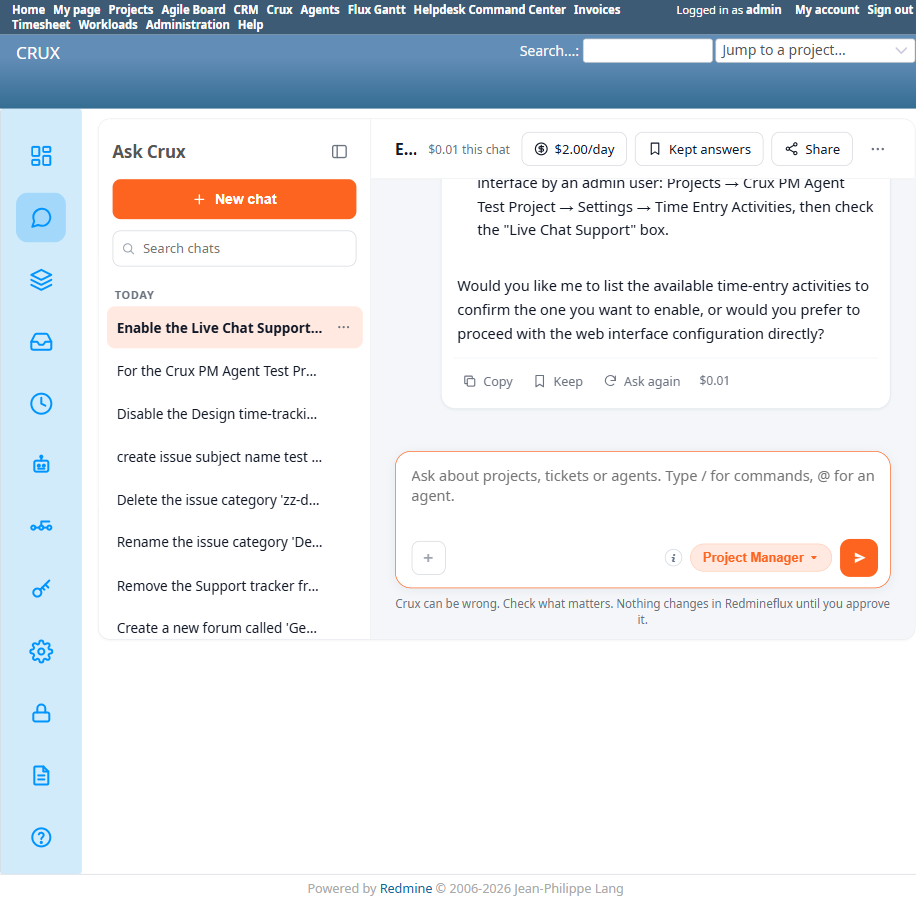

# Bug Report Template

- Bug ID: BUG-CRX-064
- Production Redmine Issue ID:
- Title: For the same genuinely-unavailable capability (a project-level time-entry activity toggle), Project Manager gives a vague, unhelpful "couldn't confirm available" non-answer for "disable" but a detailed, honest, correct explanation for "enable" — same entity, same project, same session's tool catalog
- Redmine version: 6.0-bookworm (new local Docker instance)
- Plugin name: redmineflux_crux (Ask Crux chat UI, Project Manager agent)
- Plugin version: 0.62.0
- Environment: Local — `http://localhost:3015` (`C:\crux-redmine`)
- Browser: Chromium (Playwright)
- User role: admin
- Date: 2026-10-11

## Steps to reproduce

1. Confirm via MCP server source that no tool exists anywhere for toggling a project-level time-entry-activity override: `/app/src/tools/core.py` has only `redmineflux_core_list_time_entry_activities` and `redmineflux_core_get_activity` (both read-only); `redmineflux_core_update_project`'s full parameter list (name, description, homepage, is_public, parent_id, inherit_members, default_assigned_to_id, default_version_id, default_issue_query_id, tracker_ids, enabled_module_names, issue_custom_field_ids, custom_field_values) has no activity-related field at all. This capability is genuinely, architecturally absent — correctly analogous to the Repositories/Forums gaps already confirmed honest in this suite.
2. As admin, in a fresh Ask Crux chat: "Disable the Design time-tracking activity for the Crux PM Agent Test Project."
3. Crux replies with the generic, unhelpful: *"I couldn't confirm whether this action is actually available here — please try again, or ask an administrator to check this deployment's tool configuration."* — the same boilerplate text used elsewhere in this session for false denials of tools that DO exist (BUG-CRX-061), giving the user no way to tell this case apart from a real bug or transient failure.
4. In a separate fresh chat, same project, same (confirmed-healthy, 495-tool) session: "Enable the Live Chat Support time-tracking activity for the Crux PM Agent Test Project."
5. This time Crux gives a detailed, accurate, well-reasoned reply: it names the exact tool it has (`redmineflux_core_list_time_entry_activities`), correctly explains that time-entry activities are a system-wide Redmine enumeration rather than a per-project setting, explicitly separates "what I can do" (list activities, confirm project/modules) from "what requires manual action," and gives precise native-UI navigation steps (Projects → Crux PM Agent Test Project → Settings → Time Entry Activities → check the box) — then offers to help further.

## Expected result

- Since the underlying capability is identically absent in both directions (enable and disable are the same missing tool), the response quality and content should be the same regardless of phrasing — ideally the detailed, honest explanation seen in step 5, every time.

## Actual result

The exact same genuinely-missing capability produces two wildly different answers depending only on the enable/disable wording:
- **"Disable"** → the vague, generic "couldn't confirm whether this action is actually available here... try again" text — indistinguishable from a transient failure or a real bug, and actively misleading since "try again" implies retrying might work, when the tool structurally doesn't exist at all.
- **"Enable"** → a transparent, specific, correct explanation of exactly why this can't be done via chat, what the agent's real tools are, and how to do it manually.

Neither response fabricates success and neither silently executes a write (confirmed via native UI both times — the target activity's enabled/disabled state never changed), so this isn't a data-integrity bug. But it's a real, user-facing inconsistency: a user who tries "disable" first has no idea the capability is architecturally absent and might reasonably interpret "try again" as "this might work on a retry," file a confused support ticket, or conclude Crux is broken — while a user who happens to phrase the same request as "enable" gets a clear, trustworthy answer immediately.

## Evidence

### Screenshot

### Console / log

- Both turns ran under the same confirmed-healthy MCP catalog (`tools/list ... tools=495`), ruling out BUG-CRX-063's degraded-state issue as an explanation for the difference.
- MCP source (`/app/src/tools/core.py`): confirmed no write tool exists for project-level time-entry-activity toggling in either direction — the capability gap itself is real and identical for enable and disable.

## Duplicate check

- Duplicate found: No — checked `bugs/_duplicates.md` and `bugs/_index.md`. Originally logged as Repro 7 of **BUG-CRX-061** (the "false denial of an existing tool" pattern) before the follow-up Enable test revealed the tool genuinely doesn't exist in either direction — re-filed here as a distinct issue since the root cause is different (a genuine capability gap communicated inconsistently, not a false denial of a real tool). Related to, but distinct from, the Forums/Repositories honest-refusal precedent (TC-CRX-218/219) — those get the *same* honest treatment every time they're asked; this is the first instance where the *same* genuinely-absent capability gets two different quality levels of answer depending purely on phrasing.
