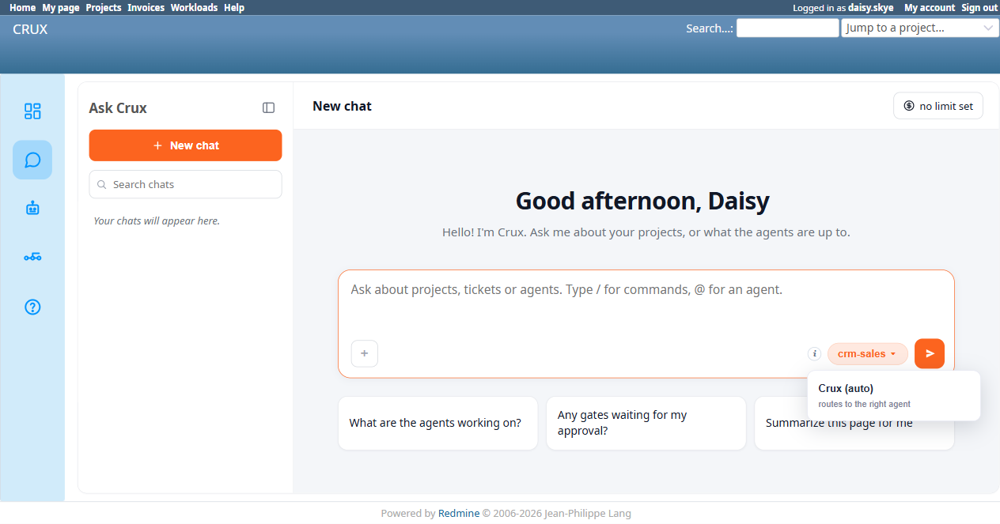

# Bug Report Template

- Bug ID: BUG-CRX-066
- Production Redmine Issue ID: #123223
- Title: Answering-agent picker shows the raw internal slug "crm-sales" instead of the human-friendly "Sales Agent" label, for a user who holds `Use Ask Crux` but lacks `view_crux` (the separate Agent Fleet permission) — root-caused to a silently-failing `/crux/agents.json` 403
- Redmine version: 6.0-bookworm (new local Docker instance, localhost:3015)
- Plugin name: redmineflux_crux (Ask Crux chat UI)
- Plugin version: 0.62.0
- Environment: Local — `http://localhost:3015` (`C:\crux-redmine`)
- Browser: Chromium (Playwright)
- User role: `daisy.skye` (Reporter role on `Crux CRM Agent Test Project` — `Use Ask Crux` granted, zero CRM permissions, and `view_crux` not granted either)
- Date: 2026-10-12

## Steps to reproduce

1. As a user who holds `Use Ask Crux` but does **not** hold `view_crux` (the permission that gates `/crux`, `/crux/agents`, and the Agent Fleet page), open a fresh Ask Crux chat at `/crux/ask`.
2. Observe the "Who answers" agent-picker button at the bottom of the chat composer.
3. Open the browser console/network tab at the same time.

## Expected result

- The agent-picker button should show the same human-readable display name every other user sees for this agent — **"Sales Agent"** — regardless of whether the viewer happens to hold the separate `view_crux` permission. `Use Ask Crux` is the permission that gates chatting at all; `view_crux` gates a completely different surface (the Agent Fleet/dashboard pages). A user legitimately chatting with an agent should never see that agent's raw internal slug just because they lack an unrelated permission.

## Actual result

- The picker button reads **"crm-sales ▾"** — the agent's raw internal slug, not its display name "Sales Agent" — and the chat's own "Answering: crm-sales. Click to change." tooltip repeats the same raw slug.
- Confirmed via the browser console: three requests to `GET /crux/agents.json` all return **403 Forbidden** for this user (she lacks `view_crux`). The frontend evidently resolves the agent's friendly display name from this same endpoint, and when it 403s, silently falls back to rendering the raw slug it already has (from the last-used-agent preference or similar) instead of a hardcoded friendly label or a generic placeholder.
- For comparison, the exact same chat, same agent, as `admin` and as `luna.blossom` (both of whom hold `view_crux`) correctly shows **"Sales Agent ▾"**.
- This is a genuine human-readability defect: a Reporter-tier, non-technical user chatting with Crux is shown raw developer-facing text ("crm-sales") that means nothing to them, purely as a side effect of a permission check unrelated to her ability to use the chat at all.
- **Not a security or data-integrity issue** — the underlying write path still enforces real permissions correctly (see BUG-CRX-067, filed from the same test session, for the actual write attempt against this same user).

## Evidence

### Screenshot

### Retest screenshot (fill after fix is verified)

### Console / log

- Browser console (3 identical entries): `Failed to load resource: the server responded with a status of 403 (Forbidden) @ http://localhost:3015/crux/agents.json:0`
- Confirmed via native UI that `daisy.skye`'s role (Reporter) has `Use Ask Crux` checked but `view_crux` left unchecked — a deliberately distinct permission pair, not a misconfiguration.
- Comparison: the identical chat flow as `admin`/`luna.blossom` (both holding `view_crux`) shows "Sales Agent ▾" correctly.

## Duplicate check

- Duplicate found: No — checked `bugs/_duplicates.md` and `bugs/_index.md`. Distinct from BUG-CRX-047 (that bug was about the top-menu "Crux"/"Agents" *links* being shown to users without `view_crux`, the opposite shape — a thing wrongly shown that should be hidden; this bug is a thing wrongly displayed in raw/internal form that should instead show a friendly label, for a user correctly *not* being shown the Agent Fleet page itself). Also distinct from the false-capability-denial family (BUG-CRX-029/032/034/050/061/062) — those are about Crux wrongly claiming a tool doesn't exist; this is a cosmetic display-name resolution bug with no functional/capability impact.
