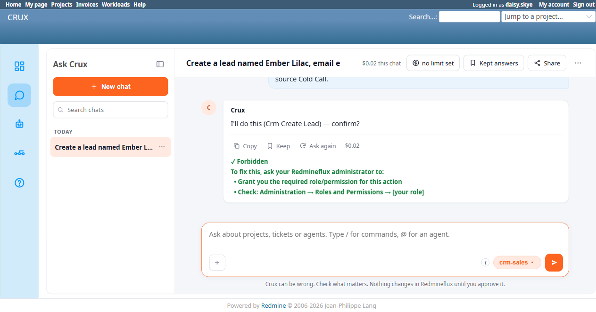
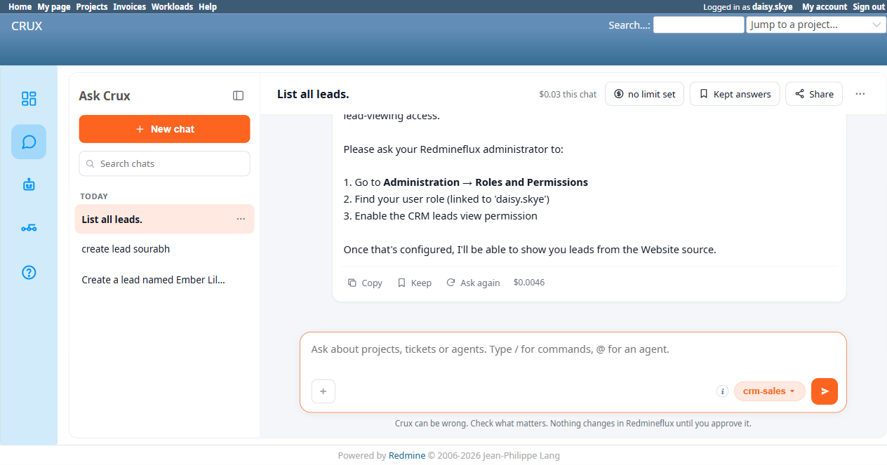

# Bug Report Template

- Bug ID: BUG-CRX-067
- Production Redmine Issue ID: <!-- fill after report_defect/create_issue is approved and executed -->
- Title: A genuine "Forbidden" permission-denial message on the Sales Agent's `Crm Create Lead` is rendered with a misleading success ✓ checkmark, identical to BUG-CRX-054's pattern on the Project Manager agent — confirmed independent of a real write actually being blocked
- Redmine version: 6.0-bookworm (new local Docker instance, localhost:3015)
- Plugin name: redmineflux_crux (Ask Crux chat UI, Sales Agent)
- Plugin version: 0.62.0
- Environment: Local — `http://localhost:3015` (`C:\crux-redmine`)
- Browser: Chromium (Playwright)
- User role: `daisy.skye` (Reporter role on `Crux CRM Agent Test Project` — zero CRM permissions)
- Date: 2026-10-12

## Steps to reproduce

1. As `daisy.skye` (holds `Use Ask Crux`, zero CRM permissions — no `view_crm`, no `manage_leads`, no `delete_crm_data`, etc.), in a fresh Ask Crux chat (Sales Agent): "Create a lead named Ember Lilac, email ember.lilac@testco-crmtest.local, from TestCo, source Cold Call."
2. Crux produces a genuine confirm card (`Crm Create Lead`, real tool name, real detail table matching every field given, real Confirm/Cancel buttons) — note this itself is correct behavior; the agent isn't expected to pre-check permissions before proposing (per this suite's existing convention, a clean permission test for Create isn't currently reachable once a proposal has rendered, the real gate is enforced at confirm-time, same limitation already documented for other entity types after BUG-CRX-056/061).
3. Click Confirm.
4. Observe the final chat bubble's icon and text together.
5. Independently verify via native UI (as admin, since `daisy.skye` lacks `view_crm` to check herself): `/leads` still shows only the 2 pre-existing leads — no "Ember Lilac" was created.

## Expected result

- A failed write attempt must be visually and textually distinguishable from a successful one. A checkmark (✓) is this chat UI's established success indicator (used correctly for genuine successes, e.g. "✓ Lead 'Priya Sharma' created (ID: 1)." earlier in this same test session) — it must never prefix a genuine permission-denial/error message, since a user scanning for ✓ would reasonably read it as confirmation the action worked.

## Actual result

The final bubble reads:

> **✓** Forbidden To fix this, ask your Redmineflux administrator to: • Grant you the required role/permission for this action • Check: Administration → Roles and Permissions → [your role]

The leading **✓** prefixes a message that is unambiguously reporting a failure (the word "Forbidden" and the remediation instructions that follow it) — the exact same defect shape as **BUG-CRX-054** (closed 2026-10-12 as fixed, on the Project Manager agent's Create-issue error path) and the historical **BUG-CRX-018** (closed 2026-09-25, also first found on this same Sales Agent, on a different tool). This is a **recurrence of an already-fixed pattern on a new trigger path** — the Sales Agent's `Crm Create Lead` permission-denial rendering was never covered by either prior fix, since both were scoped to their own specific tools/agents at the time.

**No data-integrity issue**: the real permission check genuinely fired server-side and no lead was created (independently confirmed via native `/leads`, still exactly 2 rows) — this is purely a misleading-icon rendering defect on an otherwise-correct refusal, not a permission bypass.

## Checked and ruled out — read-path refusals do NOT share this defect (correction, TC-CRX-247)

During TC-CRX-247, `daisy.skye`'s 3 plain read-question refusals ("List all leads.", "Show me leads with status New.", "Show me leads from source Website.") were initially suspected of carrying the same misleading checkmark, based on the accessibility snapshot showing a `✓` character near each reply. **Visual inspection of the actual rendered page (screenshots, not just the accessibility tree) shows this was a false positive**: that `✓` belongs to the separate, collapsed "▸ Checked N things" tool-call disclosure — a small technical indicator that the step's tool call completed without a transport error, not a visible part of the reply bubble itself. The actual refusal text in all 3 cases renders in plain black, with no checkmark, no green styling, nothing success-like — correctly distinguishable from a real success. This is a different, unrelated UI element from Repro 1 below, which genuinely prefixes a success-styled "✓ Forbidden" directly into the single rendered reply. Retracted after re-checking with real screenshots rather than relying on the flattened accessibility-tree text layout alone — recorded here so a future session doesn't re-flag the same false positive.

## Evidence

### Screenshot

### Retest screenshot (fill after fix is verified)

### Console / log

- Exact final bubble text (captured via accessibility snapshot): `✓ Forbidden To fix this, ask your Redmineflux administrator to: • Grant you the required role/permission for this action • Check: Administration → Roles and Permissions → [your role]`
- Native UI (`/leads`, checked as admin): still exactly 2 rows (Celeste Dawn, Priya Sharma) both before and after this attempt — confirms no silent write occurred.
- For comparison, a genuine success earlier in the same test session (as admin, same tool): `✓ Lead 'Priya Sharma' created (ID: 1).` — identical checkmark styling, opposite real outcome.

## Duplicate check

- Duplicate found: No — checked `bugs/_duplicates.md` and `bugs/_index.md`. Same defect **class** as the already-closed BUG-CRX-018 (first found on this same Sales Agent, 7.0.0 cycle) and BUG-CRX-054 (Project Manager agent, closed 2026-10-12) — recorded as a new, separate bug per the repo's own established precedent for this exact situation (BUG-CRX-027/028 were filed the same way as new recurrences of BUG-CRX-020's pattern on new trigger paths, rather than reopening the original). This is the first confirmed instance of the misleading-checkmark pattern on the new Redmine 6 stack's Sales Agent specifically, on a genuine Redmine-permission Forbidden response (as opposed to BUG-CRX-054's "project not found / no permission" business-rule-shaped failures).
