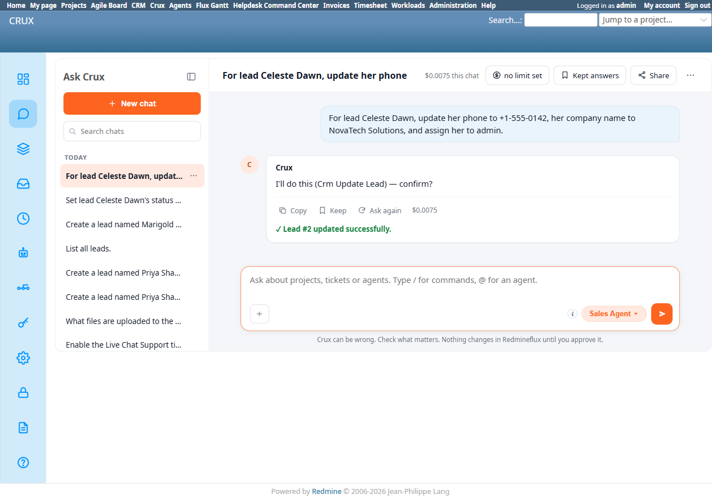
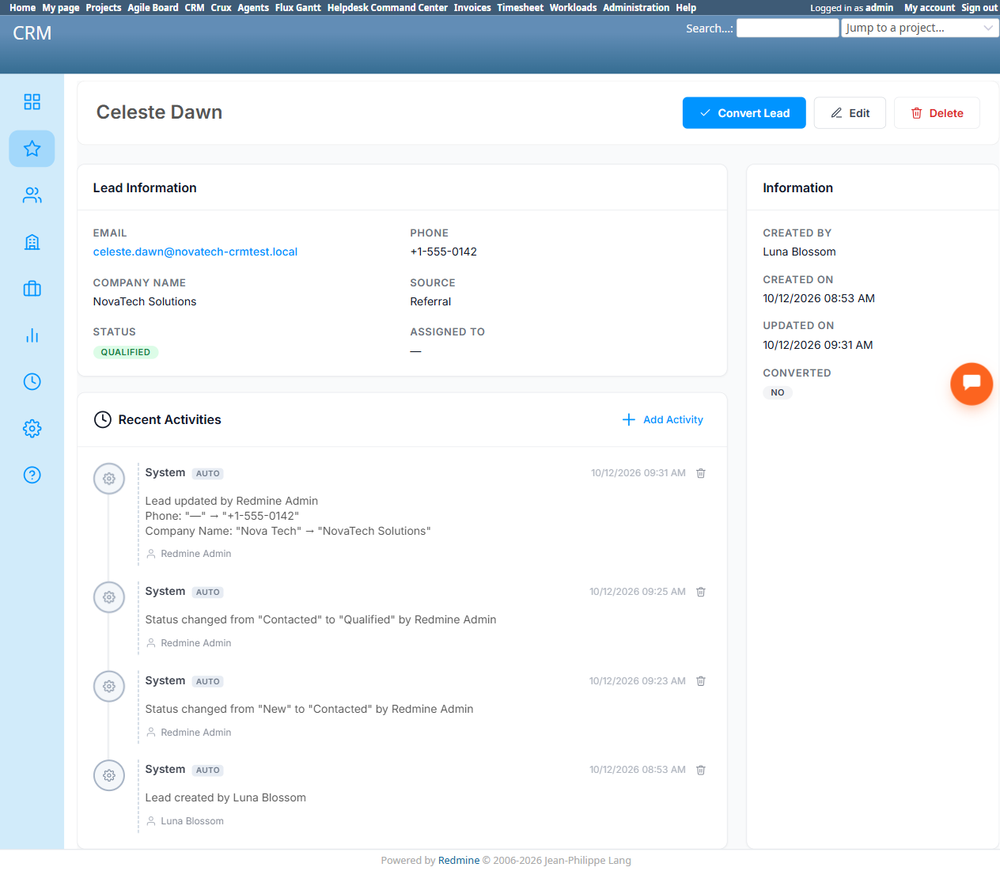
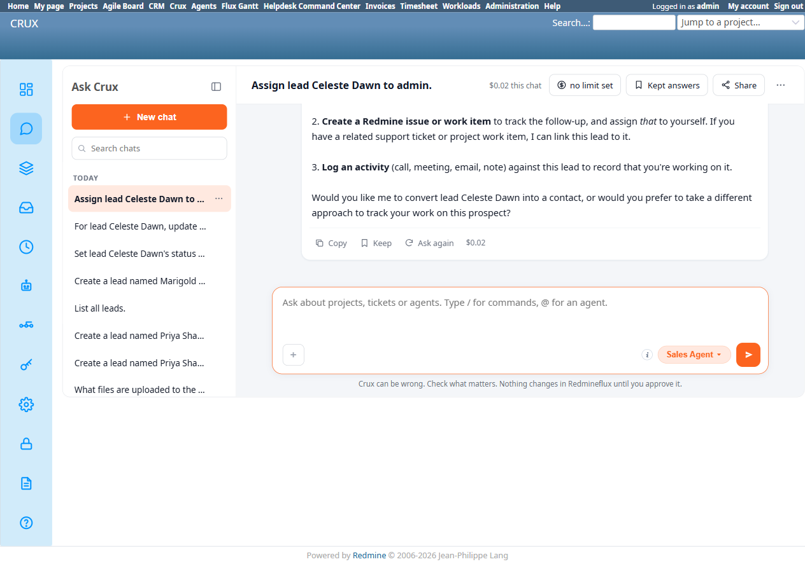
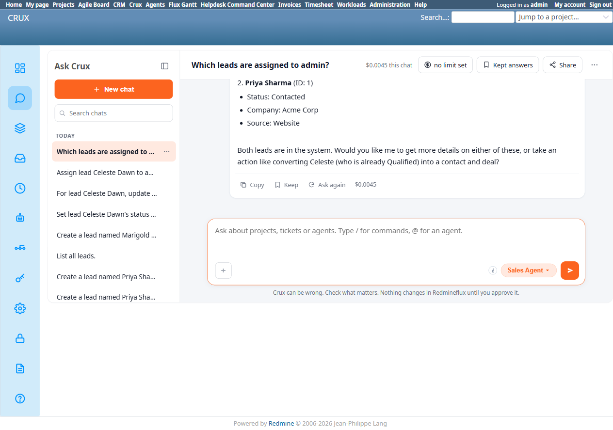

# Bug Report Template

- Bug ID: BUG-CRX-068
- Production Redmine Issue ID: #123225
- Title: Sales Agent has a systematic blind spot for the "Assigned To" field across every CRM entity (Leads, and now also Companies on Create) — falsely claims leads have no "assign to user" field at all, silently drops Assigned To from multi-field Lead updates AND from a full-field Company creation with zero disclosure either time, and ignores "assigned to X" entirely as a read-side filter
- Redmine version: 6.0-bookworm (new local Docker instance, localhost:3015)
- Plugin name: redmineflux_crux (Ask Crux chat UI, Sales Agent)
- Plugin version: 0.62.0
- Environment: Local — `http://localhost:3015` (`C:\crux-redmine`)
- Browser: Chromium (Playwright)
- User role: admin
- Date: 2026-10-12

## Steps to reproduce

### Repro 1 — multi-field update silently drops Assigned To

1. As admin, on an existing lead (e.g. "Celeste Dawn", lead #2), in Ask Crux (Sales Agent): "For lead Celeste Dawn, update her phone to +1-555-0142, her company name to NovaTech Solutions, and assign her to admin." — three distinct field changes requested in one message.
2. Observe the resulting `Crm Update Lead` confirm card's detail table.
3. Click Confirm.
4. Observe the final success message.
5. Independently verify via native UI (`/leads/2`): check all 3 fields — Phone, Company Name, and Assigned To.

### Repro 2 — standalone assignment request gets an explicit false capability denial (root cause confirmed)

1. As admin, in a fresh chat, in isolation: "Assign lead Celeste Dawn to admin."
2. Observe the reply.
3. Independently confirm via native UI (`/leads/2/edit`) that an "Assigned To" combobox genuinely exists on the lead edit form, and that the leads list page (`/leads`) has its own "ASSIGNEE" column — both real, visible, functional UI elements for this exact field.

### Repro 3 — read-side: an "assigned to X" question is silently ignored as a filter

1. Set Celeste Dawn's Assigned To to "Redmine Admin" via native UI (`/leads/2/edit`, since the chat-driven path is blocked by Repro 2). Priya Sharma (lead #1) remains unassigned.
2. As admin, in a fresh chat: "Which leads are assigned to admin?"
3. Observe the reply.

## Expected result

- Either all 3 requested field changes appear in the confirm card and are genuinely applied, or — if one of them can't be fulfilled for some real reason (ambiguous "admin" resolution, a permission gap, etc.) — the agent should say so explicitly, either before building the confirm card (asking for clarification) or in its reply alongside the proposal, so the user knows exactly which of their 3 requests will and won't take effect. Silently dropping a requested field with no mention anywhere is the one outcome that must never happen.

## Actual result

**Repro 1.** The confirm card's detail table showed only 2 rows: `Phone: +1-555-0142` and `Company Name: NovaTech Solutions`. **No "Assigned To" row at all**, and no text anywhere in the reply — before or after the table — acknowledging that the assignment request was being skipped, deferred, or needed clarification. After Confirm, the final message read: **"✓ Lead #2 updated successfully."** — an unqualified success claim with no caveat, despite only 2 of the 3 requested changes actually being included in the write. Independently verified via `/leads/2`: Phone and Company Name are genuinely updated (confirmed via the lead's own activity trail: `Lead updated by Redmine Admin Phone: "—" → "+1-555-0142" Company Name: "Nova Tech" → "NovaTech Solutions"`) — but **Assigned To is still blank ("—")**, exactly as it was before the request. A user reading "✓ Lead #2 updated successfully." after asking for 3 specific changes has no way to know — without manually re-checking the record themselves — that 1 of the 3 never happened.

**Repro 2 — the root cause.** Asked in isolation, Crux replied: *"I found lead Celeste Dawn (ID: 2). However, **the CRM lead system doesn't have an 'assign to user' field** in the way that Redmine issues do. Leads in the Redmineflux CRM are tracked as prospect records without a direct assignment field. You have a few options: 1. Convert this lead into a contact... 2. Create a Redmine issue or work item... 3. Log an activity..."* — a confident, specific, **false** factual claim. Independently confirmed via native UI: `/leads/2/edit` has a real `Assigned To` combobox (same form as Phone/Company Name/Source/Status, all of which Crux handles correctly elsewhere in this suite), and the `/leads` list page has its own dedicated "ASSIGNEE" column. This is the **direct root cause of Repro 1**: the agent doesn't believe this field exists at all, so it silently strips any "assign" instruction out of a multi-field request rather than erroring, asking, or including it.

This is the same **false-capability-denial** shape already tracked across BUG-CRX-029/032/034/050/061/062/066/067 (an agent confidently asserting a real, working capability doesn't exist) — now confirmed on the Sales Agent's lead-assignment field specifically, and notably the first instance where the false belief also causes a *silent write-time omission* (Repro 1) rather than just an outright refusal.

**Repro 3 — the same blind spot on the read side.** With Celeste Dawn (lead #2) genuinely assigned to Redmine Admin via native UI and Priya Sharma (lead #1) genuinely unassigned, "Which leads are assigned to admin?" got: *"You have 2 leads in the CRM: 1. Celeste Dawn... 2. Priya Sharma... Both leads are in the system."* — the assignee filter was **silently ignored entirely**: both leads were listed (including the one that is demonstrably NOT assigned to admin), the Assignee field was never even shown per-lead in the listing, and the closing line ("Both leads are in the system") doesn't answer the question asked at all. This confirms the agent's blind spot for this field spans read and write: it neither applies "assigned to X" as a filter nor surfaces the real assignee value when listing leads, consistent with it genuinely not modeling this field's existence anywhere in its lead-handling logic. (For contrast: filtering by Company — "Show me leads for company NovaTech Solutions" — worked correctly, returning only the 1 real match, confirming other filter dimensions are fine; this gap is specific to Assigned To.)

## Evidence

### Screenshot

### Retest screenshot (fill after fix is verified)

### Console / log

- Confirm card table (captured via accessibility snapshot): `Lead: 2`, `Phone: +1-555-0142`, `Company Name: NovaTech Solutions` — no `Assigned To` row.
- Final reply: `✓ Lead #2 updated successfully.`
- Native UI (`/leads/2`) activity trail: `Lead updated by Redmine Admin Phone: "—" → "+1-555-0142" Company Name: "Nova Tech" → "NovaTech Solutions"` — Assigned To not mentioned because it was never part of the actual write.

## Repro 4 — same silent-drop on Company Create (TC-CRX-255/256)

As admin, a full-field company-create request naming all 8 documented fields at once: "Create a company called Full Fields Enterprises, email..., phone..., website..., industry Healthcare, employee count 250, **assigned to admin**, address..., notes..." → the resulting confirm card correctly included all 7 other fields (Name, Email, Phone, Website, Industry, Employee Count, Address, Notes) but **silently omitted Assigned To entirely** — no row, no mention. Confirmed → "✓ Company 'Full Fields Enterprises' created (ID: 6)." Independently verified via `/companies/6`: all 7 other fields genuinely applied exactly as requested (Website correctly auto-`https://`-prefixed too), but **Assigned To is still blank ("—")**. This is the 3rd entity type (after Lead's write+read paths and Contact's explicit denial) confirmed to share this exact blind spot — strongly suggesting one shared root cause in how the agent's tool-calling layer resolves "assign/assigned to" across the whole CRM domain, not a per-entity issue.

## Duplicate check

- Duplicate found: No — checked `bugs/_duplicates.md` and `bugs/_index.md`. Same **false-capability-denial family** as BUG-CRX-029/032/034/050/061/062/066/067 (Repro 2: a confident, specific, checkable false claim that a real, working field doesn't exist) — filed as a new bug per the repo's own precedent for new domains/tools (this is the first instance on the Sales Agent's lead-assignment field). Distinguishing feature from the rest of that family: here the false belief doesn't just produce an outright refusal — it also causes a *silent write-time omission* when assignment is bundled into a multi-field request (Repro 1), rather than the request failing or asking for clarification. Also distinct from BUG-CRX-052 (wrong/hallucinated field *values*, not a field dropped entirely because the agent believes it doesn't exist).
