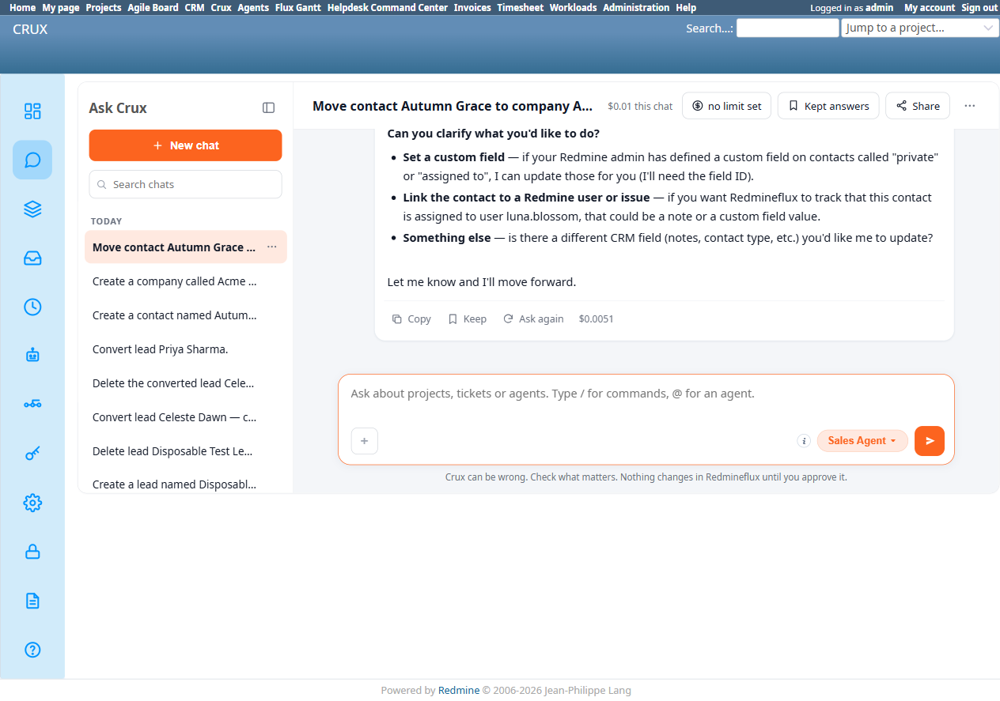
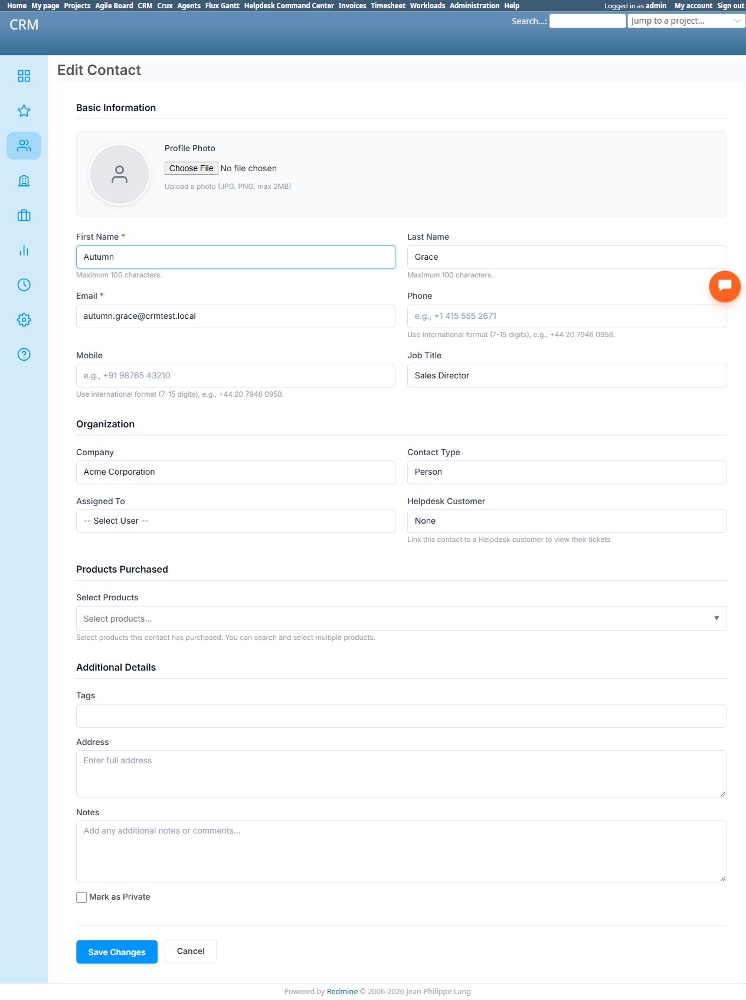

# Bug Report Template

- Bug ID: BUG-CRX-069
- Production Redmine Issue ID: #123226
- Title: Sales Agent falsely claims the CRM contact tool has no "private" or "assigned_to" fields at all — demonstrably false, the native contact form has both a real "Mark as Private" checkbox and a real "Assigned To" combobox, matching the plugin's own documentation
- Redmine version: 6.0-bookworm (new local Docker instance, localhost:3015)
- Plugin name: redmineflux_crux (Ask Crux chat UI, Sales Agent)
- Plugin version: 0.62.0
- Environment: Local — `http://localhost:3015` (`C:\crux-redmine`)
- Browser: Chromium (Playwright)
- User role: admin
- Date: 2026-10-12

## Steps to reproduce

1. As admin, on an existing contact (e.g. "Autumn Grace", contact #2), in Ask Crux (Sales Agent): "Mark contact Autumn Grace as private, assigned to luna.blossom."
2. Observe the reply.
3. Independently confirm via native UI (`/contacts/2/edit`) that a "Mark as Private" checkbox and an "Assigned To" combobox both genuinely exist on the contact edit form — the same form other correctly-working fields (First Name, Email, Phone, Company, Job Title) live on.
4. Cross-check against the CRM plugin's own documentation (`/crm/docs`, `§Contacts` and `§Record visibility`): "The form also accepts... assignee..." and "Select Mark as Private on a record's form" — both explicitly documented, real features, not Redmine-issue concepts.

## Expected result

- Since both fields are real, documented, and already rendered on the exact same contact edit form as every other field the agent handles correctly, the agent should either build a genuine `Crm Update Contact` confirm card setting both (`is_private: true`, `assigned_to_id` resolved from "luna.blossom"), or — if its own tool schema genuinely lacks support for one of them — say so honestly without claiming the underlying CRM feature doesn't exist (the agent's own limitation is not the same claim as "the CRM doesn't have this").

## Actual result

Crux replied: *"Got it — contact Autumn Grace (ID 2) is found. However, **the CRM contact tool doesn't have 'private' or 'assigned_to' fields** — those are Redmine issue/user management concepts, not CRM contact attributes. The CRM contact record carries: first name, last name, email, phone, company, job title, contact type (e.g. 'client', 'partner'), notes, and custom fields if the admin has defined any."* — followed by suggesting the user set a hypothetical custom field or add a note instead.

This is a confident, specific, **doubly false** claim:
- **"private" is a real contact attribute** — confirmed via native UI (`/contacts/2/edit`): a "Mark as Private" checkbox exists, and per the plugin's own documentation (`§Record visibility`): "Every lead, contact, company, and deal is public by default... Select Mark as Private on a record's form."
- **"assigned_to" is also a real contact attribute** — confirmed via the same edit form: a real "Assigned To" combobox exists, and per documentation (`§Contacts`): "The form also accepts a profile photo, last name, phone, mobile, job title, company, contact type (Person or Company), **assignee**, address, notes, and tags."

Both fields live on the identical form, right alongside Phone/Company/Job Title — fields this same agent correctly reads and writes elsewhere in this suite (TC-CRX-252/253). The agent's claim that these are "Redmine issue/user management concepts, not CRM contact attributes" is factually backwards: they are CRM contact attributes, genuinely present in the Redmineflux CRM plugin's own schema and documentation.

This is the same **false-capability-denial** family as BUG-CRX-029/032/034/050/061/062/066/067/068 — now confirmed on the Sales Agent's Contact-update path, covering 2 fields at once (Private, Assigned To), mirroring BUG-CRX-068's identical finding on the Lead entity's own Assigned To field. Together, BUG-CRX-068 and BUG-CRX-069 suggest the agent's tool-calling layer may have a systematic blind spot for "Assigned To"/"Private" across every CRM entity type, not just Leads or Contacts individually — worth the dev team checking Companies and Deals for the same gap.

## Evidence

### Screenshot

### Retest screenshot (fill after fix is verified)

### Console / log

- Exact Crux quote (captured via accessibility snapshot): "However, the CRM contact tool doesn't have 'private' or 'assigned_to' fields — those are Redmine issue/user management concepts, not CRM contact attributes."
- Native UI (`/contacts/2/edit`): `checkbox "Mark as Private"` and `combobox "Assigned To"` both present and functional.
- CRM plugin docs (`/crm/docs`, read this session): `§Contacts` lists "assignee" among the form's accepted fields; `§Record visibility` describes "Mark as Private" as a real, documented feature for leads/contacts/companies/deals.

## Duplicate check

- Duplicate found: No — checked `bugs/_duplicates.md` and `bugs/_index.md`. Same false-capability-denial family as BUG-CRX-029/032/034/050/061/062/066/067/068, and specifically the same shape as **BUG-CRX-068** (false denial that Leads have an Assigned To field) — filed as a new bug per the repo's own precedent for new entity types (this is the first instance on Contacts, and the first instance covering 2 fields — Private and Assigned To — in a single false claim). Flagging the pattern between 068/069 for the dev team to investigate as one shared root cause across entity types, rather than fixing each entity in isolation.
