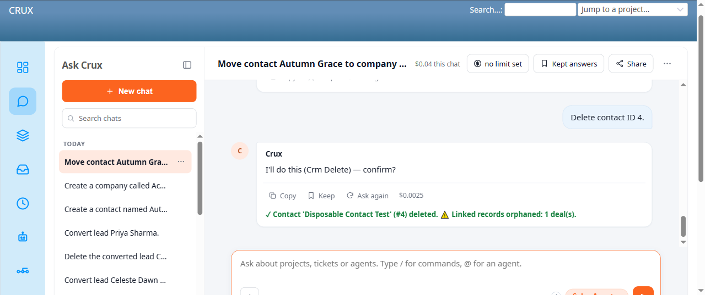

# Bug Report Template

- Bug ID: BUG-CRX-070
- Production Redmine Issue ID: #123227
- Title: Recurrence of the historical, already-fixed self-contradiction pattern (BUG-CRX-013, closed 2026-09-25 on the Redmine 7.0.0 stack) on the Sales Agent — reproduced on Contact/Company Delete (name-based, and for Company even some ID-based retries) and on a Settings Add-Deal-Stage request from a non-admin user; "I described a change without actually proposing it" repeats across all of them, 2/2 where retried
- Redmine version: 6.0-bookworm (new local Docker instance, localhost:3015)
- Plugin name: redmineflux_crux (Ask Crux chat UI, Sales Agent)
- Plugin version: 0.62.0
- Environment: Local — `http://localhost:3015` (`C:\crux-redmine`)
- Browser: Chromium (Playwright)
- User role: admin
- Date: 2026-10-12

## Steps to reproduce

1. As admin, with an existing contact named "Disposable Contact Test" (ID 4), in Ask Crux (Sales Agent): "Delete contact Disposable Contact Test."
2. Observe the reply.
3. Retry with slightly different phrasing: "Please delete the contact named Disposable Contact Test."
4. Observe the reply.
5. Retry again, this time with the contact's numeric ID instead of its name: "Delete contact ID 4."
6. Observe the reply and confirm if a genuine confirm card appears.

## Expected result

- A delete-by-name request should resolve to the same real contact and produce a genuine `Crm Delete` confirm card — the same outcome the identical request produces when phrased with the numeric ID instead. Name resolution should not change whether the agent believes it has "actually proposed" an action.

## Actual result

- **Attempts 1 and 2** (by name, two different phrasings): both produced the **exact same, word-for-word** self-contradictory non-answer: *"I described a change without actually proposing it, so there's nothing to confirm yet — please tell me again exactly what to change and I'll make it a real, confirmable proposal."* No confirm card, no Confirm/Cancel buttons — the agent describes itself as having failed to propose anything, without explaining why, and without ever actually attempting to resolve "Disposable Contact Test" to a contact id.
- **Attempt 3** (by numeric ID): immediately produced a genuine `Crm Delete` confirm card (Entity Type: contact, Entity: 4) → confirmed → **"✓ Contact 'Disposable Contact Test' (#4) deleted. ⚠️ Linked records orphaned: 1 deal(s)."** — a fully genuine, correctly-executed delete, with a notably good proactive disclosure of the orphaned deal.
- This is a **recurrence of the historical BUG-CRX-013 pattern** (first found and fixed 2026-09-25 on the old Redmine 7.0.0 stack, originally on `update_deal_stage`/lead-status-update/delete-by-name paths across the CRM domain) — the exact same literal self-contradiction sentence, the exact same shape (name-based request silently fails to resolve into a proposal; ID-based request works immediately), now observed on the new Redmine 6 stack's Contact-delete path specifically. Since BUG-CRX-013 was fixed and closed against the *old* codebase/environment, and this is the *first* time Contact deletion has been exercised via chat on the new stack, this suggests either (a) the original fix didn't fully generalize to this trigger path, or (b) something in the new build/environment reintroduced the underlying defect.

## Repro 3 — same self-contradiction on Settings (Add Deal Stage), non-admin user (TC-CRX-265)

As `luna.blossom` (full CRM role-permissions, not Redmine admin), fresh chat: "Add a new deal stage called 'Contract Review'." → "I described a change without actually proposing it, so there's nothing to confirm yet — please tell me again exactly what to change and I'll make it a real, confirmable proposal." Reproduced 2/2 via "Ask again" with the exact same text both times. This is a new trigger path (Settings/deal-stage append, not Contact/Company delete-by-name) and a new user context (a non-admin user whose own Redmine permissions genuinely can't reach Settings at all — confirmed via native UI, `/crm/settings` → 403 Forbidden for `luna.blossom`). Notably, the **same exact request** from **admin** (who does have the real Redmine-level access `/crm/settings` requires) gets a *different* failure shape in a fresh chat — sometimes the generic "I couldn't find a tool for this here" text (BUG-CRX-072's Repro 1 shape), and in an earlier session the detailed "discovery issue, `redmineflux_crm_settings_update` should exist" text (BUG-CRX-072's main repro) — confirming this self-contradiction pattern and BUG-CRX-072's tool-discovery pattern are two distinct, separately-occurring failure modes on the same underlying gap (Settings being unreachable via chat for anyone), not two names for the same thing.

## Evidence

### Screenshot

### Retest screenshot (fill after fix is verified)

### Console / log

- Attempt 1 exact reply (captured via accessibility snapshot): "I described a change without actually proposing it, so there's nothing to confirm yet — please tell me again exactly what to change and I'll make it a real, confirmable proposal."
- Attempt 2 (different phrasing, "Please delete the contact named..."): identical reply, word-for-word.
- Attempt 3 (by ID): "I'll do this (Crm Delete) — confirm?" with a real detail table (Entity Type: contact, Entity: 4) and real Confirm/Cancel buttons. Confirmed → "✓ Contact 'Disposable Contact Test' (#4) deleted. ⚠️ Linked records orphaned: 1 deal(s)." — genuine, independently verified via `/deals/2` (the linked deal survives, Contact field cleared to "—", not cascade-deleted).

## Repro 2 — same pattern on Company delete, worse persistence (TC-CRX-256)

As admin, with a disposable company "Disposable Company Test" (ID 7, with 1 linked contact and 1 linked deal):
1. "Delete company Disposable Company Test." (by name) → identical self-contradiction: "I described a change without actually proposing it..."
2. "Delete company ID 7." (by ID, same chat) → **still** the identical self-contradiction — unlike the Contact case, the ID-based retry did NOT immediately fix it this time.
3. New fresh chat, "Please delete company with ID 7." (3rd attempt overall, 2nd by ID) → finally succeeded: genuine `Crm Delete` confirm card → confirmed → **"✓ Company 'Disposable Company Test' (#7) deleted. ⚠️ Linked records orphaned: 1 contact(s), 1 deal(s)."** Independently verified: the linked contact (`/contacts/6`) and deal (`/deals/3`) both survive, Company field cleanly cleared to "—" on each, not cascade-deleted.

This confirms the defect isn't just "name resolution fails, ID always works" — on Company delete, even the ID-based path required a fresh chat session before succeeding, suggesting the self-contradiction may also be sensitive to some session/conversation state, not purely the identifier format. Worth the dev team investigating whether this correlates with the original historical BUG-CRX-013's own note about a possible conversation-state leak contributing to some of its reproductions.

## Retest — 2026-10-26 (PARTIALLY FIXED — still broken on Settings scenario)

Retested live on a freshly rebuilt instance (new laptop, Docker stack recreated from `C:\crux-redmine`, CRM plugin code freshly pulled). Fixtures rebuilt: contacts "Disposable Contact Test"/"Autumn Grace", company "Disposable Company Test", and `luna.blossom` promoted to a Manager-role membership (full CRM permissions, still genuinely blocked from `/crm/settings` — confirmed 403).

- **Contact/Company delete-by-name — now FIXED**: "Delete contact Disposable Contact Test" and "Please delete the contact named Disposable Contact Test" both immediately produced genuine `Crm Delete` confirm cards (2/2), no self-contradiction text either time. "Delete company Disposable Company Test" also produced a clean confirm card (1/1). Both deletes confirmed and genuinely executed.
- **Settings/Add-Deal-Stage, non-admin (`luna.blossom`) — still STILL BROKEN**: sent "Add a new deal stage called 'Contract Review'." twice in the same chat. First attempt leaked the internal tool name (`redmineflux_crm_settings_update`) and a computed diff before failing; "Ask again" got a different, generic "I couldn't find a tool for this here" denial. Neither attempt ever reached a confirm card for this legitimate, non-protected Settings change — the self-contradiction's exact wording didn't reproduce, but the underlying "can't complete a legitimate Settings change via chat" defect this repro exists to demonstrate is unchanged.

Net: the delete-by-name self-contradiction is genuinely fixed, but this bug's Repro 3 (Settings scope) still fails — reopened on production (#123227) with both halves of this evidence.

## Duplicate check

- Duplicate found: No — checked `bugs/_duplicates.md` and `bugs/_index.md`. Same defect **shape** as the already-closed **BUG-CRX-013** (self-contradiction pattern, first found on `update_deal_stage`/lead-status-update/delete-by-name across multiple CRM actions on the old 7.0.0 stack) — filed as a new bug since it's recurring on the new Redmine 6 stack and a trigger path (Contact delete specifically) not previously covered by that fix's own verification scope, per the repo's own precedent for recurrences on new environments/trigger paths (BUG-CRX-027/028 handled the same way for BUG-CRX-020's pattern). Not a duplicate of the false-capability-denial family (BUG-CRX-029/032/034/050/061/062/066/067/068/069) — those are confident false claims about missing capabilities; this is the agent claiming its own turn failed to produce a proposal when a proposal should have been producible from the same data, with no false claim about the CRM's capabilities themselves.
