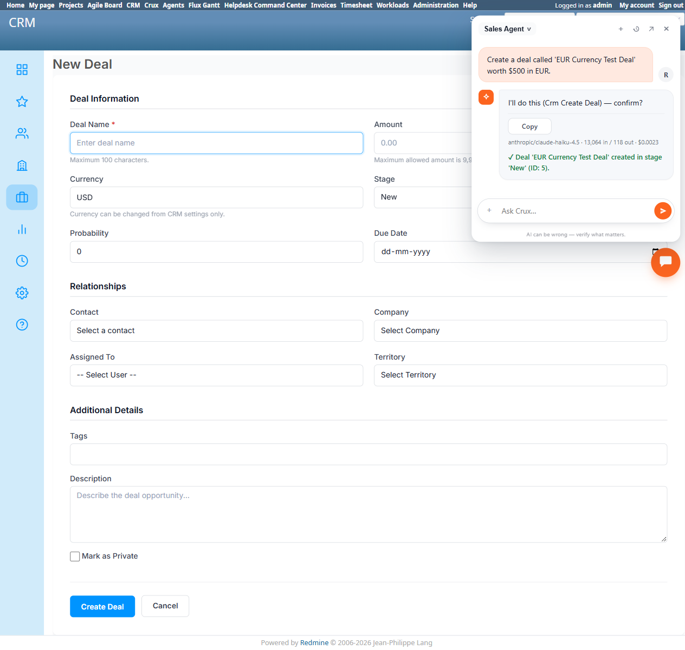
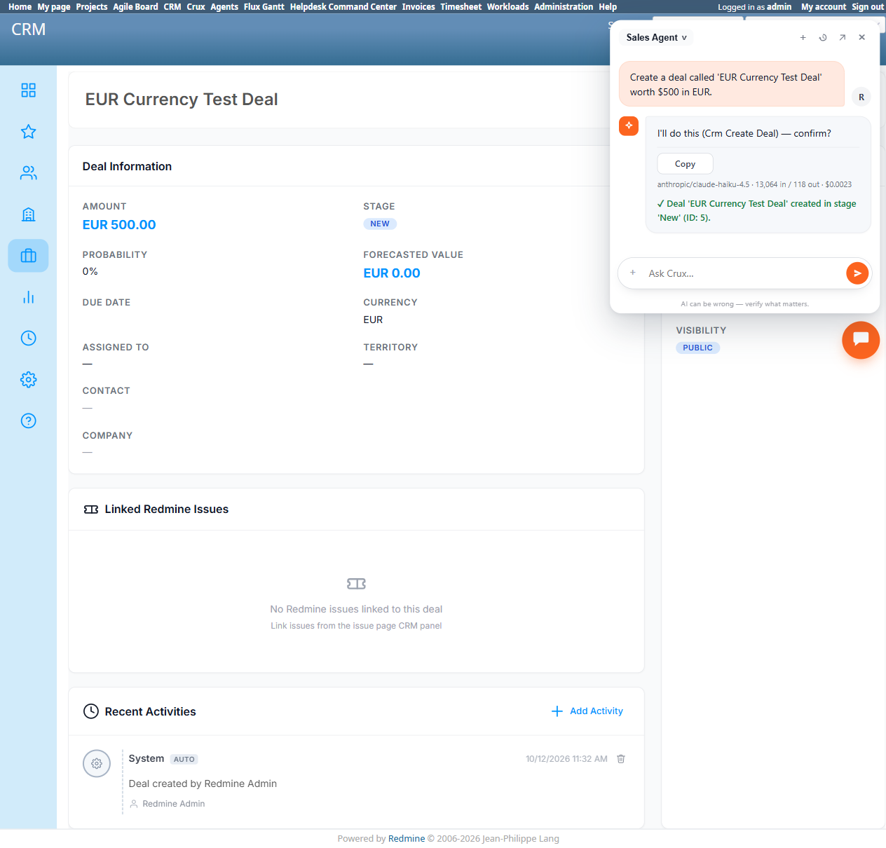

# Bug Report Template

- Bug ID: BUG-CRX-071
- Production Redmine Issue ID: <!-- fill after report_defect/create_issue is approved and executed -->
- Title: `Crm Create Deal` lets a chat user set an arbitrary deal currency (e.g. EUR), genuinely persisted — directly contradicting the CRM plugin's own documented and native-UI-enforced invariant that every deal always uses the instance's Default Currency, never a per-deal value
- Redmine version: 6.0-bookworm (new local Docker instance, localhost:3015)
- Plugin name: redmineflux_crux (Ask Crux chat UI, Sales Agent)
- Plugin version: 0.62.0
- Environment: Local — `http://localhost:3015` (`C:\crux-redmine`)
- Browser: Chromium (Playwright)
- User role: admin
- Date: 2026-10-12

## Steps to reproduce

1. As admin, in Ask Crux (Sales Agent): "Create a deal called 'EUR Currency Test Deal' worth $500 in EUR."
2. Observe the resulting `Crm Create Deal` confirm card's detail table — specifically whether it includes a `Currency: EUR` row.
3. Confirm it.
4. Independently verify via native UI (`/deals/<id>`) what Currency the real record actually shows.
5. For contrast, open the native "New Deal" form (`/deals/new`) and inspect its own Currency field.

## Expected result

- Per the CRM plugin's own documentation (`/crm/docs`, `§Deals`): *"The Currency field is read-only: deals created or edited on this form always use the Default Currency from Settings... Choose the default currency before deals are entered, and avoid changing it afterward."* Dashboard/Pipeline/Analytics totals are only meaningful because every deal is guaranteed to be in the instance's one Default Currency (all other currencies are converted to USD at fixed rates for aggregation). The chat-driven `Crm Create Deal` tool should enforce this exact same invariant — never accepting or persisting a currency other than the real Default Currency, regardless of what the user's message asks for.

## Actual result

- The confirm card genuinely included **`Currency: EUR`** as a proposed field — the agent didn't catch or question this before building the proposal.
- After Confirm, the real deal record (`/deals/5`) genuinely shows **Currency: EUR, Amount: EUR 500.00** — not USD. The write was never rejected, never silently corrected to the Default Currency, and no warning was given that this isn't normally possible.
- For direct contrast: the native "New Deal" form (`/deals/new`) shows Currency as a **disabled, read-only textbox** pre-filled with "USD" (the real Default Currency), with explicit helper text: *"Currency can be changed from CRM settings only."* The UI-level enforcement the documentation describes is real and present — it's specifically the chat/API write path that bypasses it entirely.
- This breaks a stated data-integrity invariant of the plugin: per `§Totals across currencies`, Dashboard/Pipeline/Analytics totals convert every deal to USD using a small fixed table of rates (EUR 1.08, GBP 1.27, JPY 0.0067, INR 0.012, anything else at a rate of 1) specifically *because* every deal is assumed to already be in one consistent Default Currency — multi-currency deals sneaking in via chat silently undermines the accuracy of every aggregate figure built on that assumption, with no way for a normal user to notice unless they specifically inspect this one deal's own page.

## Evidence

### Screenshot

### Retest screenshot (fill after fix is verified)

### Console / log

- Confirm card table (captured via accessibility snapshot): `Name: EUR Currency Test Deal`, `Amount: 500`, `Currency: EUR`, `Stage: New` — Currency included and not challenged.
- Final reply: `✓ Deal 'EUR Currency Test Deal' created in stage 'New' (ID: 5).`
- Native UI (`/deals/5`): `Amount: EUR 500.00`, `Currency: EUR` — genuinely persisted, not auto-corrected.
- Native UI (`/deals/new`): `textbox "Currency" [disabled]: USD` with helper text `Currency can be changed from CRM settings only.`
- CRM plugin docs (`/crm/docs`, `§Deals`): "The Currency field is read-only: deals created or edited on this form always use the Default Currency from Settings... Choose the default currency before deals are entered, and avoid changing it afterward."

## Duplicate check

- Duplicate found: No — checked `bugs/_duplicates.md` and `bugs/_index.md`. Not part of the false-capability-denial family (BUG-CRX-029/032/034/050/061/062/066/067/068/069) — those are about a real capability being wrongly denied; this is the opposite shape, a documented *restriction* being silently bypassed and a write succeeding that should have been blocked or auto-corrected. Not a duplicate of BUG-CRX-052 (wrong/hallucinated *resolved* values for a real field with a fixed enum) — Currency isn't a free-choice field at all per the plugin's own design, it's meant to be fully immutable outside Settings.
