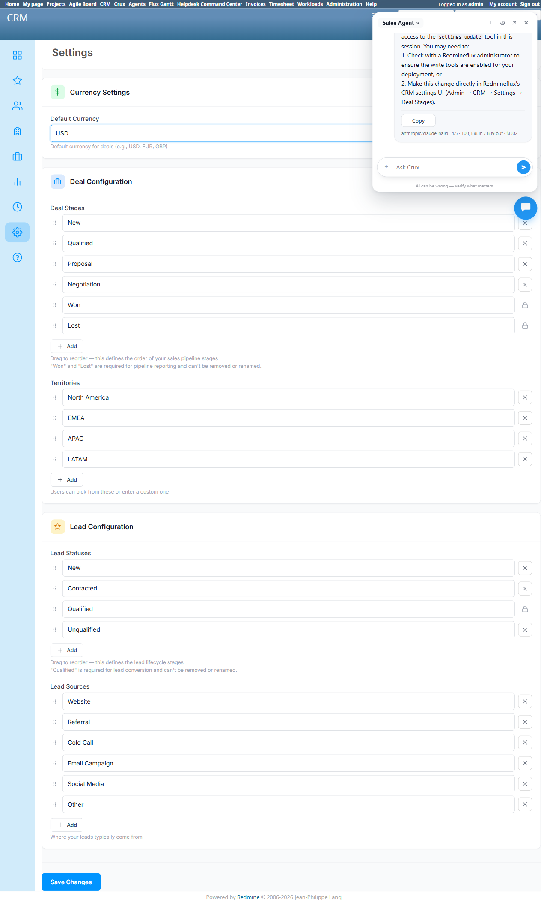

# Bug Report Template

- Bug ID: BUG-CRX-072
- Production Redmine Issue ID: <!-- fill after report_defect/create_issue is approved and executed -->
- Title: Sales Agent's CRM Settings tool (`redmineflux_crm_settings_update`) is undiscoverable/uninvokable from chat for even a legitimate, non-protected change (adding a new deal stage) — the agent names the real tool and builds the correct proposed change internally, but never produces a confirm card, confirming a genuine tool-routing/discovery defect rather than an honest capability gap
- Redmine version: 6.0-bookworm (new local Docker instance, localhost:3015)
- Plugin name: redmineflux_crux (Ask Crux chat UI, Sales Agent)
- Plugin version: 0.62.0
- Environment: Local — `http://localhost:3015` (`C:\crux-redmine`)
- Browser: Chromium (Playwright)
- User role: admin
- Date: 2026-10-12

## Steps to reproduce

1. As admin, in Ask Crux (Sales Agent), same chat session (`ses-124`): "Remove the Lost stage from CRM settings." → reply: "I couldn't find a tool for this here, so I can't do it from this chat..." (generic denial, no tool name disclosed).
2. In the **same session**, immediately after: "Add a new deal stage called 'Contract Review'." — a legitimate, non-protected Settings change with no business-rule reason to be blocked.
3. Observe the reply.
4. Independently verify via native UI (`/crm/settings`) what the real Deal Stages configuration and protection rules actually are.

## Expected result

A legitimate, non-protected Settings change (adding a new deal stage) should either succeed via a genuine confirm card (if a Settings-update tool is actually wired up for this agent) or be refused with an honest, consistent explanation. It should not produce a response that names a specific real tool as something that "should exist" per the agent's own instructions, builds out the fully correct proposed change, and then fails anyway due to an internal "discovery issue" — that is a tool-wiring defect, not a legitimate business refusal.

## Actual result

The reply for step 2 was:

> I'm hitting a discovery issue. However, my instructions mention that `redmineflux_crm_settings_update` should exist for this kind of change — it would replace the full deal-stages list with the current list plus your new 'Contract Review' stage.
> **The change I would propose:**
> - Current deal stages: `New, Qualified, Proposal, Negotiation, Won, Lost`
> - New deal stages: `New, Qualified, Proposal, Negotiation, Contract Review, Won, Lost`
> Unfortunately, I don't currently have direct access to the `settings_update` tool in this session. You may need to: 1. Check with a Redmineflux administrator to ensure the write tools are enabled for your deployment, or 2. Make this change directly in Redmineflux's CRM settings UI (Admin → CRM → Settings → Deal Stages).

Two distinct problems here:

1. **The agent explicitly discloses the real tool name (`redmineflux_crm_settings_update`) and computes a fully correct, accurate proposed change** (the current deal-stages list it cites — `New, Qualified, Proposal, Negotiation, Won, Lost` — exactly matches the real native `/crm/settings` page) — yet it never builds an actual confirm card, unlike every other successful write path in this suite (Create Lead/Contact/Company/Deal, Update Deal Stage, etc.), which always render a real Confirm/Cancel card before touching anything. This "I'm hitting a discovery issue" framing is new in this session — no other tool failure before this has named the specific tool it couldn't reach.
2. **Inconsistent failure messaging for the same underlying gap**: step 1 ("Remove the Lost stage") got a generic, uninformative denial with no tool name at all, while step 2 ("Add a new deal stage") — same session, same underlying missing capability — got a detailed technical disclosure instead. A user attempting the protected removal in step 1 has no way to know a real tool was ever in scope, while a user attempting the legitimate addition in step 2 is shown internal tool-naming details that shouldn't normally surface in a user-facing chat reply.

**Native UI cross-check (`/crm/settings`)**: confirms Deal Stages Won and Lost, and Lead Status Qualified, each render with no "Delete" button and an explicit "Required value — can't be removed or renamed" indicator, with explanatory text below each list ("Won" and "Lost" are required for pipeline reporting and can't be removed or renamed." / "'Qualified' is required for lead conversion and can't be removed or renamed."). The protected-value invariant itself (TC-CRX-260's actual subject) is correctly enforced at the native-UI/backend level — this bug is scoped only to the chat tool's inability to reach Settings at all, for protected or unprotected changes alike, not to a bypass of the protection itself.

## Evidence

### Screenshot

### Retest screenshot (fill after fix is verified)

### Console / log

- Step 1 reply (captured via accessibility snapshot): "I couldn't find a tool for this here, so I can't do it from this chat. It can be done directly in Redmineflux; if you expected Crux to do it, an administrator can check this deployment's tool setup."
- Step 2 reply (captured via accessibility snapshot): "I'm hitting a discovery issue. However, my instructions mention that `redmineflux_crm_settings_update` should exist for this kind of change..." followed by the full correct proposed current/new stages list, then "Unfortunately, I don't currently have direct access to the `settings_update` tool in this session."
- Native UI (`/crm/settings`): Deal Stages — `New` (deletable), `Qualified` (deletable, Deal-stage context), `Proposal` (deletable), `Negotiation` (deletable), `Won` (img alt="Required value — can't be removed or renamed", no Delete button), `Lost` (same lock indicator, no Delete button). Lead Statuses — `New`/`Contacted`/`Unqualified` deletable, `Qualified` locked with the same indicator.

## Duplicate check

- Duplicate found: No — checked `bugs/_duplicates.md` and `bugs/_index.md`. Related to, but distinct from, the false-capability-denial family (BUG-CRX-029/032/034/050/061/062/065/066/067/068/069): those involve the agent confidently and wrongly claiming "no tool exists" or "not supported" with no further detail; this is the first instance where the agent instead partially succeeds at internal reasoning (names the real tool, computes the exact correct diff) but still fails to invoke it, explicitly self-describing it as "a discovery issue" — a more specific, diagnosable shape of the same general tool-routing failure. Also not a duplicate of BUG-CRX-060 (member-add stalling on token budget — that's a resource-limit cutoff, this is a tool-discovery failure with no token-budget signal) or BUG-CRX-063 (whole-server MCP tool catalog degraded after startup — this is scoped to one specific tool being unreachable for one agent, not a server-wide catalog gap, and the server's tool catalog is otherwise working normally in this same session, e.g. `Crm Create Deal` succeeded minutes earlier).
