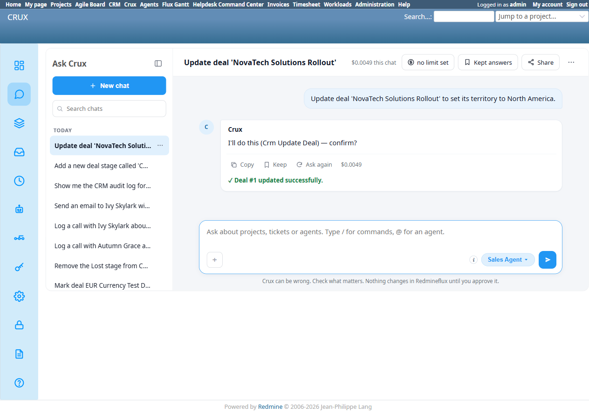
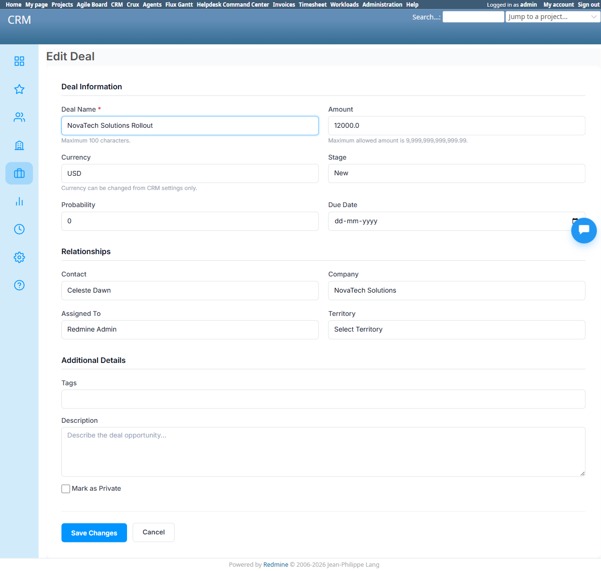

# Bug Report Template

- Bug ID: BUG-CRX-073
- Production Redmine Issue ID: <!-- fill after report_defect/create_issue is approved and executed -->
- Title: `Crm Update Deal`'s custom-field write (Territory) silently fails to persist despite a false "✓ Deal #N updated successfully" confirmation — the real record's Territory remains unset; the same tool's standard-field writes (and the equivalent custom-field-style writes on Company/Lead) work correctly
- Redmine version: 6.0-bookworm (new local Docker instance, localhost:3015)
- Plugin name: redmineflux_crux (Ask Crux chat UI, Sales Agent)
- Plugin version: 0.62.0
- Environment: Local — `http://localhost:3015` (`C:\crux-redmine`)
- Browser: Chromium (Playwright)
- User role: admin
- Date: 2026-10-12

## Steps to reproduce

1. As admin, in Ask Crux (Sales Agent), fresh chat: "Update deal 'NovaTech Solutions Rollout' to set its territory to North America."
2. Observe the `Crm Update Deal` confirm card's detail table.
3. Confirm it.
4. Independently verify via native UI (`/deals/1` and `/deals/1/edit`) whether Territory was actually set.

## Expected result

A confirm card whose write is accepted and reported as successful should genuinely persist that change — the real deal record's Territory field should read "North America" afterward, matching both the confirm card and the chat's success message.

## Actual result

- The confirm card genuinely proposed the change: `Deal: 1`, `Custom Field Values: {'territory': 'North America'}` — note Territory is passed through a `Custom Field Values` map, unlike standard fields (see comparison below).
- On Confirm, the chat reported: `✓ Deal #1 updated successfully.` — a clean, unqualified success claim, no partial-failure caveat.
- Independently verified via native UI (`/deals/1`): **Territory still reads "—" (empty)**, both immediately after and after a full page reload. The native edit form (`/deals/1/edit`) confirms the Territory dropdown is still at its default "Select Territory" (unset) — "North America" is a real, valid, exact-match option in that same dropdown, ruling out a value-mismatch/typo explanation.
- The deal's own activity trail does not show any Territory change entry at all (contrast with Company/Lead updates below, which both log a clear before→after change line) — strongly suggesting the custom-field write was dropped before even reaching the point where a change would be journaled, not merely journaled-and-then-reverted.

**Confirmed scoped to this one field/path, not a general Update-tool failure**: the same sweep (TC-CRX-266) tested two sibling cases that passed cleanly:
- `Crm Update Company` → Industry (`Technology` → `Healthcare`): confirm card passed Industry as a **top-level field** (not under `Custom Field Values`), genuinely persisted, confirmed via the company's own activity trail (`Industry: "Technology" → "Healthcare"`).
- `Crm Update Lead` → Source (`Website` → `Referral`): confirm card passed Source as a **top-level field**, genuinely persisted, confirmed via the lead's own activity trail (`Source: "Website" → "Referral"`).

Both working cases pass their changed value as a plain top-level confirm-card field; the one failing case (Territory on Deal) is the only one of the three routed through a `Custom Field Values` map — pointing at that code path specifically as where the write is being silently dropped.

## Evidence

### Screenshot

### Retest screenshot (fill after fix is verified)

### Console / log

- Confirm card (captured via accessibility snapshot): `Deal: 1`, `Custom Field Values: {'territory': 'North America'}`.
- Final reply: `✓ Deal #1 updated successfully.`
- Native UI (`/deals/1`, checked twice including after a full reload): `Territory: —`.
- Native UI (`/deals/1/edit`): Territory combobox still at `Select Territory` (default/unset); valid options present: `North America, EMEA, APAC, LATAM, Other (enter below)`.
- Deal's own activity trail: no Territory-change entry at all (contrast: the Company Industry and Lead Source updates below both produced a clear change-log line).
- For contrast, same-sweep working cases: `Crm Update Company` → native `/companies/3` activity trail: `Industry: "Technology" → "Healthcare"`. `Crm Update Lead` → native `/leads/1` activity trail: `Source: "Website" → "Referral"`.

## Duplicate check

- Duplicate found: No — checked `bugs/_duplicates.md` and `bugs/_index.md`. Not part of the false-capability-denial family (BUG-CRX-029/032/034/050/061/062/065/066/067/068/069) — the tool is invoked and claims success, it never denies the capability. Not a duplicate of BUG-CRX-068/069 (Assigned To/Private fields the agent falsely believes don't exist at all) — here the agent correctly recognizes Territory as a real field, builds a correct confirm card for it, and the tool call itself reports success; the defect is purely in whether the custom-field value is actually persisted server-side. Not a duplicate of BUG-CRX-071 (Deal Currency bypass) — that's a documented restriction being silently *accepted* when it shouldn't be; this is the opposite shape, a legitimate, unrestricted field update being silently *dropped* when it should succeed.
