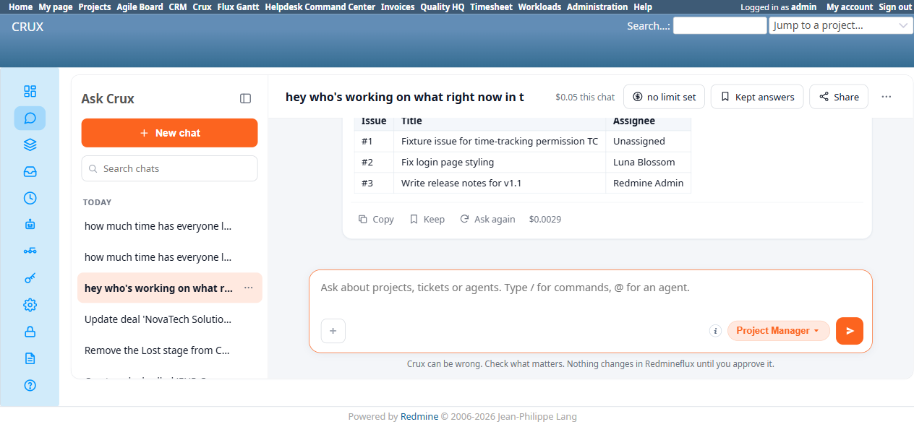

# Bug Report Template

- Bug ID: BUG-CRX-074
- Production Redmine Issue ID: #125302
- Title: A natural "who's working on what" question answers only the "what" (issue list) and silently drops the "who" (assignee) — even though the agent can correctly resolve and report assignees when asked as a separate follow-up question
- Redmine version: 6.0-bookworm (new local Docker instance, localhost:3015)
- Plugin name: redmineflux_crux (Ask Crux chat UI, Project Manager agent)
- Plugin version: 0.62.0
- Environment: Local — `http://localhost:3015` (`C:\crux-redmine`)
- Browser: Chromium (Playwright)
- User role: admin
- Date: 2026-10-26

## Steps to reproduce

1. Fixture: 3 real issues on `Crux PM Agent Test Project` — #1 (unassigned), #2 "Fix login page styling" (assigned to Luna Blossom), #3 "Write release notes for v1.1" (assigned to Redmine Admin). Confirmed via native UI before asking.
2. As admin, in a fresh Ask Crux chat (Project Manager agent), ask a natural, casual question that explicitly asks about *who* is doing the work: "hey who's working on what right now in the crux pm agent test project?"
3. Observe the reply — does it name who each issue is assigned to?
4. In the same chat, as an explicit follow-up: "and who's each one assigned to?"
5. Compare the two replies.

## Expected result

- Since the user's own question literally asks "who's working on what," the first reply should include each issue's assignee (or honestly state "unassigned" where true) — the same information the agent demonstrably has and correctly reports one turn later when asked directly.

## Actual result

- **First reply** (to "who's working on what"): lists all 3 issues by number and title, correctly notes their shared status and priority — but never mentions who any of them are assigned to, not even to say "unassigned." The "who" half of the question is silently dropped entirely; the reply reads as if it fully answered the question.
- **Second reply** (to the explicit follow-up "and who's each one assigned to?"): correctly and accurately lists all 3 real assignees — `#1 → unassigned`, `#2 → Luna Blossom`, `#3 → Redmine Admin` — exactly matching the real data. This proves the agent could resolve and report this information in the very same conversation; it simply didn't surface it the first time despite being asked directly.
- This is a different shape from the already-known false-capability-denial family (BUG-CRX-068/069, Sales Agent on CRM entities) — this is not a false claim that assignee data doesn't exist, and not a write-time silent omission. It's a **read-time silent omission of exactly the information the question asked for**, on a different agent (Project Manager) and a different entity (Issues, not CRM Leads/Contacts).

## Evidence

### Screenshot

### Console / log

- Turn 1 reply (captured via accessibility snapshot): lists `#1 – Fixture issue for time-tracking permission TC`, `#2 – Fix login page styling`, `#3 – Write release notes for v1.1`, with status/priority commentary — zero mention of "assigned," "Luna," or "Admin" anywhere in the reply text.
- Turn 2 reply (same chat, immediately after): `#1 – ... → unassigned`, `#2 – ... → Luna Blossom`, `#3 – ... → Redmine Admin` — all 3 correct, confirmed via native UI (`/issues/1`, `/issues/2`, `/issues/3`).
- Checked table-rendering behavior separately (not filed as its own bug, but worth recording — it's inconsistent, not simply "off by default" as first suspected): a follow-up message in the same chat, "can you show that as a table please", correctly rendered the same 3-issue data as a genuine HTML table (`Issue | Title | Assignee` columns) when explicitly asked. However, a separate spent-time question ("how much time has everyone logged...") rendered as a **genuine table by default, unprompted** (`Date | Hours | Issue | User | Comment` columns, with a correct `4.5h total` footer row) in one live spot-check, while the identical phrasing in this session's own test (see BUG-CRX-074's sibling finding above) rendered as a plain bullet list instead. So table-vs-list formatting is not deterministically tied to being asked, nor to the entity type — it appears to vary per attempt for the same question shape. Worth the dev team's awareness as a standing UX inconsistency, even though it isn't being filed as its own bug (no correctness impact, purely a formatting choice that isn't reliably reproducible either way).

## Duplicate check

- Duplicate found: No — checked `bugs/_duplicates.md` and `bugs/_index.md`. Distinct from BUG-CRX-068/069 (Sales Agent, CRM Leads/Contacts, a false claim that an Assigned-To field doesn't exist at all, plus a write-time silent drop) — this is the Project Manager agent, native Issues, a read-time question, and the agent demonstrably has and can correctly report the exact data a moment later; nothing is falsely denied, it's simply left out of the first answer despite being explicitly asked for.

## Retest — 2026-10-27 (STILL BROKEN)

Retested against the round-20 build. Re-sent "Hey, who's working on what right now in the Crux PM Agent Test Project?" (admin, fresh chat) — reply lists all 3 issues with status/priority/milestone commentary ("All three are blocked waiting on customer input...") but never mentions any issue's assignee, not even "unassigned" — identical omission to the original report.

**Production synced 2026-10-27**: #125302 → Status Reopen (not fixed).
