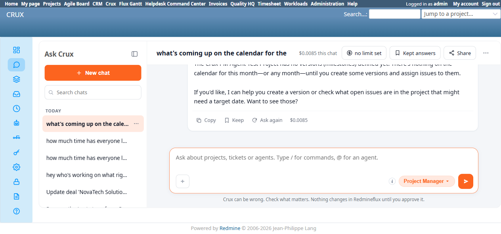
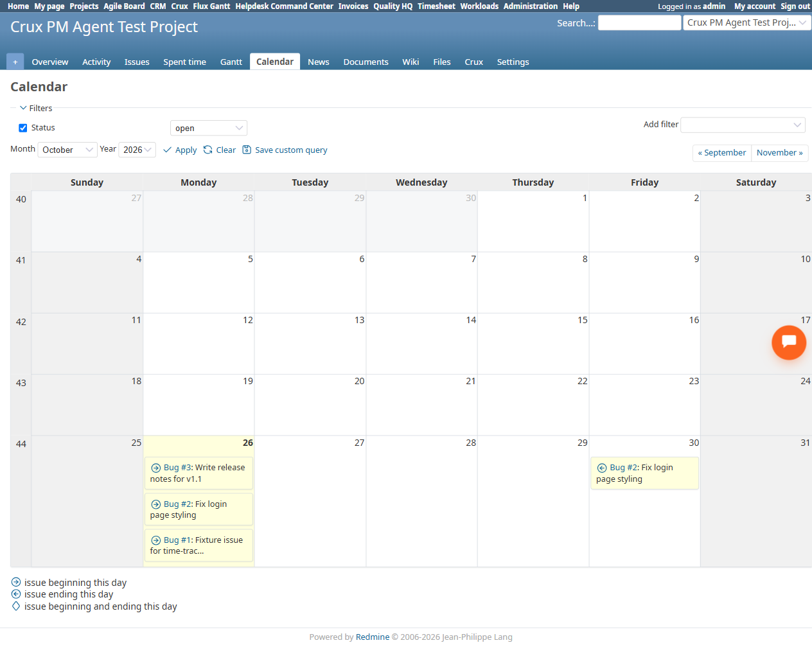

# Bug Report Template

- Bug ID: BUG-CRX-075
- Production Redmine Issue ID:
- Title: Project Manager agent falsely claims the Calendar has nothing for this month "until you create some versions and assign issues to them" — Redmine's Calendar is based purely on issue start/due dates and has no dependency on versions/milestones at all; 3 real issues genuinely appear on the native Calendar this month
- Redmine version: 6.0-bookworm (new local Docker instance, localhost:3015)
- Plugin name: redmineflux_crux (Ask Crux chat UI, Project Manager agent)
- Plugin version: 0.62.0
- Environment: Local — `http://localhost:3015` (`C:\crux-redmine`)
- Browser: Chromium (Playwright)
- User role: admin
- Date: 2026-10-26

## Steps to reproduce

1. Fixture: `Crux PM Agent Test Project` has 3 real issues — #1 (start date 10/26, no due date), #2 "Fix login page styling" (start date 10/26, due date 10/30), #3 "Write release notes for v1.1" (start date 10/26, due date 11/05). No versions/milestones exist on this project at all.
2. As admin, in a fresh Ask Crux chat (Project Manager agent), ask a natural question: "what's coming up on the calendar for the crux pm agent test project this month?"
3. Observe the reply.
4. Independently check the native Calendar view (`/projects/crux-pm-agent-test-project/issues/calendar`, October 2026) for ground truth.

## Expected result

- Since issue #2's due date (10/30) genuinely falls within October 2026 (the current month), the reply should surface it — and ideally #1/#3 too, since Redmine's Calendar plots any issue with a start or due date in the displayed month, entirely independent of whether a version/milestone exists.

## Actual result

- Crux replies: *"The Crux PM Agent Test Project has no versions (milestones) defined yet. There's nothing on the calendar for this month—or any month—until you create some versions and assign issues to them."*
- This is factually wrong on two counts: (1) the Calendar feature has no dependency on versions/milestones whatsoever — it is driven entirely by each issue's own Start Date/Due Date fields; (2) independently confirmed via the native Calendar UI that all 3 real issues genuinely appear this month — #1, #2, and #3 all show on day 26 (their shared start date), and #2 additionally shows again on day 30 (its due date), with the standard "issue beginning this day" / "issue ending this day" legend markers.
- This is a confident, specific, and doubly-wrong claim — not a hedge or an honest "I couldn't check" — that would actively mislead a user into believing the Calendar tab is useless until they create milestones, when in fact real, relevant data was sitting there the whole time.

## Evidence

### Screenshot

### Console / log

- Reply text (captured via accessibility snapshot): *"The Crux PM Agent Test Project has no versions (milestones) defined yet. There's nothing on the calendar for this month—or any month—until you create some versions and assign issues to them."*
- Native UI (`/projects/crux-pm-agent-test-project/issues/calendar?month=10&year=2026`): day 26 shows `Bug #3`, `Bug #2`, `Bug #1` (all start dates); day 30 shows `Bug #2` again (due date). Zero versions exist on this project (confirmed via `/projects/crux-pm-agent-test-project/settings/versions`, "No data").

## Duplicate check

- Duplicate found: No — checked `bugs/_duplicates.md` and `bugs/_index.md`. Not a duplicate of BUG-CRX-057 (issue-count questions silently excluding Closed issues — a different silent-omission shape, and that bug was confirmed fixed) or BUG-CRX-058 (spent-time fabricated absence — also confirmed fixed, and this session's own retest of the identical question pattern for Spent Time got a correct answer). This is the first finding specifically on the Calendar tab, which — per the plugin's own suite file (`CRUX_AGENT_PROJECT_MANAGER.md`) — had never been tested via chat at all before this session, and it is a confident false claim invoking an entirely wrong mental model (versions gate the calendar) rather than a silent count/total error.
