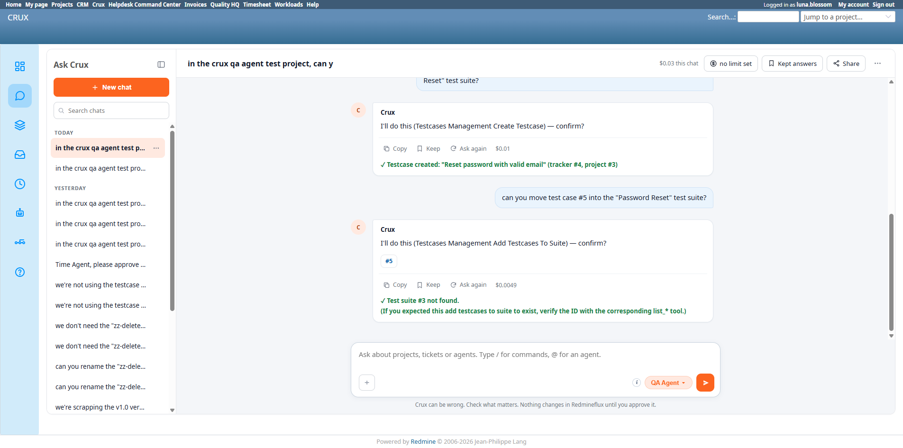

# Bug Report Template

- Bug ID: BUG-CRX-082
- Production Redmine Issue ID:
- Title: QA Agent's "Add Testcases To Suite" renders a genuine "suite not found" failure with a misleading success ✓ prefix — recurrence of the already-closed BUG-CRX-018 class (also recurring separately on the CRM Sales Agent as BUG-CRX-067), first instance on the QA Agent / Test Case Management domain
- Redmine version: 6.0-bookworm (new local Docker instance, localhost:3015)
- Plugin name: redmineflux_crux (Ask Crux chat UI, QA Agent, Test Case Management plugin domain)
- Plugin version: redmineflux_testcase_management 7.2.0 / crux-core 0.128.0
- Environment: Local — `http://localhost:3015` (`C:\crux-redmine`)
- Browser: Chromium (Playwright)
- User role: non-admin (`luna.blossom`, "QA Full Access" role)
- Date: 2026-10-27

## Steps to reproduce

1. As `luna.blossom`, with a real test case (#5) and a real test suite ("Password Reset", actual id=2) both existing.
2. In Ask Crux chat (QA Agent): "can you move test case #5 into the 'Password Reset' test suite?"
3. The confirm card resolves the suite to the wrong ID (`3`, which doesn't exist — see **BUG-CRX-079**'s new repro for that part).
4. Click Confirm.
5. Observe the exact rendering of the resulting failure message.

## Expected result

A genuine tool-level failure (here, "suite not found") should render as an honest failure — no checkmark, ideally styled as an error — matching how this same defect class was already fixed once for this plugin domain's sibling cases (BUG-CRX-018, Workload Capacity agent) and is independently still broken on another agent (BUG-CRX-067, CRM Sales agent).

## Actual result

The failure message rendered as: **"✓ Test suite #3 not found. (If you expected this add testcases to suite to exist, verify the ID with the corresponding list_* tool.)"** — the leading `✓` falsely signals success for a message that is explicitly, textually a failure. Independently confirmed via DB that the operation genuinely failed (no row created in `issue_test_suites` for the test case) — this is purely a rendering/labeling defect, not a security or data-integrity issue; the real operation was correctly blocked, it just *looks* like it succeeded at a glance.

## Evidence

### Screenshot

### Console / log

- Exact message (verbatim): `✓ Test suite #3 not found. (If you expected this add testcases to suite to exist, verify the ID with the corresponding list_* tool.)`
- DB verification: `SELECT * FROM issue_test_suites WHERE issue_id=5` → 0 rows, confirming the write genuinely did not happen.

## Note for triage

This is the same shared rendering-layer defect already documented extensively: originally found and fixed on the Workload/Capacity agent (**BUG-CRX-018**, closed 2026-09-25), confirmed recurring on 4 other domain agents at the time (KB, Scrum, and others per `CRUX_MEMORY.md`'s "Recurring Issues" notes), and currently still open on the CRM Sales agent (**BUG-CRX-067**, 6 reproductions across Lead/Contact/Company/Deal/Stage/Activity tools). This is simply the **first confirmed instance on the QA Agent / Test Case Management domain** — the underlying shared component that unconditionally prefixes outcome text with "✓" regardless of whether the underlying tool call actually succeeded evidently covers this agent's tools too, and was never fixed platform-wide despite being fixed once for the original Workload trigger path.

## Duplicate check

- Duplicate found: No (new agent/domain), but same defect **class** as the already-closed BUG-CRX-018 and the still-open BUG-CRX-067 — filed as a new bug per the repo's established precedent for this exact pattern recurring on a new agent (BUG-CRX-067 was itself filed the same way, as a CRM-domain recurrence of BUG-018's class).
