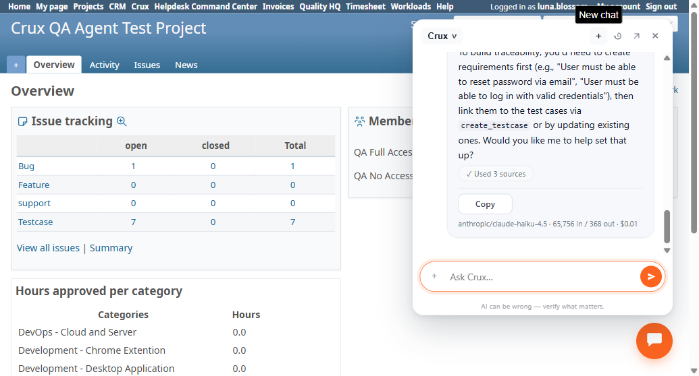

# Bug Report Template

- Bug ID: BUG-CRX-093
- Production Redmine Issue ID: #125651
- Title: QA Agent read tools (list_requirements, list_runs) resolve the wrong project when it isn't named in the current message, even after BUG-CRX-080's fix
- Redmine version: 6.0-bookworm (local Docker instance)
- Plugin name: redmineflux_crux / redmineflux-crux-core / redmineflux-mcp
- Plugin version: crux-core 0.130.0 (master @1140e8a), MCP crux_development @55e840d, redmineflux_crux 0.83.0 (master @581f704)
- Environment: Local Docker instance, Ask Crux chat, QA Agent
- Browser: Chromium (Playwright MCP)
- User role: non-admin (QA Full Access, Crux QA Agent Test Project)
- Date: 2026-10-28

## Steps to reproduce

1. In a fresh Ask Crux chat, ask something that engages a different project first, e.g. "what's happening in the crux pm agent test project right now?" — get a reply.
2. In the same chat, without naming any project again, ask: "can you show me the traceability matrix — which requirements are covered by which test cases and defects?" (or: "...show me the full progress and results table for the 'Sprint 1 Regression' run").
3. Observe which project the reply claims to be answering for, and compare the data it returns against the DB for both projects.

## Expected result

Since this chat is opened from the Crux QA Agent Test Project's own page (the floating widget shows "Looking at project crux-qa-agent-test-project" the entire time), any read request that doesn't explicitly name a different project should resolve to the project the chat is scoped to — exactly the guarantee BUG-CRX-079/080's round-21 fix already provides for testcase *write* tools ("the project named in THIS message replaces whatever project the model sent... project is the one named in THIS message").

## Actual result

Two independent read-path tools reproduce the identical stale-project defect that BUG-CRX-080 fixed for write tools, but the fix evidently does not cover them:

1. **`list_requirements`** — after a prior turn mentioned "Crux PM Agent Test Project", asking "can you show me the traceability matrix..." (project not named in this message) replied: *"The **Crux PM Agent Test Project** has no requirements defined yet... The project has 7 test cases (#4, #5, #6, #7, #8, #9, #11)..."* — but issues #4–#11 are genuinely Crux QA Agent Test Project (id 3) testcases, not PM project (id 1) ones, and the QA project genuinely has Requirement #1 ("User must be able to reset password via email") linked to testcases #7 and #13 (verified via DB, `requirement_issues` table). MCP logs confirm the actual HTTP call made: `GET /testcase_mcp/projects/1/requirements.json` — project 1 (PM), not project 3 (QA) — immediately after a separate, correct call to project 3 had already happened earlier in the same turn. The reply mislabels QA-project data under the PM project's name while also claiming (correctly, for PM, but irrelevantly) that PM has no requirements.
2. **`list_runs`** (used for the run progress/results table, BUG-CRX-087's tool) — in the same kind of long session, asking "can you show me the full progress and results table for the 'Sprint 1 Regression' run" (no project named in this message) replied *"There are no runs in the Crux QA Agent Test Project yet. The 'Sprint 1 Regression' run doesn't exist."* MCP logs show the actual call: `GET http://redmine:3000/runs.json?project_id=9` — a 404, and project id 9 does not exist anywhere on this instance (only 1, 2, 3 exist) — a fully hallucinated project id, not even a stale-but-real one.

Both read tools work correctly when the project is explicitly re-named in the same message (verified: re-asking the identical traceability-matrix question with "in the Crux QA Agent Test Project" prepended resolved correctly to Requirement #1 and both linked testcases). The defect is specifically: **when a user doesn't repeat the project name on every single message of an ongoing chat** — normal chat usage, and something BUG-CRX-080's own fix explicitly handles for write tools — these two newer read tools fall back to a stale or outright hallucinated project id instead of the project the chat page is actually scoped to.

## Evidence

### Screenshot



### Console / log

```
mcp-1 | INFO:httpx:HTTP Request: GET http://redmine:3000/testcase_mcp/projects/1/requirements.json "HTTP/1.1 200 OK"
mcp-1 | INFO:httpx:HTTP Request: GET http://redmine:3000/runs.json?project_id=9 "HTTP/1.1 404 Not Found"
```

DB truth (project 3 = Crux QA Agent Test Project):
```
requirement_issues: requirement_id=1 -> issue 7, issue 13   (title: "User must be able to reset password via email")
runs: id=1 "Sprint 1 Regression", project_id=3
run_issues: run_id=1 -> issue 6
```

## Duplicate check

- Duplicate found: No — this is a new, distinct instance of the "wrong project in long session" defect class. Not a duplicate of BUG-CRX-080, which was found, fixed and confirmed-fixed this same round for the 5 testcase *write* tools it names (Create Test Suite, Update Environment, Update Report, Create Status Result, Report Defect's existing-defect-link path). This bug reproduces the identical root-cause shape on two different, newer *read* tools (`list_requirements`, `list_runs`) that the round-21 fix's own stated scope ("for every testcase write") does not cover, and one of the two manifestations (hallucinated project id 9) is strictly worse than anything BUG-CRX-080 itself ever showed (BUG-CRX-080's wrong values were always *other real projects*, never a nonexistent id).
- Existing bug reference (if duplicate): Related to BUG-CRX-080 (same root cause class, disjoint tool set) and BUG-CRX-090 / BUG-CRX-087 (this is the mechanism behind their continued failure in long sessions after the round-21 fix — see retest notes on both).
