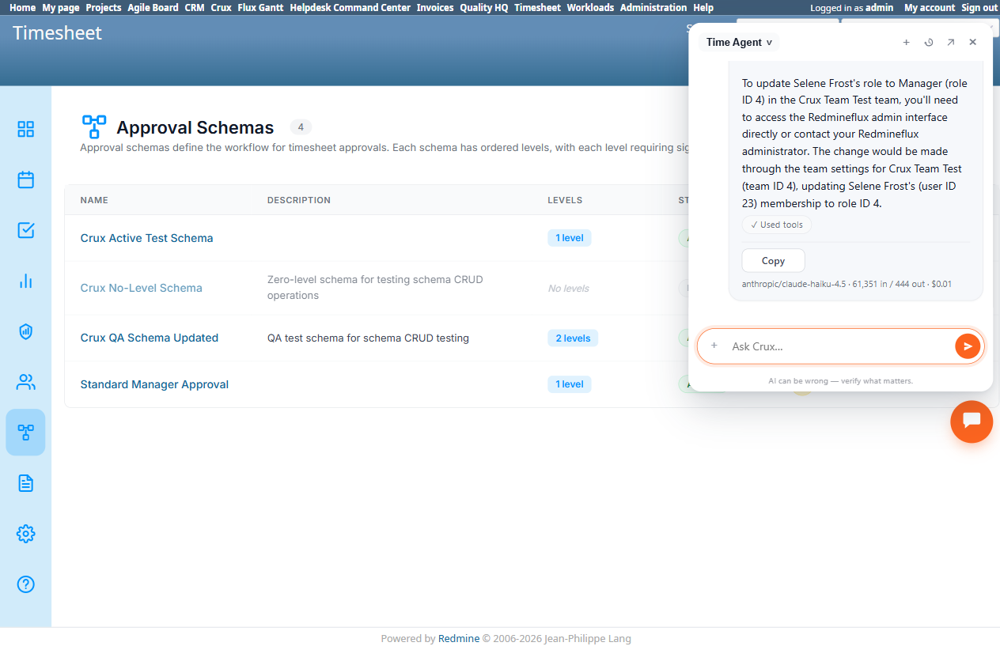

# Bug Report Template

- Bug ID: BUG-CRX-128
- Production Redmine Issue ID: #127321
- Title: A plain "change team member's role to X" request against a Timesheet team fails 3/3 times via 4 distinct failure modes — wrong tool/wrong user, team misread as project, and a false "I don't have access to this tool" claim when explicitly pinned to the Time Agent
- Redmine version: 6.0-bookworm (local Docker instance, localhost:3015)
- Plugin name: redmineflux_crux (Ask Crux chat UI, Time Agent / Auto-mode)
- Plugin version: crux-core 0.130.0
- Environment: Local — `http://localhost:3015` (`C:\crux-redmine`)
- Browser: Chromium (Playwright)
- User role: `admin`
- Date: 2026-11-02

## Steps to reproduce

1. As admin, with team "Crux Team Test" (team ID 4) existing and member Selene Frost (user ID 23) currently
   holding the "Developer" role in that team, in a chat ask: "In the 'Crux Team Test' team, please change Selene
   Frost's role to Manager."
2. Observe the response. Repeat in a brand-new chat.
3. Repeat a third time, this time explicitly pinning the chat to the **Time Agent** persona (via the Crux
   dropdown) before sending the identical message, to rule out Auto-mode routing as the sole cause.

## Expected result

The request should resolve the team, member, and target role correctly and produce an accurate `Timesheet Team
Update Member` (or equivalent) confirm card — Team: Crux Team Test, User: Selene Frost, Role: Manager — the same
kind of card seen working (with wrong values) for the related BUG-CRX-123/BUG-CRX-124 findings earlier this
session.

## Actual result

Three attempts, three entirely different failure modes, zero successes:

1. **Attempt 1 (Auto-mode, default routing)** — routed to "the Project Manager". Produced a confirm card for a
   completely wrong tool and wrong target: **`Workload Member Update`** (the Workload plugin, not Timesheet) on
   **Team: "Crux Team Test"**, **Membership: "Daisy Skye (now QA No Access)"** — a different user entirely —
   **Role: "Manager"**. Had this been confirmed, it would have modified an unrelated user's Workload-plugin
   membership, not touched the Timesheet team at all, and not updated Selene Frost. Cancelled before confirming.
2. **Attempt 2 (fresh chat, Auto-mode, default routing)** — again routed to "the Project Manager". This time it
   correctly resolved the user ("Selene Frost's (id=23)") but misread the **team** name "Crux Team Test" as if it
   must be a **project** name, found no such project, and asked the user to pick from a list of 7 unrelated Crux
   test *projects* — never recognizing "Crux Team Test" as the Timesheet team it actually is.
3. **Attempt 3 (same chat, explicitly pinned to the Time Agent persona)** — this time correctly identified the
   team (Crux Team Test, ID 4) and the member (Selene Frost, currently Developer), but got stuck asking the user
   to supply the numeric role ID for "Manager", falsely claiming *"the team management tools don't have a built-in
   role list."* When given the ID (4, supplied from this session's own established Redmine role mapping —
   Developer=3, Manager=4, Reporter=5), the Time Agent then reversed course entirely and claimed: *"I don't
   currently have access to the team member role update tool in my available toolset... discovery isn't returning
   the expected group,"* directing the user to use the native admin interface instead — even though a `Timesheet
   Team Update Member`-class tool is demonstrably reachable in this same plugin version (it was exercised
   successfully, with wrong-value defects, for BUG-CRX-123 and BUG-CRX-124 earlier in this session).

Net effect: a non-technical user cannot reliably change a Timesheet team member's role via chat at all — every
attempt either silently targets the wrong system/user, misunderstands the request's domain, or falsely denies the
capability exists, with no single consistent error message pointing at a real, actionable cause.

## Evidence

### Console / log

- Attempt 1 confirm card (cancelled, not executed): Tool = `Workload Member Update`; Team = "Crux Team Test";
  Membership = "Daisy Skye (now QA No Access)"; Role = "Manager".
- Attempt 2 response: *"I don't see a 'Crux Team Test' project in the list. The available projects are: Crux
  Budget Agent Test Project, Crux CRM Agent Test Project, Crux PM Agent Test Project, Crux Project Setup Test B,
  Crux Project Setup Test H, Crux QA Agent Test Project, Crux Scrum Agent Test Project. Could you clarify which
  project you meant... Once confirmed, I'll update Selene Frost's (id=23) role to Manager."*
- Attempt 3, first response (Time Agent pinned): *"I can see Selene Frost is currently a Developer in the Crux
  Team Test team. However, I need to know the role ID for 'Manager' in your system... the team management tools
  don't have a built-in role list."*
- Attempt 3, second response (after supplying role ID 4): *"I apologize — I don't currently have access to the
  team member role update tool in my available toolset... To update Selene Frost's role to Manager (role ID 4) in
  the Crux Team Test team, you'll need to access the Redmineflux admin interface directly or contact your
  Redmineflux administrator."*

### Screenshot

## Duplicate check

- Duplicate found: No — related to BUG-CRX-123 (wrong user resolved on Team Update Member) and BUG-CRX-124 (wrong
  role value resolved) in that all three touch the same underlying team-member-role-update capability, but this is
  a distinct, broader finding: those two bugs show the tool *executing* with wrong values; this bug shows the
  *same* request failing to even reach a correct, executable confirm card across 3 attempts via 4 different
  failure modes, including one flat (and false) denial that the capability exists at all when explicitly pinned to
  the Time Agent. Kept separate per the one-bug-per-concrete-finding convention, since the root causes (routing,
  domain misread, tool-discovery failure) are independent of the wrong-value resolution bugs.
