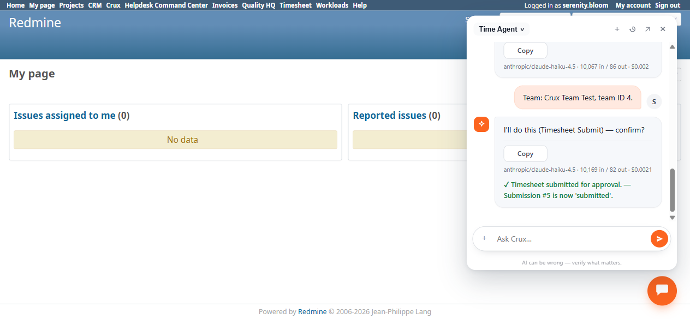

# Bug Report Template

- Bug ID: BUG-CRX-129
- Production Redmine Issue ID:
- Title: "Submit my timesheet for this week" via the Time Agent fails 2 of 3 times, with two distinct failure modes — a wrong context/week confirm card, and an immediate context-amnesia relapse right after correctly naming the team one turn earlier
- Redmine version: 6.0-bookworm (local Docker instance, localhost:3015)
- Plugin name: redmineflux_crux (Ask Crux chat UI, Time Agent)
- Plugin version: crux-core 0.130.0
- Environment: Local — `http://localhost:3015` (`C:\crux-redmine`)
- Browser: Chromium (Playwright)
- User role: `serenity.bloom` (Developer — non-admin, plain team member with no approval role)
- Date: 2026-11-02

## Steps to reproduce

Precondition: `serenity.bloom` has 5.0 hours logged for the current week (2–8 Nov 2026) on "Crux PM Agent Test
Project", and is a plain member (no approval role) of the "Crux Team Test" team (team ID 4), which has the
2-level "Crux QA Schema Updated" schema (L1=Manager, L2=Reporter) assigned.

1. **Attempt 1**: In a chat, ask simply: "Please submit my timesheet for this week." Observe the resulting confirm
   card's fields.
2. **Attempt 2** (fresh chat, no prior context): Ask the identical message. The agent first replies with an
   accurate plain-text proposal naming the correct team and week. Reply "Yes, that's correct, please proceed."
   Observe the next response.
3. **Attempt 3** (same chat, immediately after): Reply with the team name and ID explicitly: "Team: Crux Team
   Test, team ID 4." Observe whether a correct confirm card is finally produced.

## Expected result

A plain "submit my timesheet for this week" request, with only one real team membership and one week of logged
time to choose from, should resolve unambiguously and correctly every time — correct week (the current week,
Nov 02–08 2026) and correct context (the team the user actually belongs to, Crux Team Test / team ID 4) — without
needing the user to supply the team ID a second time after the agent has already stated it correctly.

## Actual result

Two different wrong responses across three attempts, with only the third succeeding (after the user supplied the
team ID explicitly):

1. **Attempt 1** produced a genuine `Timesheet Submit` confirm card (Confirm/Cancel buttons) with **two wrong
   fields**: `Context Type: project`, `Context: 1` (should be `team` / `4`) and `Week Start: 2026-10-27` — a date
   that matches neither the current week's Monday (2026-11-02) nor the previous week's Monday (2026-10-26); it is
   simply wrong. Verified natively that approval schema "Standard Manager Approval" is assigned to **Team**
   "Retest Squad" (ID 1), not to Project 1 — so `project`/`1` does not even correspond to any real schema
   assignment in this instance; it is an unrelated, fabricated context. Cancelled before confirming.
2. **Attempt 2** (fresh chat): first response correctly stated, in plain text: *"Submit your timesheet for this
   week (Nov 02–08, 2026) for **Crux Team Test** (team ID: 4) with **5.0 hours** logged."* — entirely correct. But
   replying "Yes, that's correct, please proceed" produced: *"I need to know which project or team context to
   submit your timesheet to. You mentioned 'this week' but I need the specific project or team ID... Could you
   please tell me: Which project or team should this be submitted to?"* — a complete reversal, discarding the
   team/ID it had itself stated one message earlier.
3. **Attempt 3** (same chat): only after the user re-supplied "Team: Crux Team Test, team ID 4" verbatim did the
   agent produce a correct confirm card (`Context Type: team`, `Context: 4`) and execute successfully
   ("✓ Timesheet submitted for approval. — Submission #5 is now 'submitted'."), verified natively — the weekly
   timesheet page now shows a disabled "Waiting for Approval" button and an active "Withdraw Submission" button
   for the correct week.

Net effect: the single most basic Time Agent self-service action — submitting one's own timesheet, with no
ambiguity in the real data (one team membership, one week of hours) — only succeeds if the user already knows and
supplies the internal team ID themselves, defeating the purpose of a conversational interface, and even then only
after the agent has already demonstrated (in attempt 2) that it CAN resolve this correctly on its own.

## Evidence

### Console / log

- Attempt 1 confirm card: `Context Type: project`, `Context: 1`, `Week Start: 2026-10-27`.
- Attempt 2, turn 1 (correct, never acted on): *"Submit your timesheet for this week (Nov 02–08, 2026) for Crux
  Team Test (team ID: 4) with 5.0 hours logged. Does this look correct?"*
- Attempt 2, turn 2 (after "Yes, that's correct, please proceed"): *"I need to know which project or team context
  to submit your timesheet to. You mentioned 'this week' but I need the specific project or team ID."*
- Attempt 3 (after explicit re-supply): confirm card `Context Type: team`, `Context: 4` → *"✓ Timesheet submitted
  for approval. — Submission #5 is now 'submitted'."* — verified natively: "Waiting for Approval" (disabled) +
  "Withdraw Submission" buttons present on `/timesheets/weekly` for the current week.

### Screenshot

## Follow-up — same "this week" resolution defect reproduces on Withdraw (2026-11-02)

After the Submit flow above succeeded (Submission #5, fully approved by both levels), tested Withdraw on the
same user/week as a quick cross-check: "Please withdraw my submitted timesheet for this week." response:
*"I don't see any submitted timesheets for you for this week (October 27 – November 2). This could mean: You
haven't submitted a timesheet for this week yet / Your timesheet is in a different status..."* — **October 27 –
November 2 is not a real week boundary in this system** (the actual current week is Nov 02–08; the previous week
is Oct 26 – Nov 1) — a third fabricated date range for "this week," on a third different tool (`Timesheet
Withdraw`), following the wrong `Week Start: 2026-10-27` seen on `Timesheet Submit` (attempt 1) and the correct
resolution later shown by the same tool in attempt 2. This confirms "this week" resolution is unreliable across
multiple Timesheet tools, not isolated to Submit.

Once told explicitly "the week of Nov 02-08, 2026 (submission #5, Crux Team Test)," the agent correctly declined
to withdraw: *"I can't withdraw submission #5 — it's already been approved (fully signed off at both levels by
Selene Frost and Sage Willow as of November 2). Withdrawal is only possible while a timesheet is in submitted
status and hasn't yet been approved by any level... you'd need to contact one of the approvers to reject it
first."* This matches native behavior — the weekly timesheet page shows only a disabled "Approved" button with no
Withdraw option once both levels have signed off — so the underlying business-rule check itself is accurate; only
the initial "this week" date resolution is defective.

## Duplicate check

- Duplicate found: No — distinct from the wrong-ID-resolution bugs found earlier this session (BUG-CRX-122/123/
  124/126), all of which resolved a *specific named entity* (team, user, role, time entry) to the wrong one. This
  bug is about the **Submit** action specifically failing to hold onto context across its own confirm/re-ask loop,
  including a genuine amnesia relapse immediately after correctly restating the context — a different failure
  shape (conversational state loss, not entity misresolution) on a different tool (`Timesheet Submit`). Also
  distinct from BUG-CRX-128 (Team Update Member routing/tool-discovery failures) — different tool, different root
  symptom (wrong field values, not wrong tool or false capability denial).
