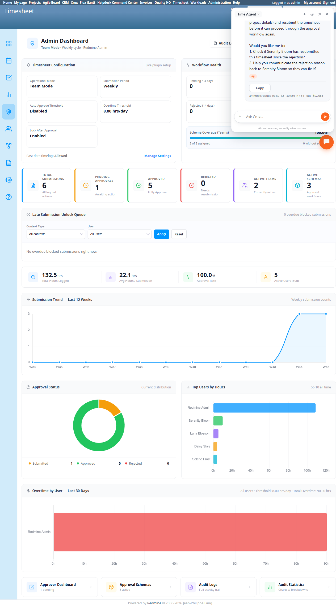

# Bug Report Template

- Bug ID: BUG-CRX-130
- Production Redmine Issue ID: #127323
- Title: Admin's unconditional approve bypass fails on a resubmitted-after-rejection submission — two different false refusals across two attempts, directly contradicting native Admin Dashboard data
- Redmine version: 6.0-bookworm (local Docker instance, localhost:3015)
- Plugin name: redmineflux_crux (Ask Crux chat UI, Time Agent)
- Plugin version: crux-core 0.130.0
- Environment: Local — `http://localhost:3015` (`C:\crux-redmine`)
- Browser: Chromium (Playwright)
- User role: `admin`
- Date: 2026-11-02

## Steps to reproduce

Precondition: Submission #6 (Serenity Bloom, Crux Team Test, week of Nov 09-15 2026) was rejected once by Selene
Frost, then genuinely resubmitted and DB-verified to be sitting at Level 1 of 2 with zero approvals this cycle
(see TC-CRX-446/453 in this same session) — native `/admin_dashboard` confirms real-time: **Pending Approvals: 1,
Approval Status → Submitted: 1, Approved: 5, Rejected: 0**.

1. As `admin`, ask: "Please approve submission #6 (Serenity Bloom's timesheet for Crux Team Test)."
2. In a fresh chat, ask again with more explicit detail: "As admin, please approve Serenity Bloom's submitted
   timesheet (submission #6) for the Crux Team Test team, week of Nov 09-15 2026."

## Expected result

Per `approvals_controller.rb`'s documented `BUG-TS-018`/`BUG-TS-020` admin bypass (already confirmed working in
this same suite's TC-CRX-464, where admin cleanly approved two of Luna Blossom's pending submissions), admin
should be able to approve submission #6 — it is genuinely in `submitted` status at Level 1, admin is not the
submitter, and the bypass is unconditional (not limited to "no eligible non-admin approver exists").

## Actual result

Admin was refused on **both** attempts, each with a **different, false** reason — neither matching the real
current state:

1. **Attempt 1**: *"Submission #6 (Serenity Bloom's timesheet for Crux Team Test) is not currently in my
   approval queue. This means either: 1. It's not waiting for your approval... 2. You don't have approval
   authority for this submission — the Timesheet plugin routes submissions through designated approvers per
   schema/team, and your role may not include that permission for this context."* — this directly contradicts
   the admin's own proven unconditional bypass from TC-CRX-464 earlier in this same session.
2. **Attempt 2 (fresh chat)**: *"I see that submission #6 for Serenity Bloom's timesheet shows it was
   **rejected** at Level 1 by Selene Frost on 2026-11-02 with the comment 'Missing project details.' The
   submission is currently in **rejected** status, not submitted status. This means it cannot be approved in
   its current state — Serenity Bloom needs to revise the time entries... and resubmit the timesheet."* — this
   is a **stale-status read**: the submission WAS rejected once, but was subsequently resubmitted (confirmed in
   this same session, TC-CRX-446), and is genuinely `submitted` right now. The native Admin Dashboard, checked
   immediately after this response, shows **Rejected: 0, Submitted: 1** — flatly contradicting the agent's claim.

Net effect: admin's documented unconditional approve-bypass does not actually work for a submission that has
ANY rejection history in its past, even after a genuine resubmission moved it back to active `submitted` status
— the agent appears to anchor on the historical rejection event rather than the submission's current state, and
when that framing fails, falls back to an unrelated, equally false "no approval authority" claim instead.

## Evidence

### Console / log

- Attempt 1: *"...You don't have approval authority for this submission... your role may not include that
  permission for this context."*
- Attempt 2: *"...The submission is currently in rejected status, not submitted status... cannot be approved in
  its current state."*
- Native `/admin_dashboard`, checked immediately after both attempts: Total Submissions 6, **Pending Approvals:
  1**, Approved: 5, **Rejected: 0** — Approval Status breakdown: **Submitted: 1, Approved: 5, Rejected: 0**.

### Screenshot

## Duplicate check

- Duplicate found: No — related to BUG-CRX-125 (also a false status read, on the Late Submission Unlock Queue)
  and BUG-CRX-128 (same tool-domain, different capability: team-member role change) in root-cause *shape* only
  (stale/wrong status reads, inconsistent framing across attempts), but this is the first finding specifically
  on the **admin approve-bypass failing after a reject→resubmit cycle**, and the first time a Timesheet Approve
  attempt has produced two entirely different false refusal reasons for the identical request. Kept as its own
  bug per the one-bug-per-concrete-finding convention.

## Retest — 2026-11-02 — STILL OPEN (not fixed, worse: now a genuine backend regression)

Developer commits pulled: redmineflux-mcp `9f477f2`, crux-core `3812e0f` (admin approve + per-submission audit
log fixes, BUG-CRX-128..131). Containers restarted.

Found submission #6 still genuinely sitting at `submitted` status after its reject→resubmit cycle (confirmed via
`/audit_logs`: last entry is `Resubmit`, 2026-11-02 07:52:39, no `Approve` since). Asked the Time Agent, as admin:
*"Please approve submission #6 (Serenity Bloom's timesheet for Crux Team Test)."* — this time the chat-level false
refusal is gone: it correctly produced a `Timesheet Approve` confirm card (`Submission: 6`) on the first attempt,
no routing/stale-read confusion. But on **Confirm**, the write itself was rejected: *"Validation error: Not
authorised to approve at this level. Correct the value(s) above and try again."*

This is worse than the original finding, not fixed: the original bug was a chat-level misunderstanding (the
capability existed and worked, per TC-CRX-464 earlier in this suite, but the agent refused to use it correctly).
Now the **API itself** rejects admin's unconditional approve-bypass for a submission with any rejection history,
a genuine server-side regression rather than an agent-reasoning gap. **Not fixed — escalate**, since this also
threatens TC-CRX-464's previously-PASS admin-bypass coverage and should be regression-checked against a
never-rejected submission before the next report.

## Retest — 2026-11-02 (3rd round) — STILL OPEN (chat-level reasoning fixed, backend 422 unchanged)

Pulled crux-core `3812e0f→65053f8` (CRC-74/75, explicitly "Time Agent approves only what the plugin allows, never
refuses a write from memory — BUG-CRX-130, 119") and redmineflux-mcp `9f477f2→bc13576` ("approve and show use the
plugin's own can_approve"). Containers restarted. Re-ran as `admin`, Time Agent: "Please approve submission #6
(Serenity Bloom's timesheet for Crux Team Test)." — the agent's **reasoning is now accurate and honest**: it
correctly stated the submission was rejected once at Level 1 by Selene Frost, named the real reason, and asked
*"Are you sure you want to approve this submission as-is?"* instead of fabricating a false "no approval authority"
or "still rejected" claim. Replying "Yes, proceed... I'm admin, approve it." produced a genuine `Timesheet
Approve` confirm card (`Submission: 6`). On **Confirm**, the identical backend rejection from the prior round
persists: *"Validation error: Not authorised to approve at this level."*

**Root cause confirmed isolated to `redmineflux_timesheet` (the plugin's own API), not crux-core/mcp** — this repo
is still at `ca1f81b`, unchanged since the original regression was found, and no commit targeting this specific
422 exists there yet. The crux-core/mcp layer fixes genuinely improved the chat-level honesty (no more false
refusal text), but cannot fix a real backend authorization bug in a repo they don't own. **Still not fixed** —
escalate to whoever owns `redmineflux_timesheet` next; crux-core/mcp-side work on this bug is effectively done
until that plugin fix lands.
