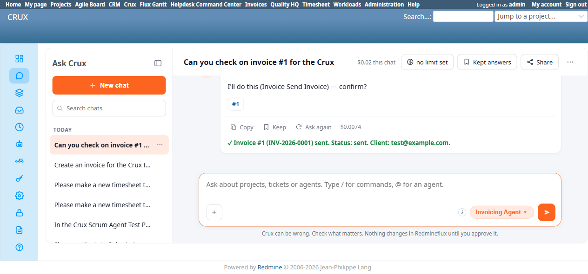

# Bug Report Template

- Bug ID: BUG-CRX-133
- Production Redmine Issue ID: #127460
- Title: Invoicing Agent's "Send Invoice" silently targets a different, unrelated project when the current message doesn't re-name it — same wrong-project-resolution defect class as BUG-CRX-080/093/101, now on the Invoicing Agent
- Redmine version: 6.0-bookworm (local Docker instance, localhost:3015)
- Plugin name: redmineflux_crux (Ask Crux chat UI, Invoicing Agent)
- Plugin version: crux-core 0.130.0
- Environment: Local — `http://localhost:3015` (`C:\crux-redmine`)
- Browser: Chromium (Playwright)
- User role: admin
- Date: 2026-11-03

## Steps to reproduce

1. As `admin`, fresh chat, Invoicing Agent pinned. First message established **Crux Invoice Agent Test
   Project** as the chat's working project: "Can you check on invoice #1 for the Crux Invoice Agent Test
   Project?" — correctly answered using that project's real invoice #1 (INV-2026-0001, Draft).
2. In the same chat, without re-naming the project: "Send invoice #1 to the client now."

## Expected result

Per the repo-wide rule already enforced (with fixes) on other domain agents for this exact defect class
(BUG-CRX-080/093/101), the project this chat had already been operating on should be reused when the current
message doesn't name a different one — not silently replaced by an unrelated project.

## Actual result

The response was: *"✓ Invoice #1 not found in project 'crux-pm-agent-test-project' (#1). Verify the invoice
ID belongs to this project..."* — **a completely different, unrelated project** (`crux-pm-agent-test-project`,
id 1) was silently substituted for the `Crux Invoice Agent Test Project` (id 10) this chat had just
confirmed real data for one turn earlier. No bad write occurred here only because invoice #1 doesn't exist
in that wrong project either — had an invoice with the same numeric id genuinely existed in the wrong
project, it could have been sent to the wrong client with no warning.

Retrying in the same chat with the project explicitly re-named ("Send invoice #1 for the Crux Invoice Agent
Test Project to the client now.") correctly resolved `Project: Crux Invoice Agent Test Project` and
succeeded cleanly: *"✓ Invoice #1 (INV-2026-0001) sent. Status: sent."* — confirming the send mechanism
itself works correctly once properly scoped; this is purely a project-resolution defect on a message that
doesn't restate the project.

**Secondary, independently-notable observation**: the "not found" failure is rendered with a misleading
**✓** success prefix — the same already-well-documented false-success-icon defect class as
BUG-CRX-009/018/054/067/082/086.

## Evidence

### Screenshot

### Console / log

- First send attempt (verbatim): *"✓ Invoice #1 not found in project 'crux-pm-agent-test-project' (#1).
  Verify the invoice ID belongs to this project. (If you expected this invoice #1 to exist, verify the ID
  with the corresponding list_* tool.)"*
- Retry with explicit project name (verbatim): confirm card `Project: Crux Invoice Agent Test Project`,
  `Invoice: 1` → *"✓ Invoice #1 (INV-2026-0001) sent. Status: sent. Client: test@example.com."*
- Native verification on `/invoices?project_id=crux-invoice-agent-test-project`: invoice #1's Status column
  genuinely reads "Sent" after the second attempt.

## Duplicate check

- Duplicate found: No new root cause — same general class as **BUG-CRX-080** (Testcase-Management, fixed via
  `field_check`), **BUG-CRX-093** (same root cause on read tools, outside that fix's scope), and
  **BUG-CRX-101** (Scrum Agent, Agile Board plugin). This is a **fresh recurrence on a fourth domain — the
  Invoicing Agent's `send_invoice` tool specifically** — kept as its own bug file per this repo's one-bug-
  per-domain rule (see `bugs/_duplicates.md` for the equivalent BUG-CRX-094/096/101 precedent).
