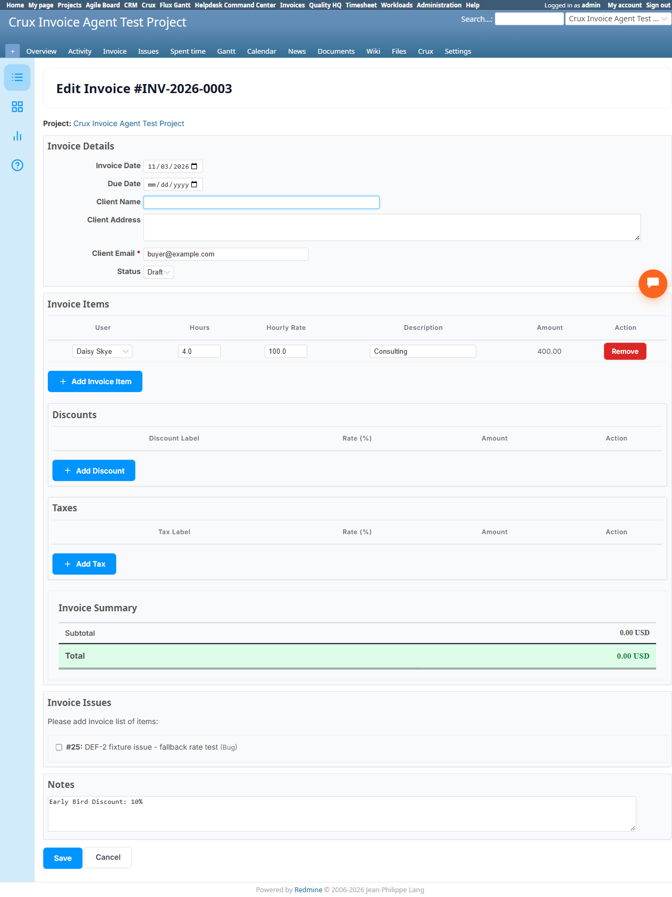

# Bug Report Template

- Bug ID: BUG-CRX-136
- Production Redmine Issue ID:
- Title: Invoicing Agent's `create_invoice` has no support for the native Discounts or named/multiple Taxes line-item systems — a requested discount is silently dropped from the real total (only mentioned as text in Notes), and named taxes (e.g. CGST/SGST) are collapsed into one opaque percentage with no line-item breakdown
- Redmine version: 6.0-bookworm (local Docker instance, localhost:3015)
- Plugin name: redmineflux_crux (Ask Crux chat UI, Invoicing Agent) / redmineflux_invoice (native plugin feature gap)
- Plugin version: crux-core 0.130.0
- Environment: Local — `http://localhost:3015` (`C:\crux-redmine`)
- Browser: Chromium (Playwright)
- User role: admin
- Date: 2026-11-03

## Steps to reproduce

1. Confirm the native "New Invoice" form (`/invoices/new`) has two genuine, separate line-item systems beyond
   the basic line items: a **Discounts** table (Discount Label, Rate %, Amount) and a **Taxes** table (Tax
   Label, Rate %, Amount — placeholder example "e.g., CGST, SGST", confirming multiple independently-named
   taxes are a real, intended use case, e.g. Indian GST).
2. As `admin`, Invoicing Agent pinned, fresh chat: "Create an invoice for the Crux Invoice Agent Test
   Project, client email buyer@example.com, one line item: 'Consulting', quantity 4, rate 100, user id 1.
   Apply a 10% 'Early Bird Discount' and add CGST tax at 9% and SGST tax at 9%."
3. Confirm the resulting `Invoice Create Invoice` card and the final created invoice.

## Expected result

The discount should genuinely reduce the invoice total by 10% of the subtotal, and the two named taxes
(CGST 9%, SGST 9%) should appear as two separate, labeled line items in the native Taxes table — matching
what a user can do natively and what the invoice's own PDF/email template presumably needs for a compliant
GST-style invoice.

## Actual result

The confirm card showed: `Line Items: [{'description': 'Consulting', 'quantity': 4, 'rate': 100, 'user_id':
1}]`, `Tax Rate: 18`, `Notes: "Early Bird Discount: 10%"` — the tool has silently:
- **Collapsed CGST (9%) + SGST (9%) into a single flat `Tax Rate: 18`** — no separate labeled tax lines are
  created at all.
- **Dropped the discount from the actual calculation entirely**, merely writing "Early Bird Discount: 10%"
  as free text into the Notes field — with zero effect on the real total.

Confirming created **Invoice #3 — INV-2026-0003, total $472.00** (subtotal $400 × 1.18, exactly — i.e. the
discount contributed nothing to the math). The correct total, had the discount genuinely been applied before
tax, would be $400 − $40 = $360 × 1.18 = **$424.80** — a **$47.20 discrepancy**, i.e. the client is silently
billed the full pre-discount amount while the invoice's own Notes field claims a 10% discount was given.

Native verification on `/invoices/3/edit`: both the **Discounts** table and the **Taxes** table are
genuinely **empty** (zero rows in either) — the 18% "Tax Rate" shown in the confirm card is a different,
flat field on the Invoice model itself, entirely disconnected from the native structured Taxes line-item
system a real user would use and that a GST-compliant invoice needs to show (CGST and SGST must be itemized
separately for Indian tax compliance, not merged into one unlabeled number).

This is a genuine financial-correctness defect (the discount fabrication) compounded by a real feature gap
(no access to the native named-tax system) — not merely a missing nice-to-have, since the resulting invoice
total is factually wrong relative to what the user explicitly asked for.

## Evidence

### Screenshot

### Console / log

- Confirm card (verbatim): `Line Items: [{'description': 'Consulting', 'quantity': 4, 'rate': 100,
  'user_id': 1}]`, `Tax Rate: 18`, `Notes: "Early Bird Discount: 10%"`.
- Result (verbatim): *"✓ Invoice created: #3 — INV-2026-0003 for buyer@example.com (status: draft, total:
  472.0)"*.
- Native verification, `/invoices?project_id=crux-invoice-agent-test-project`: Subtotal `USD 400.00`, Total
  `USD 472.00` — exact match to `400 × 1.18`, confirming no discount was applied anywhere in the real
  calculation.
- Native verification, `/invoices/3/edit`: `Discounts` table — 0 rows. `Taxes` table — 0 rows. `Notes` field
  genuinely contains only the string `"Early Bird Discount: 10%"`.

## Duplicate check

- Duplicate found: No. First finding on the Invoicing Agent's Discounts/Taxes feature coverage — distinct
  from BUG-CRX-132 (nil `due_date` crash), BUG-CRX-133 (wrong-project resolution), BUG-CRX-134 (Set Team
  Rate 500 crash), and BUG-CRX-135 (Delete lifecycle gap). Related in spirit to the already-documented DEF-2
  fallback-rate defect (wrong/undisclosed figures silently reaching a real invoice total) but a distinct
  root cause (missing tool parameters for two entire native features, not a rate-fallback calculation).
