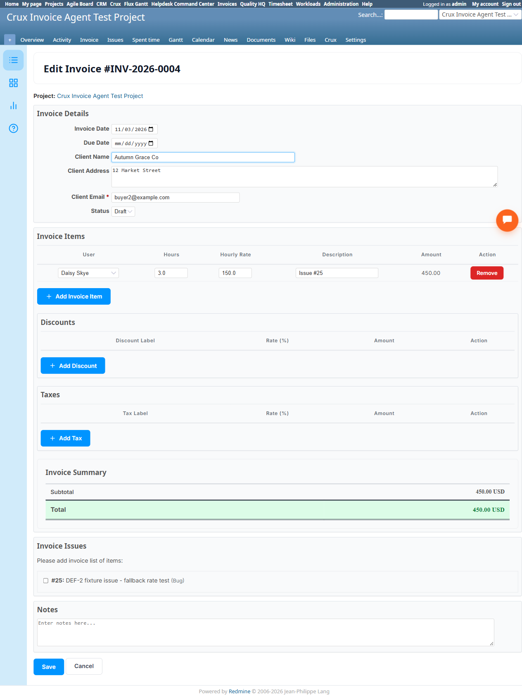

# Bug Report Template

- Bug ID: BUG-CRX-137
- Production Redmine Issue ID: #127470
- Title: Invoicing Agent's `create_invoice` can never genuinely link a line item to a real Redmine issue — the native "Invoice Issues" checkbox mechanism is unreachable via chat; "for issue #X" only ever produces a plain-text description mentioning the number
- Redmine version: 6.0-bookworm (local Docker instance, localhost:3015)
- Plugin name: redmineflux_crux (Ask Crux chat UI, Invoicing Agent)
- Plugin version: crux-core 0.130.0
- Environment: Local — `http://localhost:3015` (`C:\crux-redmine`)
- Browser: Chromium (Playwright)
- User role: admin
- Date: 2026-11-03

## Steps to reproduce

1. Confirm the native "New Invoice" form has a genuine "Invoice Issues" section — a list of real, checkbox-
   selectable open issues in the project ("Please add invoice list of items:"), intended to let a user pull
   a real issue into the invoice as a genuinely-linked item.
2. As `admin`, Invoicing Agent pinned, fresh chat: "Create an invoice for the Crux Invoice Agent Test
   Project, client name 'Autumn Grace Co', client address '12 Market Street', client email
   buyer2@example.com, for issue #25, quantity 3, rate 150, user id 1."
3. Confirm the resulting invoice, then inspect it natively.

## Expected result

A line item explicitly tied to a real issue ("for issue #25") should result in the native "Invoice Issues"
checkbox for issue #25 being genuinely checked/linked on the created invoice — the same real association a
user gets by checking that box natively — not merely a text description that happens to mention the issue
number.

## Actual result

The confirm card correctly resolved `Client Name: Autumn Grace Co`, `Client Address: 12 Market Street`,
`Client Email: buyer2@example.com` (all three fields genuinely supported — positive finding), but the line
item itself was: `[{'description': 'Issue #25', 'quantity': 3, 'rate': 150, 'user_id': 1}]` — a plain-text
description string, not a real reference. Confirming created Invoice #4 (total $450, math correct for this
part). Native verification on `/invoices/4/edit`: the "Invoice Issues" checkbox for *"#25: DEF-2 fixture
issue - fallback rate test (Bug)"* is genuinely **unchecked** — no real link between this invoice and issue
#25 exists anywhere; the only trace is the word "Issue #25" inside a free-text Description field, which is
cosmetically similar but structurally meaningless (e.g. it won't show up in any report or query that looks
for invoices linked to a specific issue).

This is a real capability gap: the Invoicing Agent's `create_invoice` tool has no parameter for genuinely
attaching a real issue to a line item, only a free-text `description` field — the agent fakes the
appearance of an issue reference without the underlying structural link the native UI actually creates.

## Evidence

### Screenshot

### Console / log

- Confirm card (verbatim): `Client Name: Autumn Grace Co`, `Client Address: 12 Market Street`, `Client
  Email: buyer2@example.com`, `Line Items: [{'description': 'Issue #25', 'quantity': 3, 'rate': 150,
  'user_id': 1}]`.
- Result (verbatim): *"✓ Invoice created: #4 — INV-2026-0004 for Autumn Grace Co (status: draft, total:
  450.0)"*.
- Native verification, `/invoices/4/edit`: Line item's own Description field genuinely reads just `"Issue
  #25"` (plain text). The "Invoice Issues" section's checkbox for `#25: DEF-2 fixture issue - fallback rate
  test (Bug)` is unchecked.

## Duplicate check

- Duplicate found: No. First finding on the Invoicing Agent's issue-linking capability. Distinct from
  BUG-CRX-136 (Discounts/Taxes gap, same session, same investigation) — a different native feature
  (issue-linked line items vs. discount/tax line items) with the same general root cause shape (a real
  native feature with no corresponding tool parameter, so the agent fakes a text-only approximation).
  **Positive finding in the same test, not a defect**: Client Name and Client Address are both genuinely
  supported fields, correctly resolved and persisted.

## Retest — 2026-11-04 (STILL REPRODUCES — PARTIALLY IMPROVED, NOT FIXED)

Retested with the same repro shape: "...for issue #25, quantity 2, rate 150, user id 1." The confirm card this
time showed a **genuine improvement** — the line item JSON now carries a real `'issue_id': 25` field (`[{...,
'user_id': 1, 'issue_id': 25}]`), not just a text description — confirming `create_invoice` gained a real
`issue_id` parameter since the original report.

However, created Invoice #8 — INV-2026-0008, total $300.00 (math correct). Native-verified on
`/invoices/8/edit`: the "Invoice Issues" section's checkbox for *"#25: DEF-2 fixture issue - fallback rate
test (Bug)"* is **still genuinely unchecked** — the real, structural link the native UI creates (the
checkbox-driven association) still doesn't happen, even though the tool now accepts and stores an `issue_id`
value somewhere. The line item's own Description field now reads plain "Consulting Retest136" (no longer even
a text workaround mentioning the issue number) — so the only trace of "issue #25" is the `issue_id` value in
the API payload, which still doesn't translate into the native checkbox-based association a real user would
see or rely on.

**Conclusion: STILL REPRODUCES**, though with a partial improvement (a real `issue_id` parameter now exists
on the tool, where none did before) — the underlying structural-link gap identified in the original report
is not yet closed. **Bug stays open.** Production issue #127470 remains in its current status (not synced to
Done).

## Retest — 2026-11-05 (STILL REPRODUCES — crux-core 1.0.0, Invoice Agent)

First attempt (same chat as a just-confirmed unrelated invoice, `ses-401`): the identical request produced only
fabricated prose ("Proposal: ... Shall I create this invoice?") with **no real Confirm/Cancel button at all** —
a different, fabricated-confirm-class symptom than the original finding. Retried the exact same message in a
genuinely fresh chat (`ses-402`) and got a real confirm card this time (`Invoice Create Invoice`, Line Items:
`[{'description': 'Issue #25', 'quantity': 3, 'rate': 150, 'user_id': 1, 'issue_id': 25}]`) — confirming the
missing-confirm-card symptom is chat-history-dependent, not a stable defect of this specific tool path (worth a
note for `CRUX_MEMORY.md`, not re-filing separately here).

Confirmed, creating Invoice #11 — INV-2026-0011, total $450.00. Native-verified on `/invoices/11/edit`: the
"Invoice Issues" checkbox for `#25: DEF-2 fixture issue - fallback rate test (Bug)` is still genuinely
**unchecked** — same structural-link gap as both prior findings, the `issue_id` value still doesn't translate
into the real native checkbox association.

**Conclusion: STILL REPRODUCES.** **Bug stays open.**

## Retest — 2026-11-11 (STILL REPRODUCES — developer marked "In QA", production #127470)

Same repro shape, fresh chat, Auto routing (landed on Invoice Agent): "...for issue #25, quantity 3, rate 150,
user id 1." Agent first correctly caught that user id 1 isn't a project member and asked which real member to
use (Daisy Skye or Luna Blossom) — a genuine improvement tying into BUG-CRX-139's fix. Supplied Daisy Skye;
confirm card showed `Line Items: [{'description': 'Issue #25', 'quantity': 3, 'rate': 150, 'user_id': 6,
'issue_id': 25}]` — the real `issue_id` field is present as in prior retests.

Confirmed, creating Invoice #12 — INV-2026-0012, total $450.00. Native-verified on `/invoices/12/edit` via
direct DOM inspection of the checkbox element (`input[name="invoice[invoice_issues][]"][value="25"]`):
`checked: false` — the "Invoice Issues" checkbox for `#25: DEF-2 fixture issue - fallback rate test (Bug)` is
still genuinely **unchecked**. Same structural-link gap as all three prior findings — the `issue_id` value in
the API payload still never translates into the native checkbox-based association a real user would see.

**Conclusion: STILL REPRODUCES.** Developer's "In QA" move on production #127470 does not reflect a real fix.
**Bug stays open — NOT moved to closed, production status NOT updated.**
