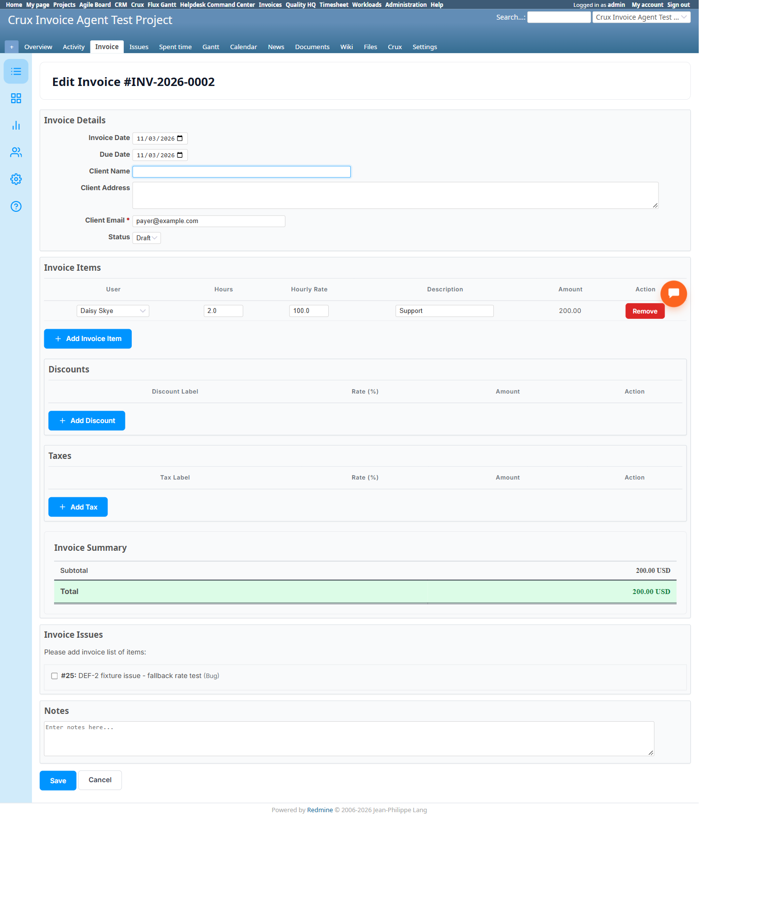

# Bug Report Template

- Bug ID: BUG-CRX-139
- Production Redmine Issue ID: #127472
- Title: Invoicing Agent's `create_invoice` silently substitutes a completely different, real user for the line item's `user_id` when the one given isn't a formal project member — explicitly confirmed `user_id: 1` (Redmine Admin) on the agent's own confirm card, but 3/3 created invoices genuinely persist "Daisy Skye" (user id 6) instead
- Redmine version: 6.0-bookworm (local Docker instance, localhost:3015)
- Plugin name: redmineflux_crux (Ask Crux chat UI, Invoicing Agent) / redmineflux_invoice (native plugin, root cause)
- Plugin version: crux-core 0.130.0
- Environment: Local — `http://localhost:3015` (`C:\crux-redmine`)
- Browser: Chromium (Playwright)
- User role: admin
- Date: 2026-11-03

## Steps to reproduce

1. As `admin` (Redmine user id 1, NOT a formally-added project member of the target project — only
   `luna.blossom` and `daisy.skye` are explicit project members), Invoicing Agent pinned: create an invoice
   with a line item explicitly specifying `user_id: 1` (e.g. "...one line item: 'Consulting', quantity 4,
   rate 100, user id 1."). The agent's own confirm card genuinely shows `'user_id': 1` in the Line Items
   JSON before confirming.
2. Confirm the invoice.
3. Natively open the created invoice's Edit page (`/projects/<project>/invoices/<id>/edit`) and inspect the
   line item's own `User` dropdown.

## Expected result

The line item's stored/persisted user should genuinely be user id 1 (Redmine Admin) — matching exactly what
was shown and confirmed on the agent's own confirm card. If user id 1 is genuinely not a valid choice for
this invoice (e.g. because the native line-item User dropdown is restricted to formal project members and
Admin isn't one), the agent should refuse or warn **before** showing a confirm card that claims `user_id: 1`
will be used — not silently confirm one value and persist a different one.

## Actual result

Reproduced **3 of 3 times**, across three separately-created invoices (#2, #3, #4), all created in the same
session with the same explicit `user_id: 1` in the request and the same `'user_id': 1` shown on each
confirm card: every single one, when inspected on its native Edit page, shows the line item's `User`
dropdown with **"Daisy Skye"** (the real user id 6) genuinely selected — never Redmine Admin. The dropdown's
own option list for this field only offers `-- Select User --`, `Daisy Skye`, and `Luna Blossom` — Redmine
Admin is not even a selectable option, confirming the native line-item User field is restricted to the
project's actual formal members, which Admin is not.

So the agent proposes and gets confirmation on `user_id: 1`, but the real write silently falls back to a
different, real person (Daisy Skye) with zero disclosure anywhere — not an honest validation error, not a
refusal, and not even a different value reported back in the "✓ Invoice created" success message (which
never mentions the user at all). A real invoice's line item is now attributed to a specific named person
(Daisy Skye) who never did that work and was never mentioned anywhere in the request — a genuine data-
integrity and audit-trail defect, not merely a cosmetic one.

## Evidence

### Screenshot

### Console / log

- Confirm card for invoice #2 (verbatim JSON): `Line Items: [{'description': 'Support', 'quantity': 2,
  'rate': 100, 'user_id': 1}]`.
- Confirm card for invoice #3 (verbatim JSON): `Line Items: [{'description': 'Consulting', 'quantity': 4,
  'rate': 100, 'user_id': 1}]`.
- Confirm card for invoice #4 (verbatim JSON): `Line Items: [{'description': 'Issue #25', 'quantity': 3,
  'rate': 150, 'user_id': 1}]`.
- Native verification, all three invoices' Edit pages (`/projects/crux-invoice-agent-test-project/invoices/
  2/edit`, `.../3/edit`, `.../4/edit`): the line item's `User` combobox genuinely shows **"Daisy Skye"**
  selected in every case — 3 for 3.
- Native confirmation `/users/1` = "Redmine Admin"; `/users/6` = "Daisy Skye" — ruling out any naming
  confusion.
- Native Edit page's own `User` dropdown option list for this field: `-- -- Select User -- --`, `Daisy
  Skye`, `Luna Blossom` — Redmine Admin genuinely isn't a selectable option at all.

## Duplicate check

- Duplicate found: No new root cause filed as a separate class — shares the general "proposes/confirms one
  value, persists a different one" shape with the already-documented wrong-ID-resolution family
  (BUG-CRX-015/019/038/043/050/052/079 etc.), but this is the first instance where the *confirm card itself*
  already shows the correct requested value and the user has already approved it — the substitution happens
  silently between confirmation and the actual database write, not during the agent's own proposal-building
  reasoning. Distinct from BUG-CRX-132/133/134/135/136/137/138 (all different tools/root causes on this
  suite). Kept as its own bug given the distinct mechanism and severity.

## Retest — 2026-11-04 (STILL REPRODUCES — NOT FIXED)

Retested the exact original repro: as `admin` (user id 1, not a formal project member), create an invoice
with `user_id: 1` explicit in the line item. Confirm card again correctly showed `'user_id': 1` in the Line
Items JSON — confirmed, creating Invoice #9 — INV-2026-0009.

Native-verified on `/invoices/9/edit`: the line item's `User` dropdown still genuinely shows **"Daisy Skye"**
selected, not Redmine Admin — the identical silent substitution as the original report. Worth noting this is
asymmetric with this round's BUG-CRX-134 fix: `set_team_rate` now correctly validates/refuses a non-member
user id, but `create_invoice`'s line-item `user_id` still silently substitutes instead of refusing or
persisting the confirmed value.

**Conclusion: STILL REPRODUCES.** **Bug stays open.** Production issue #127472 remains in its current status
(not synced to Done).
