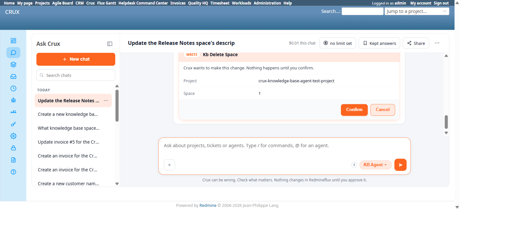

# Bug Report Template

- Bug ID: BUG-CRX-140
- Production Redmine Issue ID: #127507
- Title: KB Agent's write tools (`update_space`, `delete_space`, `create_node`, `update_node`) silently fabricate a wrong project identifier string on later-turn confirm cards in a multi-turn chat — causing genuine write failures ("Project not found") in most cases, and in one case (`delete_space`) a genuinely wrong REAL RECORD being targeted instead — reproduced repeatedly across 4 different tools; fresh-chat/first-message writes are unaffected
- Redmine version: 6.0-bookworm (local Docker instance, localhost:3015)
- Plugin name: redmineflux_crux (Ask Crux chat UI, KB Agent) / redmineflux_knowledgebase (native plugin)
- Plugin version: crux-core 0.130.0
- Environment: Local — `http://localhost:3015` (`C:\crux-redmine`)
- Browser: Chromium (Playwright)
- User role: admin
- Date: 2026-11-03

## Steps to reproduce

1. In a single chat, KB Agent pinned: create a space "Release Notes" (becomes space #2 — space #1
   "Engineering Docs" already exists with real content from this chat's own earlier fixture setup).
2. In the same chat, genuinely update the "Release Notes" space's description — confirm card and result both
   correctly reference `Space #2`, name `'Release Notes'` (native-verified correct).
3. In the same chat: "Delete the Release Notes space." The agent first asks an explicit yes/no pre-check
   naming "Release Notes" correctly, then (after "Yes, delete it.") shows the real `Kb Delete Space` confirm
   card.
4. Inspect the confirm card's `Space` field before confirming.

## Expected result

The confirm card's `Space` field should genuinely be `2` (Release Notes) — matching the space named in the
request and already correctly resolved as space #2 earlier in the identical chat.

## Actual result

Reproduced **2 of 2 times** (once via "Yes, delete it." follow-up, once via a fresh repeat of "Delete the
Release Notes space." in the same chat): the confirm card's `Space` field genuinely shows **`1`** — the real
`Engineering Docs` space, which holds this suite's actual fixture content (2 pages including a published page
with real content, 1 folder) — not space #2 (`Release Notes`, empty) which is what was actually requested and
named. Had this been confirmed without checking, it would have permanently deleted the wrong, real,
content-bearing space — "This will delete the space AND every folder, page, and version history within it.
This action cannot be undone," per the agent's own prior warning text in the same turn.

**Secondary, compounding observation**: the `Project` field on the same confirm card shows yet another
inconsistent value across attempts — `crux-knowledge-base-agent-test-project` (a fabricated, nonexistent
slugified-from-display-name identifier; the project's real identifier is `crux-kb-agent-test-project`) on one
attempt, and `crux-kb-agent-test` (a different, truncated, also-nonexistent identifier) on another — neither
matches the real project identifier, despite this exact chat having already used the correct identifier
(`crux-kb-agent-test-project`) successfully on an earlier `create_space` call in the same session. This
project-identifier instability is a related but distinct symptom from the wrong-`Space`-id defect — both point
to the KB Agent's write-tool argument construction not reliably reusing already-correctly-resolved IDs from
earlier in the same chat, instead re-deriving (and getting wrong) a fresh guess on later write calls.

Both deletion attempts were caught and cancelled before any data loss — verified natively on
`/projects/crux-kb-agent-test-project/knowledgebase` that both `Engineering Docs` (space #1) and `Release
Notes` (space #2) still genuinely exist, untouched.

**Further reproductions, 2026-11-03 (same investigation) — root-cause pattern now clear.** The same
project-identifier fabrication recurred on `create_node` (once, failed then succeeded on retry) and on
`update_node` (twice in a row, both failed — see Console/log for exact strings). Across roughly 7 write-tool
confirm cards observed in this investigation, a clear pattern emerged:

- **Fresh chat, first message in that chat** → the confirm card always correctly shows either the project's
  real identifier (`crux-kb-agent-test-project`) or its real display name (`Crux Knowledge Base Agent Test
  Project`) — and the write always succeeds.
- **A later-turn write in a chat that had already correctly resolved the project in an earlier turn** →
  the confirm card instead shows a corrupted/fabricated variant — observed forms include
  `crux-knowledge-base-agent-test-project` (a plausible-looking but nonexistent full slugification of the
  display name) and `crux-kb-agent-test` (a truncated, also-nonexistent variant) — and the write then
  genuinely fails with *"✓ Project not found"* (note the misleading ✓ prefix on a failure, the established
  BUG-CRX-009/018/054/067/082/086 class) in most cases, or (the `delete_space` case) targets a different, real
  record's numeric id instead of failing cleanly.

This is now confirmed across **4 different write tools** (`update_space`, `delete_space`, `create_node`,
`update_node`) — a systemic, context-carryover defect in how the KB Agent resolves/re-derives the project
argument for a write call made later in an already-established chat, rather than reusing the already-correct
value from earlier in the same chat. It shares its general shape with the wrong-project-resolution family
already documented elsewhere this cycle (BUG-CRX-080/093/101/133) — a later-turn write re-deriving the project
instead of reusing context — but manifests differently here: instead of switching to a different, real,
unrelated project (as in the BUG-CRX-133 family), the KB Agent corrupts the identifier string itself into a
plausible-looking but nonexistent value, which usually fails cleanly but, combined with a wrong numeric
record id (`delete_space`), can silently target a different real record instead.

## Evidence

### Screenshot

### Console / log

- Prior turn (correct): confirm card + result for `update_space` on "Release Notes" — *"✓ Space #2 updated.
  Name: 'Release Notes'."* — space #2 correctly resolved in this exact chat, moments before the delete attempt.
- Delete confirm card (attempt 1, verbatim): `Project: crux-knowledge-base-agent-test-project`, `Space: 1`.
- Delete confirm card (attempt 2, fresh repeat in same chat, verbatim): `Project:
  crux-knowledge-base-agent-test-project`, `Space: 1` (identical wrong Space id both times; Project string
  varied across the session's several confirm cards — see Secondary observation above).
- Native verification, `/projects/crux-kb-agent-test-project/knowledgebase`: both `Engineering Docs` (2 Pages,
  1 Folder) and `Release Notes` (0 Pages, 0 Folders) genuinely still exist after cancelling both attempts.
- `create_node` (folder "Runbooks"), later-turn in an established chat: `Project:
  crux-knowledge-base-agent-test-project` → *"✓ Project not found..."* (native-verified: not created). Retry,
  same chat: `Project: Crux Knowledge Base Agent Test Project` → *"✓ Node created: #5 [folder] 'Runbooks' in
  space #1."*
- `update_node` (node #1, title+content), later-turn in an established chat, attempt 1: `Project:
  crux-knowledge-base-agent-test-project` → *"✓ Project not found..."* (native-verified: node #1's title and
  content genuinely unchanged). Attempt 2, same chat: `Project: crux-kb-agent-test` → *"✓ Project not
  found..."* again.
- `update_node` (node #1, title only), **fresh chat, first message**: `Project: Crux Knowledge Base Agent Test
  Project` (correct) → *"✓ Node #1 'New Hire Onboarding Guide' updated."* — succeeded cleanly, confirming the
  fresh-chat/first-message vs. later-turn pattern.

## Duplicate check

- Duplicate found: No. Shares its general shape with the wrong-project-resolution family already documented
  this cycle (BUG-CRX-080/093/101/133 — a later-turn write re-deriving the project instead of reusing it from
  earlier in the same chat), but is kept as its own bug because the manifestation is meaningfully different
  and specific to the KB Agent: instead of switching to a different, real, unrelated project (the BUG-CRX-133
  family's exact shape), the KB Agent corrupts the project identifier string into a plausible-looking but
  nonexistent value across 4 different write tools, usually causing a clean (if misleadingly ✓-prefixed)
  failure — except in the `delete_space` case, where the corruption combines with a wrong numeric *record* id
  to silently target a different, real, content-bearing record for a **destructive, irreversible** action.
  That combination — not just a wrong project, but a wrong real target record for a cascade-delete — is what
  makes this the more severe of the two shapes and worth its own bug file rather than folding into the
  BUG-CRX-133 family.

## Retest — 2026-11-04 (STILL REPRODUCES — NOT FIXED)

Developer's retest guide round (KB domain) retested against current `redmineflux_knowledgebase` /
`redmineflux_crux` / `redmineflux-mcp` builds pulled this session (see Workload-domain retest notes for the
exact commit set pulled; same restart cycle applied to all plugins including this one).

Reproduced the exact defect shape documented above, on `delete_space` specifically, in chat session `ses-374`
(KB Agent pinned, "Crux Knowledge Base Agent Test Project"):

1. Created a fresh space "Release Notes Retest" (#3) — succeeded, confirm card and result correctly used the
   real project identifier `crux-kb-agent-test-project` (fresh-ish context, first write-type call in this
   chat).
2. Updated the space's description — succeeded, correctly referenced `Space: 3`.
3. Listed all spaces — correctly showed "Release Notes Retest (ID #3)".
4. "Delete the Release Notes Retest space." — the confirm card showed `Project:
   crux-knowledge-base-agent-test-project` (the same fabricated, nonexistent slug variant documented above —
   full slugification of the display name, not the real identifier). Confirming produced *"✓ Project not found
   (If you expected this knowledge base space #3 to exist, verify the ID with the corresponding list_* tool.)"*
   — misleading ✓ on a genuine failure, confirmed via Rails logs: `DELETE
   /api/knowledgebase/spaces/3.json?project_id=crux-knowledge-base-agent-test-project` →
   `Filter chain halted as :find_project rendered or redirected` → 404.
5. Sent a retry: "That failed with \"Project not found.\" Please retry the delete." — this time the confirm
   card correctly showed `Project: Crux Knowledge Base Agent Test Project` (display name this time, not the
   slug, but resolved correctly). Confirming succeeded: Rails logs confirmed `DELETE
   /api/knowledgebase/spaces/3.json?project_id=crux-kb-agent-test-project` (correct real identifier) → space
   genuinely deleted. Native-verified via `/projects/crux-kb-agent-test-project/knowledgebase`: only
   "Engineering Docs" (#1) and "Release Notes" (#2) remain; "Release Notes Retest" (#3) is genuinely gone.

**Conclusion: STILL REPRODUCES.** The first attempt at a later-turn `delete_space` write still fabricates the
wrong project identifier, exactly matching the originally documented defect — the only difference from the
original finding is that this particular retry happened to self-correct onto the right real space (no wrong
real record was targeted this time), rather than also mis-resolving the numeric space id as the original
report's worst-case did. That is retry-to-retry variance in the underlying corruption, not evidence of a fix —
the root defect (later-turn write calls re-deriving instead of reusing an already-correct project identifier
from earlier in the same chat) is unchanged. **Bug stays open.** Production issue #127507 remains in its
current status (not synced to Done).

Remaining checks (BUG-CRX-141, 142, 143) continue in this same session/project context per the retest guide.
