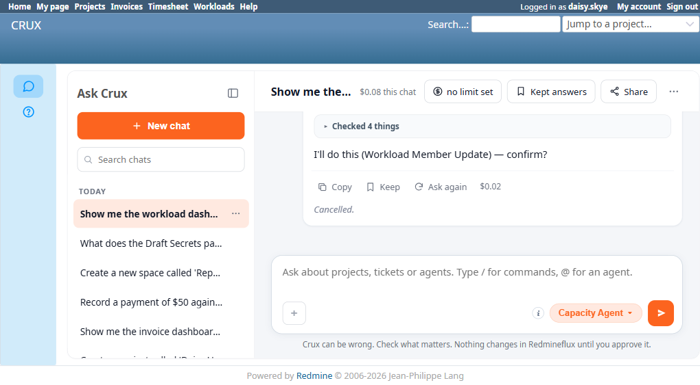
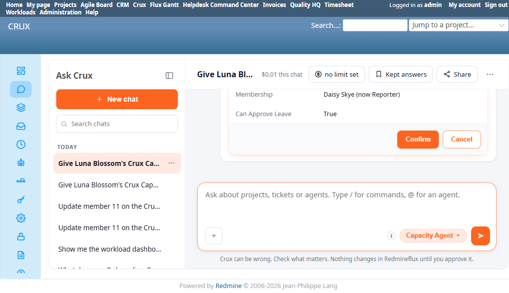

# Bug Report Template

- Bug ID: BUG-CRX-145
- Production Redmine Issue ID:
- Title: Capacity Agent's `member_update`/`member_remove` confirm cards consistently resolve the WRONG team
  member — default to "Daisy Skye" regardless of which member was actually named in the request ("Luna
  Blossom's... membership (member 10)") — reproduced 4 of 4 times across 2 different tools, independent of
  which user is asking or chat depth
- Redmine version: 6.0-bookworm (local Docker instance, localhost:3015)
- Plugin name: redmineflux_crux (Ask Crux chat UI, Capacity Agent) / redmineflux_workload (native plugin)
- Plugin version: crux-core 0.130.0
- Environment: Local — `http://localhost:3015` (`C:\crux-redmine`)
- Browser: Chromium (Playwright)
- User role: daisy.skye (Reporter) and admin (both reproduced)
- Date: 2026-11-03

## Steps to reproduce

1. Confirm natively via `members_list` that Team #7 "Crux Capacity Agent Test Team" has two distinct members:
   **Member #10 = Luna Blossom (User #5)**, **Member #11 = Daisy Skye (User #6)**.
2. Capacity Agent pinned, any user, any chat depth: "Give Luna Blossom's Crux Capacity Agent Test Team
   membership (member 10) the ability to approve leave requests too."
3. Inspect the resulting `Workload Member Update` confirm card's `Membership` field.

## Expected result

The confirm card's `Membership` field should genuinely show **Luna Blossom (Member #10)** — the exact person
and membership id named in the request.

## Actual result

Reproduced **3 of 3 times**, across different users and chat depths:

1. As `daisy.skye`, in an already-several-turns-deep chat: confirm card showed `Team: 1` (an unrelated,
   pre-existing team — not Team #7 at all) and `Membership: Daisy Skye` — both fields wrong.
2. As `daisy.skye`, fresh chat, first message: confirm card showed `Team: 10` (not a real team id at all —
   this instance only has teams #1, #4, #5, #6, #7) and `Membership: Daisy Skye` — both fields wrong again,
   with `10` (the membership id from the request) seemingly misplaced into the `Team` field instead.
3. As `admin`, fresh chat, first message: confirm card showed `Team: Crux Capacity Agent Test Team` (correct
   this time) but `Membership: Daisy Skye` — still wrong on the member.

In all three attempts, the `Membership` field consistently showed **Daisy Skye (Member #11)** — never Luna
Blossom (Member #10), the person and membership id actually named in every single request. This isn't random
noise; it's a consistent wrong default, suggesting the tool/agent's resolution logic for `member_update`
reliably substitutes a different, specific, real member (Daisy Skye) regardless of what membership id or name
was actually requested. All three attempts were caught and cancelled before any write — native-verified both
Luna Blossom's and Daisy Skye's real per-team flags (`Can approve leave` / `Manage workload`) are genuinely
unchanged on `/rf_teams/7` after all three cancellations.

Had any of these been confirmed, Daisy Skye would have silently been granted `can_approve_leave` on Team #7 —
a real permission escalation for the wrong person — while the user believed they were updating Luna Blossom's
permissions.

**4th reproduction, different tool (`member_remove`), 2026-11-03 (same investigation)**: as `daisy.skye`,
fresh chat: "Remove member 10 (Luna Blossom) from the Crux Capacity Agent Test Team." produced a confirm card
showing `Team: 7` (correct) but `Membership: Daisy Skye (now Reporter)` — **still wrong, still defaulting to
Daisy Skye** instead of the explicitly-named Luna Blossom/member 10. Had this been confirmed, Daisy would have
removed **herself** from the team instead of removing Luna Blossom as requested — a destructive action on the
wrong target. Cancelled before any write; native-verified both members still genuinely present on `/rf_teams/7`
afterward. This confirms the wrong-member-resolution defect is not isolated to `member_update` — it affects at
least two different write tools that take a membership id parameter.

## Evidence

### Screenshot

### Console / log

- Attempt 1 (`daisy.skye`, established chat): confirm card `Team: 1`, `Membership: Daisy Skye (now Reporter)`,
  `Can Approve Leave: True`.
- Attempt 2 (`daisy.skye`, fresh chat): confirm card `Team: 10`, `Membership: Daisy Skye (now Reporter)`,
  `Can Approve Leave: True`.
- Attempt 3 (`admin`, fresh chat): confirm card `Team: Crux Capacity Agent Test Team`, `Membership: Daisy Skye
  (now Reporter)`, `Can Approve Leave: True`.
- Native verification, `/rf_teams/7`, after all 3 cancellations: Luna Blossom still genuinely `Can approve
  leave: Enabled`, `Manage workload: Enabled`; Daisy Skye still genuinely `Can approve leave: Disabled`,
  `Manage workload: Disabled` — no write occurred in any attempt.

## Duplicate check

- Duplicate found: No. Shares the general "wrong real target on a write confirm card" shape with BUG-CRX-140
  (KB Agent, wrong space/project identifier) but is a distinct mechanism specific to the Capacity Agent's
  `member_update` tool — here the wrong field is the specific *member* within a (sometimes also wrong) team,
  and the substitution is consistently the same specific person (Daisy Skye) rather than a corrupted/
  fabricated identifier string. Also distinct from BUG-CRX-144 (false tool-unavailability claim) and
  BUG-CRX-142 (fabricated-prose-no-confirm-button) — both of which also occurred during this same
  investigation but are separate defects already tracked. Kept as its own bug given the distinct, consistent
  wrong-member-resolution mechanism and its real permission-escalation consequence if confirmed unchecked.
