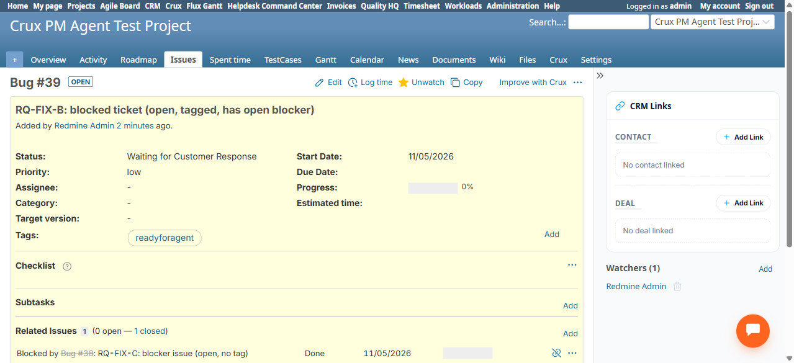
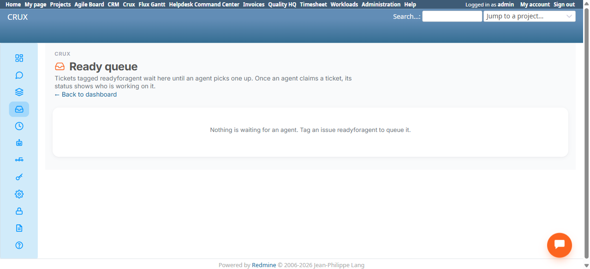

# Bug Report

- Bug ID: BUG-CRX-174
- Production Redmine Issue ID: #127945
- Title: Ready Queue permanently excludes a ticket after its blocker is resolved, even though the "no open blockers" condition is now met
- Redmine version: 6.0-bookworm
- Plugin name: redmineflux_crux (crux-core 1.1.0, commit 347ee6e)
- Plugin version: 1.1.0
- Environment: localhost:3015 (local Docker QA instance)
- Browser: Chromium (Playwright MCP)
- User role: Admin
- Date: 2026-11-05

## Steps to reproduce

1. In "Crux PM Agent Test Project", create issue #39 ("RQ-FIX-B"), tracker Bug, tag `readyforagent`. Confirm it
   appears in `/crux/queue` (it does — "Any available agent" / "Waiting for an agent").
2. Create issue #38 ("RQ-FIX-C"), no tag, status open.
3. On #39, add a relation "Blocked by #38". Reload `/crux/queue` — #39 correctly disappears (0/3 conditions no
   longer fully met — has an open blocker). This half of the rule works correctly.
4. Edit #38, set its Status to "Done" (a closed-type status for this tracker — confirmed via the "closed" badge
   on #38's own issue page, and via #39's own Related Issues panel showing "1 (0 open — 1 closed)").
5. Reload `/crux/queue` repeatedly (tested 5 reloads across ~45 seconds, well past the ~10-15s propagation delay
   seen elsewhere on this page for brand-new tag additions) — #39 never reappears.
6. As a workaround attempt, removed the `readyforagent` tag from #39 and re-added it, then reloaded the queue
   twice more — #39 still does not reappear.
7. Isolation check: created a brand-new control issue #40 with the same `readyforagent` tag, open, no blocker
   relation ever applied — #40 appears in the Ready Queue correctly and immediately (within the same normal
   propagation window). This confirms the Ready Queue mechanism itself is healthy; the defect is specific to a
   ticket that has ever had an open blocking relation which was later resolved.

## Expected result

- Per the developer's own feature reference (`CRUX_DEV_FEATURE_REFERENCE_20261105.md` §3): "A ticket appears
  here when all 3 are true: open; tagged `readyforagent`; no open blockers." Once #38 (the blocker) is closed,
  #39 has 0 open blockers and should reappear in the Ready Queue, exactly as it did before the blocker was added.

## Actual result

- #39 never reappears in the Ready Queue after its sole blocker is closed, even after multiple reloads over
  45+ seconds and a remove-tag/re-add-tag workaround attempt. It appears permanently stuck outside the queue
  once it has ever acquired an open blocking relation, regardless of that relation later closing. A fresh
  ticket with the identical tag and no blocker history behaves correctly, isolating the defect to the
  blocker-resolution re-check specifically (most likely the query checks "has ever had a blocking relation"
  or otherwise fails to re-evaluate the *current* open/closed state of the blocking issue, rather than
  correctly checking "has a blocking relation to a currently-open issue").

## Evidence

### Screenshot

### Retest screenshot (fill after fix is verified)

### Console / log

- No browser console errors observed; this is a server-side query/eligibility-logic defect, not a client-side
  rendering issue.

## Duplicate check

- Duplicate found: No
- Existing bug reference (if duplicate): — (checked `bugs/_duplicates.md`; no prior Ready Queue or blocker-logic
  finding exists in this suite)
