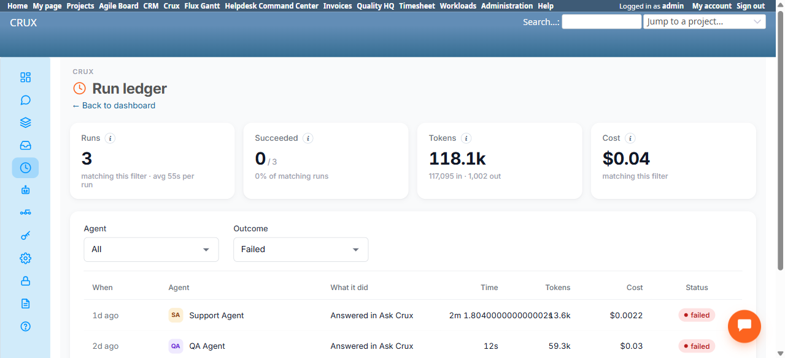

# Bug Report

- Bug ID: BUG-CRX-175
- Production Redmine Issue ID: <!-- pending approval -->
- Title: Run Ledger's Time column shows a raw unrounded floating-point number instead of a formatted duration
- Redmine version: 6.0-bookworm
- Plugin name: redmineflux_crux (crux-core 1.1.0, commit 347ee6e)
- Plugin version: 1.1.0
- Environment: localhost:3015 (local Docker QA instance)
- Browser: Chromium (Playwright MCP)
- User role: Admin
- Date: 2026-11-05

## Steps to reproduce

1. Go to `/crux/runs`.
2. Set the Outcome filter to "Failed".
3. Look at the "Time" column for the first row (Support Agent, "1d ago").

## Expected result

- The Time column should show a human-formatted duration, consistent with every other row in the ledger (e.g.
  "6.1s", "8.6s", "2m 3s") — a clean, rounded value.

## Actual result

- The cell renders the literal string **"2m 1.804000000000002s"** — an unrounded JavaScript floating-point
  arithmetic artifact (classic base-2 floating point representation error, e.g. from a `seconds % 60` or
  similar calculation) leaked directly into the UI instead of being rounded/formatted first. Confirmed via the
  page's own accessibility tree (exact cell text: `"2m 1.804000000000002s"`), not just a visual glitch.

## Evidence

### Screenshot

### Retest screenshot (fill after fix is verified)

### Console / log

- No browser console errors; this is a server-side (or client-side JS) number-formatting defect in the duration
  display logic specifically, not a crash.

## Duplicate check

- Duplicate found: No
- Existing bug reference (if duplicate): — (checked `bugs/_duplicates.md`; no prior Run Ledger or
  duration-formatting finding exists in this suite)
