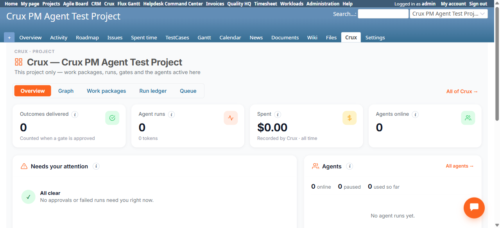
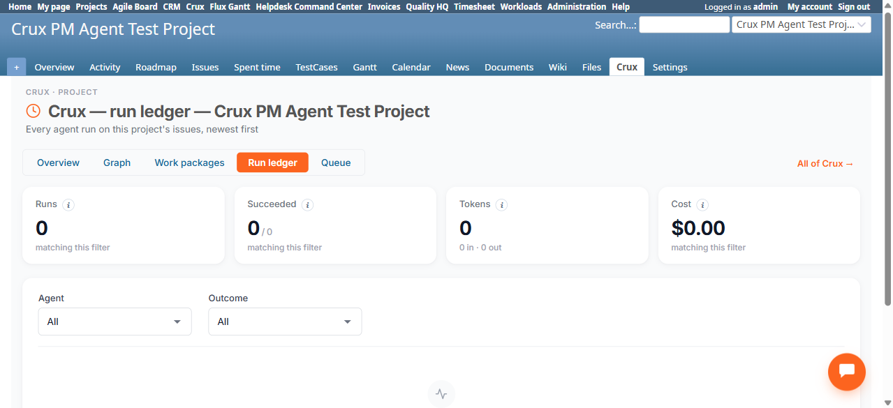

# Bug Report

- Bug ID: BUG-CRX-176
- Production Redmine Issue ID: <!-- pending approval -->
- Title: Project-scoped Crux tab (Overview + Run ledger) shows 0 agent runs despite real runs existing against that project's own ticket
- Redmine version: 6.0-bookworm
- Plugin name: redmineflux_crux (crux-core 1.1.0, commit 347ee6e)
- Plugin version: 1.1.0
- Environment: localhost:3015 (local Docker QA instance)
- Browser: Chromium (Playwright MCP)
- User role: Admin
- Date: 2026-11-05

## Steps to reproduce

1. In "Crux PM Agent Test Project", open Ask Crux, pin Project Manager, and ask it to "Set up a work package for
   ticket #40 to fix the control-ticket cleanup." Confirm the resulting "Create work package" card.
2. This genuinely logs at least 2 runs in the global Run Ledger (`/crux/runs.json`): `run-1232` (the Project
   Manager chat turn that produced the WP, `agent_id: project-manager`, real tokens/cost) and `run-1233` (the
   write-confirmation run, `tool: crux_create_work_package`, `approved_by: admin`) — both timestamped at the
   moment of this action and tied to ticket #40, which belongs to this project.
3. Open the project's own Crux tab → Overview (`/projects/crux-pm-agent-test-project/crux`).
4. Open the project's own Crux tab → Run ledger (`/projects/crux-pm-agent-test-project/crux/runs`).

## Expected result

- Per the page's own subtitle on the project Run ledger ("Every agent run on this project's issues, newest
  first"), and per the dev reference's description of the project Crux tab being "This project only — work
  packages, runs, gates and the agents active here", both pages should reflect the 2 real runs tied to this
  project's ticket #40 — at minimum "Agent runs: 1" or more on Overview, and the Run ledger's own "Runs" tile and
  table should show at least these entries.
- The project's own Work Packages sub-page (`/projects/crux-pm-agent-test-project/crux/work_packages`) correctly
  shows the resulting WP ("Fix control-ticket cleanup behavior", 1 WP, In progress) — proving the project
  correctly knows about this WP and its ticket. The Run Ledger/Overview scoping should use the same WP↔ticket↔
  project linkage and is inconsistent with it.

## Actual result

- Both Overview ("Agent runs: 0", "Spent: $0.00") and the project Run ledger ("Runs: 0", "Succeeded: 0/0",
  "Tokens: 0", "Cost: $0.00", empty table) show zero activity, even after 20+ seconds and multiple reloads (well
  past the short propagation lag observed elsewhere in this cycle, e.g. the Ready Queue's ~1-reload tag-add
  delay). Meanwhile the project's own Work Packages sub-page correctly shows the WP that these very runs
  produced — confirming the project does have real, current Crux activity, and that the Run Ledger/Overview
  scoping specifically (not the whole project-tab feature) is failing to surface it.

## Evidence

### Screenshot

### Retest screenshot (fill after fix is verified)

### Console / log

- Relevant excerpt from `/crux/runs.json?limit=10` (global ledger, confirming both runs are genuinely recorded):
  `{"id":"run-1233","kind":"chat","action":"write","agent_id":"ask-crux",...,"tool":"crux_create_work_package","proposal_id":"prop-435","approved_by":"admin","started_at":"2026-11-05T11:17:34+00:00",...}`
  `{"agent_id":"project-manager","provider":"openrouter","model":"anthropic/claude-haiku-4.5",...,"started_at":"2026-11-05T11:17:06+00:00","id":"run-1232",...}`
  Neither run record exposes an explicit `project_id`/`issue_id` field in this JSON — suggesting the
  project-scoped Run Ledger likely needs to resolve project membership via the Work Package's ticket
  association rather than a direct field on the run itself, and that join/lookup is what appears to be failing.

## Duplicate check

- Duplicate found: No
- Existing bug reference (if duplicate): — (checked `bugs/_duplicates.md`; no prior project-scoping finding
  exists in this suite)
