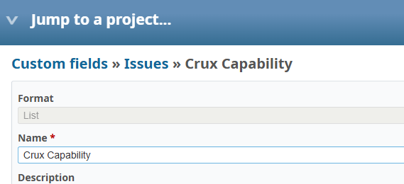

# Bug Report

- Bug ID: BUG-CRX-178
- Production Redmine Issue ID: <!-- pending approval -->
- Title: "Crux Capability" custom field exists but is enabled for zero trackers, so it never actually appears on any issue form
- Redmine version: 6.0-bookworm
- Plugin name: redmineflux_crux (crux-core 1.1.0, commit 347ee6e)
- Plugin version: 1.1.0
- Environment: localhost:3015 (local Docker QA instance)
- Browser: Chromium (Playwright MCP)
- User role: Admin
- Date: 2026-11-05

## Steps to reproduce

1. Open a New Issue form for any tracker (tested: Bug, in "Crux PM Agent Test Project") — observe there is no
   "Crux Capability" field anywhere on the form.
2. Go to Administration → Custom fields → Issues → "Crux Capability" (`/custom_fields/1/edit`) to confirm the
   field genuinely exists (it does — Format: List, Name: Crux Capability).
3. Scroll to the "Trackers" section of this custom field's own configuration.

## Expected result

- Per the dev reference (`CRUX_DEV_FEATURE_REFERENCE_20261105.md` §9 / TC-CRX-908): "the plugin adds an issue
  custom field 'Crux Capability' (list, all trackers), visible on issue forms." The field should be enabled for
  all trackers (or at minimum some trackers) so it is actually visible somewhere.

## Actual result

- The custom field's own Trackers section shows all 4 trackers (Bug, Feature, Support, Testcase) unchecked —
  the field is associated with precisely zero trackers, so it can never appear on any issue form regardless of
  project or tracker. This matches the observed absence on the New Issue form in step 1. The field was likely
  created by the plugin's install/migration but never actually attached to any tracker, making "all trackers" a
  documentation claim that doesn't match the live configuration.

## Evidence

### Screenshot

Accessibility-tree confirmation of the Trackers section (not separately screenshotted due to a tall empty region
pushing it below an easy screenshot crop): `checkbox "Bug"`, `checkbox "Feature"`, `checkbox "Support"`,
`checkbox "Testcase"` — none shown with a `[checked]` state.

### Retest screenshot (fill after fix is verified)

### Console / log

- No browser console errors; this is a configuration/seed-data gap (the field exists, but its tracker
  associations were never set), not a runtime crash.

## Duplicate check

- Duplicate found: No
- Existing bug reference (if duplicate): — (checked `bugs/_duplicates.md`; no prior custom-field-configuration
  finding exists in this suite)
