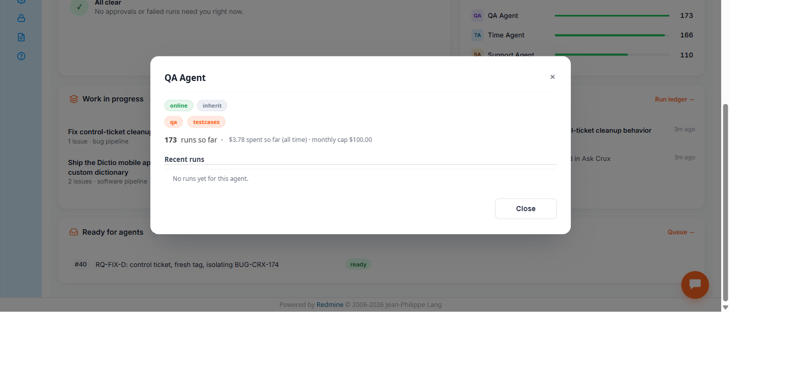

# Bug Report

- Bug ID: BUG-CRX-179
- Production Redmine Issue ID: <!-- pending approval -->
- Title: Dashboard's agent-detail modal always shows "No runs yet for this agent" in its Recent runs table, even for agents with hundreds of real runs
- Redmine version: 6.0-bookworm
- Plugin name: redmineflux_crux (crux-core 1.1.0, commit 347ee6e)
- Plugin version: 1.1.0
- Environment: localhost:3015 (local Docker QA instance)
- Browser: Chromium (Playwright MCP)
- User role: Admin
- Date: 2026-11-05

## Steps to reproduce

1. Go to `/crux` (global Dashboard).
2. In the "Agents" card, click any agent's bar in the chart (tested: "QA Agent: 173 runs" and
   "Time Agent: 166 runs" — the two busiest agents shown).

## Expected result

- Per TC-CRX-736 / the dev reference §1, the agent-detail modal should show "a Recent runs table (Time/Run/
  Issue/Agent/Model/Duration/Tokens in-out/Cost/Tool calls/Outcome)" populated with that agent's actual recent
  run history.

## Actual result

- The modal's summary line correctly shows real data ("173 runs so far · $3.78 spent so far (all time) ·
  monthly cap $100.00" for QA Agent; similarly correct non-zero figures for Time Agent) — confirming the
  aggregate-stats query works fine. But the "Recent runs" section immediately below always reads "No runs yet
  for this agent." for both agents tested, despite each genuinely having well over 100 historical runs (visible
  in both the Run Ledger and this very same modal's own run-count line). This contradicts the modal's own
  displayed run count and suggests the Recent-runs sub-query (as opposed to the aggregate count/spend query) is
  broken — e.g. querying the wrong agent-id field, a mismatched time window, or a query that never actually
  executes.

## Evidence

### Screenshot

### Retest screenshot (fill after fix is verified)

### Console / log

- No browser console errors; this is a data/query defect in the modal's Recent-runs fetch, not a crash.

## Duplicate check

- Duplicate found: No
- Existing bug reference (if duplicate): — (checked `bugs/_duplicates.md`; no prior Dashboard
  agent-detail-modal finding exists in this suite)
