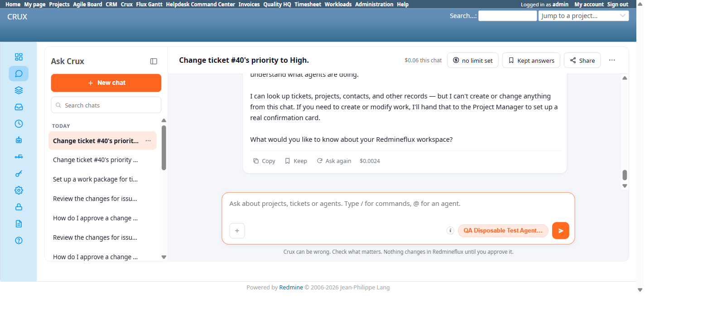

# Bug Report Template

- Bug ID: BUG-CRX-180
- Production Redmine Issue ID: #127951
- Title: A Retired agent remains selectable in Ask Crux's agent picker/@-mention and silently answers as the generic "Ask Crux" persona instead of being excluded
- Redmine version: 6.0-bookworm
- Plugin name: redmineflux_crux
- Plugin version: crux-core 1.1.0 (commit 347ee6e)
- Environment: localhost:3015 (Docker)
- Browser: Chromium (Playwright MCP)
- User role: admin
- Date: 2026-11-05

## Steps to reproduce

1. On the Agent Fleet page (`/crux/agents`), confirm "QA Disposable Test Agent RENAMED" (a disposable test
   fixture created and retired earlier this cycle) shows status **Retired**.
2. Go to `/crux/ask`, open either the agent picker (click the "<Agent> ▾" button) or the `@`-mention
   autocomplete in the composer.
3. Observe "QA Disposable Test Agent RENAMED" is listed as a normal, clickable option alongside active agents
   (no "retired"/disabled visual treatment, not greyed out, not excluded from the list).
4. Click it to select it as the answering agent — the composer's agent button now reads
   "QA Disposable Test Agent RENAMED ▾".
5. Send a message ("hello, who are you?").
6. Observe the reply.

## Expected result

- Per the plugin's own documented behavior for `?agent=<id>` URL params (an equivalent code path — same
  "ignore retired/unavailable agents" rule, see suite TC-CRX-984), a retired agent should not be a selectable
  answering agent at all: it should either be absent from the picker/@-mention list entirely, or visibly
  marked unavailable and rejected if selected, falling back to Auto/the default agent.

## Actual result

- The retired agent is shown as a normal, fully selectable option in both the picker dropdown and the
  `@`-mention list, with no "Retired" badge or disabled state.
- Selecting it and sending a message does not refuse or fall back to Auto — it silently answers as a
  different, unlabeled persona: the generic "Ask Crux" assistant ("I'm **Ask Crux**, the assistant inside
  Redmineflux...") rather than the disposable agent's own configured persona, and rather than any honest
  "this agent is retired" message. The picker still shows the retired agent's name as the active selection
  even though a completely different (generic) persona actually answered — a user would reasonably believe
  the retired agent itself responded.

## Evidence

### Screenshot

### Retest screenshot (fill after fix is verified)

### Console / log

- Agent Fleet page (`/crux/agents`) confirms status "Retired" for this agent via its row badge, both inline
  and in the "More actions" status indicator.
- Chat response explicitly self-identifies as "Ask Crux" rather than the agent's own persona/name, confirming
  a silent fallback rather than the retired agent's real persona answering.

## Additional repro (TC-CRX-984 — URL param)

- Navigating directly to `/crux/ask?agent=qa-disposable-test-agent` (the retired agent's real id) also honors
  it — the composer's agent button shows "QA Disposable Test Agent RENAMED ▾" as the active selection, with no
  fallback to Auto/default. Per the suite's own documented behavior, a retired agent id in the URL param should
  be ignored (same "ignore retired/unavailable/excluded" rule documented for 2 other conditions — missing
  plugin, excluded by Chat-agents setting). Confirms the exclusion rule is missing entirely for the "retired"
  condition specifically, across all 3 entry points (picker, @-mention, URL param).

## Duplicate check

- Duplicate found: No
- Existing bug reference (if duplicate): N/A — first finding on the picker/@-mention's own retired-agent
  filtering; distinct from BUG-CRX-177 (a write-side overwrite defect on the same disposable fixture, Agent
  Fleet Admin suite) and from the Auto-routing-miss family (BUG-CRX-171/172/173), which are about routing to
  the wrong real agent, not a retired agent remaining selectable at all.
