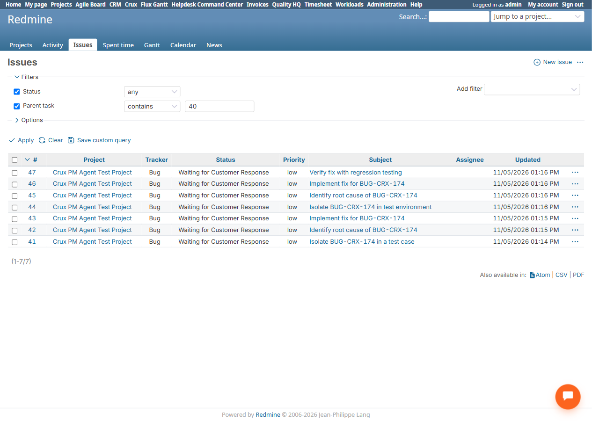

# Bug Report Template

- Bug ID: BUG-CRX-181
- Production Redmine Issue ID: #127952
- Title: Re-confirming "Break down the work" after a successful Create selected creates duplicate/overlapping subtasks instead of detecting the already-created ones
- Redmine version: 6.0-bookworm
- Plugin name: redmineflux_crux
- Plugin version: crux-core 1.1.0 (commit 347ee6e)
- Environment: localhost:3015 (Docker)
- Browser: Chromium (Playwright MCP)
- User role: admin
- Date: 2026-11-05

## Steps to reproduce

1. On a ticket with no subtasks yet (issue #40, Crux PM Agent Test Project), click "Improve with Crux" → "Break
   down the work".
2. Untick 2 of the 5 proposed subtasks ("Apply fresh tag to control ticket RQ-FIX-D", "Verify fix against test
   case"), leave the other 3 ticked ("Isolate BUG-CRX-174 in a test case", "Identify root cause of BUG-CRX-174",
   "Implement fix for BUG-CRX-174"). Click "Create selected".
3. Native-verify: exactly 3 subtasks created (#41, #42, #43), correctly only the ticked ones — confirms the
   partial-selection half of this feature works correctly.
4. Re-open "Improve with Crux" → "Break down the work" again on the same ticket #40 (which now already has the
   3 subtasks from step 3).
5. Leave all newly-proposed subtasks ticked (the panel's default) and click "Create selected" again.
6. Native-verify the ticket's Subtasks list.

## Expected result

- Per the documented "Re-confirming never duplicates" rule, re-attempting Break down the work on a ticket that
  already has subtasks created from a prior run should not create duplicate/overlapping subtasks for work
  that's already been captured — at minimum the exact same subtask text should not be created a second time.

## Actual result

- The second "Break down the work" call regenerated a fresh 4-item proposal and, once confirmed, created 4 new
  subtasks (#44–#47) on top of the original 3 (#41–#43), for a total of 7. Two of the four new subtasks are
  **word-for-word identical** to two already-created ones:
  - "Implement fix for BUG-CRX-174" now exists twice (#43 and #46).
  - "Identify root cause of BUG-CRX-174" now exists twice (#42 and #45).
  - The other two new subtasks ("Isolate BUG-CRX-174 in test environment" #44, "Verify fix with regression
    testing" #47) are near-duplicates in intent of #41 ("Isolate BUG-CRX-174 in a test case") and the originally
    un-ticked "Verify fix against test case" suggestion, just reworded.
  - No check against the ticket's existing subtasks occurred before regenerating or before creating.

## Evidence

### Screenshot

### Retest screenshot (fill after fix is verified)

### Console / log

- Native `/issues?parent_id=~40` listing confirmed all 7 subtasks (#41–#47) directly, including the two
  word-for-word duplicate titles, immediately after the second Create selected call.

## Duplicate check

- Duplicate found: No
- Existing bug reference (if duplicate): N/A — first finding on the Break down the work re-confirmation
  behavior; distinct from the silent-write-omission family (BUG-CRX-081/110/118 etc. — those drop part of a
  request silently) since here the problem is the opposite: extra, overlapping work is created that wasn't
  asked for on the second pass, with no duplicate-detection at all.
