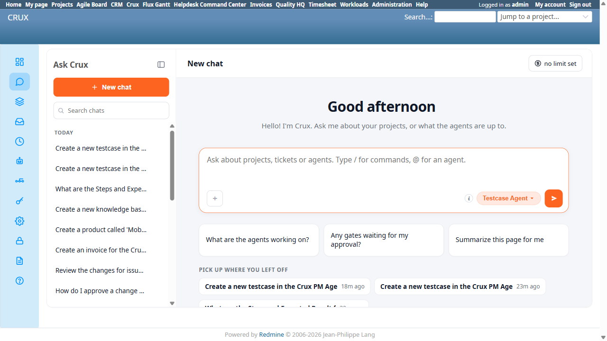

# Bug Report

- Bug ID: BUG-CRX-182
- Production Redmine Issue ID: #128076
- Title: Ask Crux's "Pick up where you left off" suggestion row is silently clipped (bottom ~20px cut off) on a
  fresh chat at a standard 1280×720 viewport, with no scrollbar to reveal it
- Redmine version: 6.0-bookworm (local Docker instance, localhost:3015)
- Plugin name: redmineflux_crux (Ask Crux chat UI)
- Plugin version: crux-core 1.1.0
- Environment: Local — `http://localhost:3015`
- Browser: Chromium (Playwright MCP)
- User role: admin
- Date: 2026-11-11

## Steps to reproduce

1. Resize the browser viewport to exactly 1280×720 (a very common laptop/small-monitor resolution).
2. Go to `/crux/ask` and click "New chat" to reach the welcome screen (with at least 3 recent chats in this
   Redmine instance, so the "Pick up where you left off" row shows 3 suggestion chips and wraps to 2 rows: 2
   chips on the first line, 1 chip on the second).
3. Look at the bottom of the "Pick up where you left off" section, where the 3rd (wrapped) suggestion chip sits.

## Expected result

All 3 "Pick up where you left off" suggestion chips should be fully visible and clickable at this viewport
size, the same way they are at a taller viewport (e.g. 1280×800) — either the welcome panel's height should
accommodate however many rows the chips wrap to, or the panel should scroll to reveal content that doesn't fit.

## Actual result

The panel holding this welcome content (`.crux-client-main.crux-is-welcome`) has a fixed CSS `height: 544px`
and `overflow: hidden` at this viewport size. The last suggestion chip (3rd chip, 2nd wrapped row) sits at
`top: 632px` / `bottom: 668px` (36px tall), but the clipping panel's own bottom edge is at `648px` —
**20px of the chip's bottom is silently cut off**, with no visible indication anything is missing.

Critically, there is **no way to scroll to see it**: `document.body.scrollHeight === window.innerHeight ===
720` and `window.scrollY` stays `0` after an explicit `scrollBy(0, 100)` — the page genuinely does not scroll
at all. The only other scrollable element on the page is the unrelated chat-history sidebar
(`.crux-session-list`). The clipped chip is simply unreachable at this viewport size, not just awkwardly
placed.

Confirmed the root cause is viewport-height-driven, not a fixed bug at all sizes: at 1280×800, the same panel
computes to `height: 624px` and the identical 3rd chip (`bottom: 686px`) fits cleanly inside it with no
clipping. So the panel's height is calculated from the viewport (e.g. something like `calc(100vh - Npx)`), but
that calculation doesn't account for the welcome content needing 2 wrapped rows of suggestion chips once 3+
recent chats exist — it assumes less content than can actually be present, and clips instead of scrolling or
growing.

## Evidence

### Screenshot

### Retest screenshot (fill after fix is verified)

### Console / log

- At 1280×720: `.crux-client-main.crux-is-welcome` computed `height: 544px`, `overflow: hidden`, panel
  `bottom: 648px`. Last `.crux-recent-chip` (3rd chip): `top: 632.35px`, `bottom: 668.35px`, `height: 36px` —
  clipped by `668.35 - 648 = 20.35px`.
- Page-level scroll check: `document.body.scrollHeight = 720`, `window.innerHeight = 720`,
  `window.scrollY` stays `0` after `window.scrollBy(0, 100)` — page does not scroll at all.
- At 1280×800 (control, same fresh chat, same 3 chips): panel computed `height: 624px`, last chip
  `bottom: 685.68px` — fits cleanly, not clipped.

## Duplicate check

- Duplicate found: No
- Existing bug reference (if duplicate): N/A — checked `bugs/_duplicates.md` and `bugs/_index.md`, no prior
  finding on the Ask Crux welcome panel's viewport-height sizing or the "Pick up where you left off" row
  specifically.
