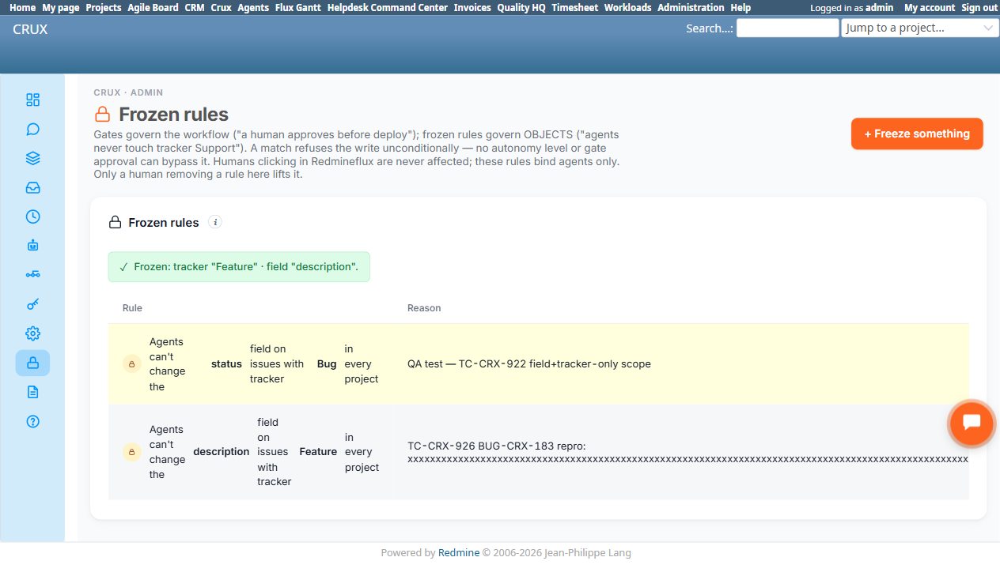

# Bug Report

- Bug ID: BUG-CRX-183
- Production Redmine Issue ID: #128268 (ztflux, flux.zehntech.com) — linked to Test Run #607 "Crux Run 2", Test Case #127941 (CRUX_PLATFORM_FROZEN_RULES), Environment "Window 11 + Chrome", assigned to Prashant Chaurasia
- Title: Frozen Rule "Reason" field's 300-character cap is enforced only client-side (HTML `maxlength`); server accepts and stores a 350+ character reason verbatim, with no truncation or rejection
- Redmine version: 6.0-bookworm
- Plugin name: redmineflux_crux
- Plugin version: (current local build, 2026-11-12)
- Environment: Local Docker, http://localhost:3015
- Browser: Chromium (Playwright)
- User role: admin
- Date: 2026-11-12

## Steps to reproduce

1. Go to `/crux/admin/frozen_rules` → "+ Freeze something".
2. Fill Tracker = "Feature", Field = "description" (any valid scope works).
3. Set the Reason field's value to a string longer than 300 characters — e.g. via dev tools / direct DOM manipulation (`el.value = 'x'.repeat(350)`) to bypass the input's client-side `maxlength="300"` attribute, which is exactly how a real client (a different browser extension, a direct API call, or simply an attacker using dev tools) could submit a longer value regardless of the HTML attribute.
4. Click "Freeze".

## Expected result

- Per TC-CRX-926's own spec and the input's own `maxlength="300"` contract, a Reason longer than 300 characters should be rejected (clear validation error) or truncated server-side to 300 characters — the cap should hold regardless of how the request reaches the server.

## Actual result

- The rule is created successfully with the full 350-character Reason stored verbatim (confirmed: cell `textContent.length === 350`). No validation error, no truncation. The only enforcement of the 300-char limit is the browser's own `maxlength` attribute on the `<input>`, which is trivially bypassable (direct DOM write, devtools, or a raw API call) since there is no corresponding server-side length check on save.
- Note: this input is a plain text `<input>` with a `<datalist>` for the Field control (already documented client-side-only in TC-CRX-936's PASS note) — the Reason field has the same "client-side-only guard" pattern, but here the consequence is a stored-data cap violation, not just a bypassable dropdown.

## Evidence

### Screenshot

### Console / log

- No server error was returned; the rule was created with HTTP success and appears in the rules table with its full, unmodified 350-character reason.

## Duplicate check

- Duplicate found: No
- Existing bug reference (if duplicate): N/A — first finding on the Frozen Rules admin page's Reason field validation specifically. Not related to BUG-CRX-116 (schema level validation gap, Time Agent domain) despite the similar "client accepts what native/server should reject" shape — different feature area.
