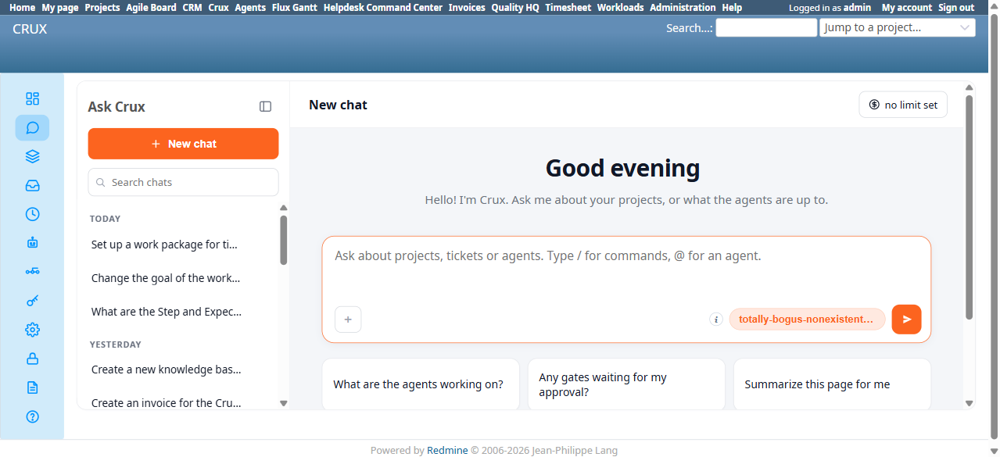
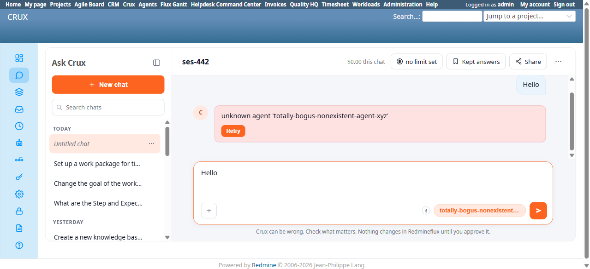

# Bug Report

- Bug ID: BUG-CRX-184
- Production Redmine Issue ID: #128269 (ztflux, flux.zehntech.com) — linked to Test Run #607 "Crux Run 2", Test Case #127940 (CRUX_PLATFORM_SETTINGS), Environment "Window 11 + Chrome", assigned to Prashant Chaurasia
- Title: Settings' "Default agent" field accepts and saves a nonexistent/invalid agent id with zero validation — every user's fresh "Ask Crux" chat then fails on the very first message with "unknown agent '<id>'"
- Redmine version: 6.0-bookworm
- Plugin name: redmineflux_crux
- Plugin version: (current local build, 2026-11-12)
- Environment: Local Docker, http://localhost:3015
- Browser: Chromium (Playwright)
- User role: admin
- Date: 2026-11-12

## Steps to reproduce

1. Go to `/crux/admin/settings` → "Ask Crux bubble" section → "Default agent" field.
2. Enter a nonexistent agent id, e.g. `totally-bogus-nonexistent-agent-xyz`.
3. Click "Save".
4. Reload `/crux/admin/settings` — the invalid value is genuinely persisted (confirmed via hard navigation, not just an unreloaded form).
5. Open `/crux/ask` (any fresh chat, including a brand-new one via "+ New chat").

## Expected result

- Per TC-CRX-914's spec: "Default agent with an invalid/nonexistent agent-id — confirm a clear validation error [at save time], not a silently-broken default that fails at chat-open time instead."

## Actual result

- Step 3 (Save) produces **no validation error at all** — no field is marked invalid, no error banner appears, and the value is silently written to the setting.
- The chat picker button itself then literally renders the raw broken string as if it were a real agent name: `"totally-bogus-nonexistent-agent-xyz ▾"` (see screenshot 1) — on every fresh chat, not just the one open when the setting was saved.
- Sending any message in that state fails immediately with: `unknown agent 'totally-bogus-nonexistent-agent-xyz'` and a "Retry" button that cannot succeed, since retrying hits the exact same broken default (see screenshot 2).
- This is plugin-wide and affects every user who opens a fresh Ask Crux chat while this bad value is saved — not scoped to the admin session that set it. Severity is High: a single admin typo in this one field can silently break the first-message experience for the entire instance until someone notices and fixes/clears it, with the only user-facing signal being a generic "unknown agent" chat error that gives no hint the Settings page is the actual cause.
- Cleaned up: restored "Default agent" to blank immediately after reproducing and confirming (re-verified fresh chat works again with Auto routing).

## Evidence

### Screenshot

### Console / log

- Browser console showed 1 error on the failed chat send (network/API error consistent with the chat backend rejecting the unknown agent id); no server-side validation error was ever returned on the Settings Save call itself.

## Duplicate check

- Duplicate found: No
- Existing bug reference (if duplicate): N/A — distinct from BUG-CRX-155/116 (both validation gaps on write-tool parameters in other agents/domains, not this admin Settings page) and from BUG-CRX-183 (Frozen Rules' Reason-field length cap, same general "client-side-only validation" shape but a different page/field and a non-breaking consequence — here the consequence breaks chat for every user). First finding on the Settings page's Default-agent field validation specifically.
