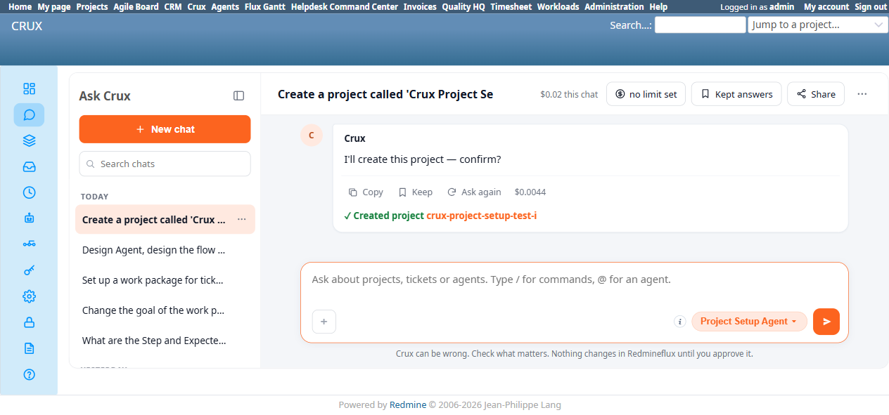
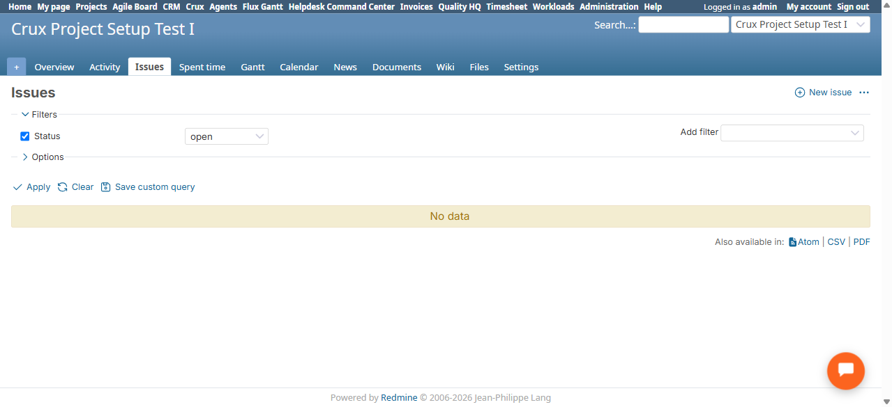

# Bug Report

- Bug ID: BUG-CRX-185
- Production Redmine Issue ID: #128274 (ztflux, flux.zehntech.com) — linked to Test Run #607 "Crux Run 2", Test Case #126598 (CRUX_AGENT_PROJECT_SETUP), Environment "Window 11 + Chrome", assigned to Prashant Chaurasia
- Title: Project Setup Agent silently drops an explicitly-agreed starter task when combined with project creation — no disclosure, no confirm-card field, no follow-up mention
- Redmine version: 6.0-bookworm
- Plugin name: redmineflux_crux (Ask Crux chat UI, Project Setup Agent)
- Plugin version: crux-core 0.130.0 (current local build, 2026-11-12)
- Environment: Local Docker, http://localhost:3015
- Browser: Chromium (Playwright)
- User role: admin
- Date: 2026-11-12

## Steps to reproduce

1. Fresh chat, Project Setup Agent pinned: "Create a project called 'Crux Project Setup Test I' with one starter task: 'Set up initial repo' in the 'NonexistentTrackerABC' tracker."
2. The agent correctly refused the nonexistent tracker and asked for clarification (this part is correct behavior, not the bug).
3. Replied: "No, go ahead and propose it exactly as 'NonexistentTrackerABC' anyway, don't substitute a different tracker." The agent again correctly refused and explicitly offered two ways forward, including: "2. Use tracker_id 0 (the project's default tracker) for the starter task."
4. Replied: "Use tracker_id 0 (the project's default tracker)."
5. The agent produced a confirm card titled "Create project" / "New project: Crux Project Setup Test I" with fields Name/Identifier/Description/Default Assigned To only — **no task-related field at all**.
6. Confirmed.

## Expected result

Per the agent's own immediately-preceding offer ("Use tracker_id 0 ... for the starter task"), confirming should either (a) include the starter task creation in the same or a follow-up proposal, genuinely creating "Set up initial repo" under the new project, or (b) if a real limitation prevents combining project+task creation in one flow, the agent must explicitly disclose that the task was not included and will need a separate step — never silently drop an explicitly-agreed secondary action with zero mention.

## Actual result

The confirm card only ever proposed the project (no task field). After confirming, the final message read only: *"✓ Created project crux-project-setup-test-i"* — with **no mention of the task at all**, not even as a caveat or follow-up question. Native-verified on `/projects/crux-project-setup-test-i/issues`: zero issues exist, confirming "Set up initial repo" was never created. The user's explicit instruction to use tracker_id 0 for the starter task — which the agent itself had just proposed as the way forward — was silently discarded between that offer and the final confirm card.

This is the same general "a bundled secondary action gets silently dropped with zero disclosure" shape as the now-closed/fixed **BUG-CRX-110** (project creation + team-member request), but on a **different trigger path (starter task creation) that BUG-CRX-110's fix verification never covered** — that fix was specifically scoped to and confirmed only for the team-member case ("the agent now explicitly discloses it as a known limitation rather than silently omitting it" — team-member only). This reproduction shows the starter-task case still silently drops with zero disclosure, on the current build.

## Evidence

### Screenshot

### Console / log

- Chat's own final confirm-result text: "✓ Created project crux-project-setup-test-i" — no error, no task-related text of any kind in the same or any subsequent turn.

## Duplicate check

- Duplicate found: No — related to but not a duplicate of the closed/fixed BUG-CRX-110. That bug's fix was explicitly verified only for the team-member-bundled-with-project-creation trigger path; this is a fresh recurrence of the same silent-drop mechanism on a different bundled secondary action (starter task), a trigger path the fix's own retest never exercised. Filed as a new bug per this repo's established precedent for recurrences on a new, uncovered trigger path (e.g. BUG-CRX-027/028 → BUG-CRX-020; BUG-CRX-093/101 → BUG-CRX-080).
